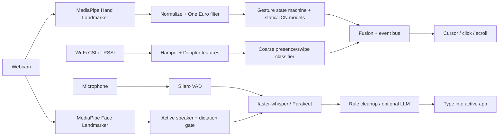

# Project Away

Hands-free PC control, free and local. Webcam hand gestures drive the cursor, push-to-talk voice typing handles text, face cues gate who is dictating, and optional Wi-Fi CSI adds coarse motion confidence.

Nothing leaves your machine unless you point the optional LLM cleanup at an endpoint yourself.

## Architecture



## Quickstart

Full per-OS instructions: [docs/INSTALL.md](docs/INSTALL.md). Wi-Fi sensing: [docs/wifi-setup.md](docs/wifi-setup.md).

```bash
pipx install ".[all]"        # Python 3.10–3.12
away setup                   # downloads models, checks camera + mic
away demo                    # synthetic end-to-end check
away run                     # or: away tray ; away autostart on
```

- **Windows:** run the `.exe` installer from Releases. It's unsigned, so choose *More info → Run anyway*.
- **macOS:** open the `.dmg`, drag to Applications, then right-click → Open. Allow Camera, Microphone, and Accessibility.
- **Linux:** use the AppImage or `.deb`. Mouse and keyboard control needs X11; Wayland is untested.

## Customizing controls

Every control is a **trigger → action** binding you can change without touching code: from the
**Settings** window (tray → *Settings...*, or `away settings`), from the CLI, or in `config.yaml`
(`away config path` shows where it is). A running Away reloads the file within a second of a save.

### Default bindings

| Trigger | Default action |
|---|---|
| `gesture:point` (index finger) | `mouse:move` (cursor) |
| `gesture:pinch` | `mouse:click` |
| `gesture:double_pinch` | `mouse:double_click` |
| `gesture:pinch_hold` | `mouse:drag` |
| `gesture:two_finger_scroll` | `mouse:scroll` |
| `gesture:open_palm` (hold) | `pause:toggle` (pause/resume gestures) |
| `gesture:swipe_left` / `swipe_right` | `key:left` / `key:right` |
| `face:brow_raise` (needs `face.brow_raise_toggle: true`) | `dictation:toggle` |
| `face:mouth_open` (needs `face.mouth_open_trigger: true`) | `none` |
| `hotkey:ptt` (= `voice.hotkey`, Ctrl+Alt+Space) | `dictation:toggle` |
| `hotkey:mute` (= `voice.mute_hotkey`, Ctrl+Alt+M) | `mic:toggle` |
| `voice:"click"`, `"double click"`, `"right click"`, `"scroll up"`, `"scroll down"` | the matching `mouse:` action |
| `voice:"go back"` / `"go forward"` | `key:alt+left` / `key:alt+right` |
| `voice:"open browser"` | `launch:https://www.google.com` |
| `voice:"stop listening"` / `"start listening"` | `dictation:stop` / `dictation:start` |
| `voice:"command mode"` / `"dictation mode"` | `voice:command_mode` / `voice:dictation_mode` |
| `voice:"pause gestures"` / `"resume gestures"` | `pause:on` / `pause:off` |

**Triggers:** the gestures above plus your own (record with `away record --custom --label wave`, then
`away calibrate`), any spoken phrase (matched ignoring case and punctuation), `face:brow_raise`,
`face:mouth_open`, and any key combo (`hotkey:ctrl+alt+k`).

**Actions:** `none` · `mouse:click|double_click|right_click|middle_click|scroll_up|scroll_down`
(`mouse:move`, `mouse:drag`, `mouse:scroll` only on point / pinch_hold / two_finger_scroll) ·
`key:ctrl+tab` · `type:any text` · `launch:firefox` or `launch:https://…` (no shell) ·
`shell:command` (**off unless** `bindings.allow_shell: true`) · `dictation:toggle|start|stop` ·
`mic:toggle|on|off` · `voice:command_mode|dictation_mode|toggle_mode` · `pause:toggle|on|off`.

### Per-app profiles

`default` holds the full map. Any other profile names the apps (process names, case-insensitive,
`.exe` optional) it applies to and overrides only the triggers it lists; everything else falls through
to `default`. `active_profile: auto` switches profile with the focused app (Linux needs `xdotool`);
`away profile use chrome` pins one.

### CLI

```bash
away bindings list [--profile chrome] [--json]
away bindings set gesture:swipe_left key:alt+left
away bindings set "voice:new tab" key:ctrl+t --profile chrome
away bindings reset [TRIGGER] [--profile NAME | --all]
away bindings export my-controls.yaml        # or "-" for stdout
away bindings import my-controls.yaml [--replace]   # default merges
away profile list | use NAME|auto | new NAME --apps chrome chrome.exe [--copy-from default] | remove NAME
away voice show | mode always_on|push_to_talk|toggle | wake-word away|off | intent dictation|command | sensitivity 0.6
away settings                                # GUI editor (tkinter); prints CLI help when there is no display
```

Invalid configs fail with every problem listed and its YAML path, e.g.
`bindings.profiles.default.gestures.pinchh: unknown gesture 'pinchh' (did you mean 'pinch'?)`.

### Tunables

Sliders in the Settings window, or in YAML: `hands.cursor.gain` (sensitivity), `dead_zone`,
`acceleration`, One Euro `min_cutoff` / `beta` / `d_cutoff`; `hands.gestures.pinch_on` / `pinch_off`
(pinch threshold), `scroll_gain` (scroll speed), `swipe_min_dx` + `swipe_max_time` (swipe velocity =
distance / time), `double_pinch_window`, `drag_hold`, `clutch_hold`; `voice.vad_sensitivity`,
`end_silence_ms`, `max_utterance_s`. Each is range-checked.

### Voice input modes

`voice.mode` is `always_on` (default), `push_to_talk` (hold `voice.hold_key`) or `toggle` (press
`voice.hotkey`).

Always-on listens continuously, cuts speech into utterances with an energy VAD (end-pointing after
`end_silence_ms` of silence) and decides per utterance:

- **Wake word on** (`voice.wake_word_enabled: true`, `wake_word: away`): only utterances starting with
  the wake word count ("away, scroll down"). A bare "away" opens a `wake_window` for the next utterance.
- **Wake word off:** text is typed only when the face gate agrees that you are at the screen and your
  mouth is moving (active-speaker detection), so TV or background talk is ignored. With no camera,
  `voice.ambient_fallback: commands_only` (default) runs bound phrases but types nothing.
- `voice.intent: command` never types, it only runs voice commands. Say "command mode" /
  "dictation mode" to switch.
- "stop listening" / "start listening", the mute hotkey and the tray's **Mic on** item control it.
  The tray icon shows the state (green active, red mic off, amber not listening, blue recording, grey paused).
- Audio is kept in memory only and dropped after transcription. Nothing is written to disk.

`app.always_on: true` (default) makes gestures and voice active as soon as the app starts;
`false` starts paused and muted until you resume from the tray. `app.start_minimized: false` also opens
Settings at launch.

### Example `config.yaml`

```yaml
app:
  always_on: true
  start_minimized: true
voice:
  mode: always_on            # always_on | push_to_talk | toggle
  wake_word_enabled: false
  wake_word: away
  intent: dictation          # dictation | command
  vad_sensitivity: 0.5
  mute_hotkey: <ctrl>+<alt>+m
hands:
  cursor: {gain: 2.2, dead_zone: 0.004, acceleration: 1.6, min_cutoff: 1.0, beta: 0.02}
  gestures: {pinch_on: 0.32, pinch_off: 0.45, scroll_gain: 40.0, swipe_min_dx: 0.25, swipe_max_time: 0.45}
bindings:
  active_profile: auto
  allow_shell: false
  custom_gestures: [wave]
  profiles:
    default:
      gestures:
        swipe_left: key:alt+left
        swipe_right: key:alt+right
        wave: launch:https://calendar.google.com
      voice:
        "screenshot": key:cmd+shift+s
      hotkeys:
        ctrl+alt+d: type:Best regards,
    chrome:
      apps: [chrome, chrome.exe, Google Chrome]
      gestures:
        two_finger_scroll: key:ctrl+tab
      voice:
        "new tab": key:ctrl+t
        "close tab": key:ctrl+w
    code:
      apps: [code, Code.exe]
      gestures:
        open_palm: key:ctrl+shift+p   # open palm no longer pauses in VS Code
```

## Verified vs untested

| Area | Status |
|---|---|
| Core logic (filters, state machine, cleanup, CSI features, fusion, bindings, dispatch, always-on voice policy) | 445 tests pass; ruff + mypy clean |
| Static pose model | 99.27% acc / 0.982 macro-F1 on 4,094 HaGRID v2 samples from 520 unseen people (MediaPipe-annotated, not live webcam) |
| Temporal gesture model | Synthetic only. Off by default until `away calibrate` |
| MediaPipe hands/face on real photos | Verified |
| faster-whisper + Silero VAD on synthetic speech | Verified |
| PicoScenes `.csi` parsing on sample file | Verified |
| Linux bundle, AppImage (aarch64), `.deb` | Built and launched in sandbox |
| Settings window (tkinter) | Model logic unit-tested; window smoke-tested under Xvfb (Linux) only |
| Always-on voice | End-pointing, wake word and face-gate policy tested with synthetic audio; **untested with a real mic/ASR** |
| Per-app profile detection (active window process) | **Untested** on real desktops (Windows API / osascript / xdotool) |
| Real webcam, mic, mouse/keyboard, global hotkeys, tray, overlay | **Untested** |
| Windows `.exe`, macOS `.dmg` | **Built by CI, untested** |
| AX200/AX210 + PicoScenes live capture | **Untested** |
| Parakeet, LLM cleanup endpoint, Wayland | **Untested** |

## Roadmap

1. Real-hardware validation on Windows/macOS/Linux.
2. Personal calibration data → fine-tune the temporal model on real recordings.
3. Face recognition for the enrolled-user gate (currently largest face).
4. TalkNet/Light-ASD active-speaker backend.
5. Live AX210 CSI capture and a learned swipe/push-pull classifier.
6. Phone-as-second-camera / IMU fusion.

## Development

```bash
pip install -e ".[dev]"
pytest -q && ruff check . && ruff format --check . && mypy src
python scripts/mutation.py && python scripts/mutation.py --summary
```

Private project. All rights reserved by the author until a license is chosen.
