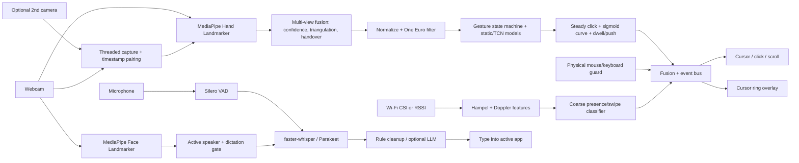

# Project Away

**The bridge between you and your AI agents, controlled by your hands, face and voice.**

**Website:** [fernandogarzaaa.github.io/project-away](https://fernandogarzaaa.github.io/project-away/) · **[Download for Windows](https://github.com/fernandogarzaaa/project-away/releases/latest)**

Project Away sees your gestures, notices whether you are at the screen and paying attention, and listens for your
voice. You use that to run your PC hands-free (point to move the cursor, pinch to click, talk to type), and, new in
v0.1.20, to work with the AI agent you already use (Claude, ChatGPT, Cursor or any other): it can ask you a quick
question you answer with a thumbs up, tell you when something is done, look at your screen or camera when you allow
it, tune Project Away to how you like it, and even use your computer while you watch. Free and local-first.

Nothing leaves your machine unless you connect an agent and press **Allow** on your own screen (or point the
optional LLM cleanup at an endpoint yourself).

[Privacy policy](PRIVACY.md) · [Code signing policy](#code-signing-policy)

## User guide (no technical knowledge needed)

### 1. Installing

1. Download `ProjectAway-…-windows-x64-setup.exe` from the [Releases page](https://github.com/fernandogarzaaa/project-away/releases/latest).
2. Windows will warn that the app is unrecognized (it isn't code-signed yet). Click **More info → Run anyway**, then **Install**.
3. The installer then downloads the speech and tracking models, about **1.6 GB**. **This is the slow part — read this first:**
   - On a slow or unstable connection it can take **hours**, and the progress bar may **stall** at the same number for a long time. That's normal; it isn't frozen for good.
   - **If it fails, stalls for ages, or the window closes: just open Project Away again.** Each time it starts, it checks for missing models and carries on downloading **from where it stopped** — nothing already downloaded is lost. You may need to do this a few times.
   - You can also use **Start menu → Project Away: re-download models** to resume.
   - Leave the PC awake and plugged in, and avoid other big downloads while it runs.
4. When it's done, a hand icon appears in the system tray (bottom-right, by the clock — check the **^** arrow). Gestures and voice are on straight away.
5. **Have an NVIDIA graphics card?** Open **Settings → Performance → Install GPU pack** (about 570 MB, once). Voice typing gets much faster and more accurate.

### 1b. Your first five minutes (guided first run)

The first time Project Away starts, a friendly guide opens by itself. It has big buttons, a row of dots that
shows how far you are, and a **Skip this step** button on every page: everything already works with the standard
settings, so skipping is always fine.

1. **Find your camera:** one button checks that it turns on. If it doesn't, you get a plain explanation and a
   button that fixes the usual cause (open the camera privacy settings, download a missing file, try again).
2. **Sit comfortably:** a live picture and tips like "You're a bit far away" or "It's a bit dark" until it says
   *Looks great*.
3. **Try it out (about 2 minutes):** point at three circles, pinch to click, scroll, and pause with an open palm.
   Each one turns green as soon as Project Away sees it. Nothing on your computer is clicked while you practise.
4. **Make it comfortable:** two optional switches, *Only respond when I'm looking at the screen* and
   *Switch to head control when my arm is tired* (see section 6).
5. **Eye setup (optional):** follow a few dots with your eyes.

Run it again any time: tray menu → **Guided first run...**, or **Settings → Getting started**
(or type `away tour`). People who already used Project Away before v0.1.20 just get a one-time note about it.

### 2. Setting up your space

- **Camera:** at or just above your screen, facing you, with your hand clearly visible from about 40–80 cm away.
- **Light:** light coming from in front of you, not a bright window behind you.
- **Background:** plain is best. Busy backgrounds and other people's hands in view make tracking jumpier.
- **Two webcams (optional):** better accuracy. Add the second one in **Settings → Cameras**, then press **Calibrate** and slowly wave an open hand where both cameras can see it for about 20 seconds.

### 3. Gestures: how to project away

Hold up one hand, palm toward the screen, and point.

| Do this | What happens |
|---|---|
| **Point** with your index finger | Moves the cursor |
| **Pinch** — tap thumb and index finger together | Left-click |
| **Pinch twice** quickly | Double-click |
| **Pinch and hold**, then move | Drag (select text, move windows) — open your fingers to drop |
| **Two fingers up** (index + middle), move up or down | Scroll |
| **Four fingers up, thumb tucked in**, then move your hand up or down | **Auto-scroll**: keeps scrolling on its own, faster the further you move from where you started. Make a **fist** to stop |
| **Open palm** (thumb out too), held still for a moment | Pause / resume gestures |
| **Swipe** left or right | Left / right arrow key (previous / next slide or photo) |
| **Palm glide** — hold one hand flat, slide the other hand's index fingertip along it | Scroll, like a trackpad (two fingers slide sideways = scroll sideways) |
| **Clap once** | Turn gestures on (resume) |
| **Clap twice** quickly | Pause gestures |

**Auto-scroll, step by step:** hold up four fingers with your thumb folded across your palm (or just held
against the side of your index finger) for a moment (the cursor ring, if you turned it on, goes orange). Where
your hand is at that moment is the "middle": you do not have to move away from it first. Move your hand
a little above it to scroll up, below it to scroll down; the further away, the faster. Hold your hand still and
it keeps scrolling at that speed, so you can read a long page without moving. Moving left or right scrolls
sideways. Close your hand into a **fist** to stop (it also stops if your hand leaves the camera for more than
half a second, if you pause, or if you make another gesture). Keeping your thumb tucked in matters: with the
thumb out it is the open palm, which pauses.

**Claps:** the microphone listens for a sharp hand clap. One clap turns gestures back on; two claps within about
half a second pause them (a single clap waits that half second to make sure a second one isn't coming). Claps
are ignored while you're in the middle of saying something. If the camera can see both your hands come together
it is extra sure it was a clap. Turn it off, or make it pickier, in **Settings → Voice & input**.

**Big cursor:** while gestures are on, the Windows mouse pointer is made bigger so you can see it from across the
room. It shrinks back to your normal size whenever gestures pause, so the size also tells you whether gestures
are on. Choose the size (or 0 for off) in **Settings → Voice & input → Cursor size while gestures are active**.
On Mac and Linux the pointer itself isn't changed; the cursor ring grows instead.

**Palm-glide scroll (v0.1.14), step by step:** hold one hand up flat, palm toward the screen, fingers
together — that hand is your "trackpad". Touch the middle of that palm with the index fingertip of your other
hand and hold it there for a moment (about a sixth of a second; the cursor ring, if you turned it on, goes
cyan). Now slide the fingertip along the palm: **toward the fingers scrolls up, toward the wrist scrolls down**.
Put your **index and middle finger** on the palm together and slide **sideways** to scroll left or right. Flick
and lift, and the page keeps going for a moment and slows down, like on a phone; touch the palm again or make
any other gesture to stop it. A quick **tap** on the palm (touch and lift, without sliding) can be given an
action in **Settings → Bindings → gesture:palm_tap** (it does nothing until you do). While your fingertip is on
the palm the cursor holds still and nothing clicks, and the flat hand never pauses gestures. Speed, the dead
zone, the momentum and the rest are in **Settings → Tuning → Palm scroll**.

**Which hand is which (hand roles, v0.1.14):** Away works out by itself which hand is the *pointer* (moves the
cursor, clicks and does every one-hand gesture) and which is the *helper* (the flat "trackpad" hand). The first
hand that **points** gets the pointer (or simply the only hand in view), and it keeps it — even if the camera
mixes up left and right, or the hand disappears for up to a second. Raised your flat "trackpad" hand first?
That's fine: as soon as the other hand points, it becomes the pointer. Holding your phone in the other hand?
Pick **Settings → Voice & input → Hand roles → Right** or **Left** to use only that hand as the pointer;
**Auto** is the default. You can also say **"use left hand"**, **"use right hand"**, or **"use either hand"**
(back to Auto).

Tips for smooth control:
- **Small movements go a long way.** The cursor speeds up when you move fast and slows for precise work, so slow down near small buttons.
- **Pinch crisply** and keep your hand still while you do — the cursor locks briefly so the click lands where you aimed.
- **Rest your elbow** on the desk or armrest. Holding your arm up in the air gets tiring fast.
- Touching your real mouse or keyboard pauses gestures automatically. They come back after a second or two of not touching them.
- **F9** turns gesture control on or off at any time. The tray menu does the same.
- Several monitors? The cursor covers all of them. Say **"next monitor"**, **"previous monitor"** or **"monitor two"** to jump.
- **Your hand stays in view on its own** (auto-centering): the camera frame quietly nudges your resting hand back
  toward the middle, and a quick swing back from the edge of the camera's view doesn't drag the cursor back (like
  lifting a mouse). Lost the cursor? Say **"center"** to put it in the middle of the screen you're on.

### Teaching your own gestures (Settings → Gesture Studio)

Open **Settings** and pick the **Gesture Studio** tab.

1. Press **Turn camera on**. You see yourself like in a mirror, with your hand drawn on top. (Project Away pauses
   while the Studio uses the camera and carries on when you turn it off.)
2. Press **Teach a new gesture** and follow the 3 steps: give it a name, show it when the app says **Now!**
   (15 times, in 3 short rounds, with a short "just relax" moment after each round), then try it and choose what it
   should do: press a key, click, type some text, open an app or a website, or a voice action.
3. **Practice mode** is on by default: you see what would happen, but nothing is really pressed or opened. Untick
   it when you are happy.
4. Did something happen that you did not want? Press **That was wrong** straight away. The last 2 seconds are
   kept as an example of "no gesture" so it learns not to do that. Then press **Learn my gestures now**.
5. **Where gestures work:** the picture is split into squares. Pick **Ignore here** and click the squares where
   gestures should be ignored (where your coffee cup is, or where your hand rests on the keyboard). You can also
   draw a box or say "only above a line". The cursor still moves everywhere unless you tick **Also stop the cursor
   there** (under **Show details**). Areas are saved for each camera, and can differ for each app profile.
6. **Show details** adds charts: the last 5 seconds, the points of your hand it looks at, which practice example the
   hand looks most like, and what it mixed up when it checked itself.

Your practice recordings stay on this computer (only hand points, never pictures). **Delete all my recordings**
removes them. **Share my gestures...** saves your gestures to a file for someone else; recordings are only added
if you say so.

### 4. Voice

Voice is always listening by default. Just talk, and your words are typed wherever the text cursor is.

- **Punctuation:** say "comma", "period", "question mark", "new line", "new paragraph".
- **Mistake?** Say **"scratch that"** to remove the sentence you just said, or **"no wait, make it Tuesday"** to fix the last word.
- **Smart cleanup (optional):** Settings > Voice & input > **Smart cleanup**. Tick it, press **Download** once
  (about 0.5-1.1 GB, shown on the button) and your dictation gets proper punctuation, and is casual in chat apps
  and tidy in email. If it is ever slow, the basic cleanup is typed instead, so you never wait.
- **My words:** add names and terms to the **My words** list in the same tab (or say **"add Jonie to my
  dictionary"**). Right after a mistake you can say **"correct Jonnie to Jonie"**. Words you fix by hand are
  learned too.
- **Commands:** "click", "double click", "right click", "scroll up", "scroll down", "go back", "go forward", "open browser", "pause gestures", "resume gestures", "stop listening", "start listening", "use left hand", "use right hand", "use either hand", "center" (cursor to the middle of this screen), "look here" (cursor to where you're looking, after gaze calibration).
- **Shortcuts:** `Ctrl+Alt+Space` pauses/resumes listening, `Ctrl+Alt+M` mutes the mic, `Ctrl+Alt+E` lets you edit selected text by voice.
- **Tray icon colour:** green = listening, amber = not listening, red = mic off, blue = recording, grey = paused.
- **Words not being typed?** If you're looking away from the webcam, the face check may ignore you. Turn **Face gate** off in the tray menu.
- **Videos and other people aren't typed (v0.1.22).** Words count as yours when the camera sees your mouth move.
  If it barely moved, only a very clear recognition is typed, and while another app plays sound (a YouTube video,
  a call) your mouth must be seen moving. The computer's own voice (an agent speaking to you) is never typed.
- **Talk to your AI agent (v0.1.22):** say **"Hey"** and your agent's name, for example **"Hey Claude, remind me to
  call Mom at five"**, and the words go to that agent instead of being typed. You see **"Sent to Claude"**. Say
  "Hey Claude" on its own and then your message, or use the summon gesture and speak. See *Talk to your agent*.
- Speech is processed on your PC and never saved or uploaded.
- **Click things by name (Windows):** say **"click Save"**, **"double click Photos"** or **"focus Search"**. Look at
  something (or point at it) and say **"click that"**. If two things have the same name, numbers appear next to
  them: say the number, or "cancel".
- **Snap to buttons (Windows):** the pointer is gently drawn to buttons and links and holds still over them, so
  a shaky camera image doesn't make you miss. Both are on by default; turn them off, or turn on
  **Smoother cursor**, under Settings > Voice & input > Smart pointer.

### Shortcuts: show it once, then a gesture or a word repeats it

Something you do often, like opening your mail and starting a new message? Teach it once:

1. Open **Settings > Shortcuts** and press the big **Record a shortcut** button (or say **"record shortcut"**, or pick
   **Record a shortcut** in the tray menu).
2. Do the clicks and typing yourself, the normal way, or hands-free: pinch-clicks and dictated text count too. A small red **Recording** bar shows at the top; press its **Stop**
   button when you are done (or say **"stop recording"**).
3. Give it a name, then choose what runs it: **say** a phrase ("open mail") or **make a gesture**. That's it.

To stop a shortcut while it runs, press **Esc**, move the mouse, or say **"stop"**. If a shortcut can't run (the app it
was made in isn't open, or another window is in the way), Settings > Shortcuts tells you why and shows a button that
fixes it. Shortcuts never record what you type into a password box, and a shortcut that types text stays on your PC.
**Edit steps** lets you remove or reorder steps, change pauses, add text, a key or a wait, and pick the speed.

### 5. Head and eye tracking (optional, off until you set it up)

- **Head pointer:** with your hands busy, turn your head to move the cursor and click with a wink, smile or
  eyebrow raise (turn those on in the face settings). Set `hands.cursor.head_assist: pointer`.
- **Head + hand:** `head_assist: coarse` makes the cursor jump to the part of the screen you turn toward; your
  hand does the fine aiming.
- **Eye tracking ("where am I looking?"):** Settings → Performance → **Calibrate gaze…** (or `away gaze calibrate`).
  Look at the dots on each screen until they vanish (about 2 seconds each). Afterwards Project Away knows where
  your screens are and roughly where on them you look: when you start moving your hand after resting it, the
  cursor first jumps to where you're looking, then your hand fine-tunes. Webcams are only good for "which screen
  and which area" (roughly a hand-width on the screen), not for small buttons.
- **Optional gaze model:** a learned eye-gaze network can be downloaded in Settings → Performance → Models. Its
  weights are for **research use only** (see below), so it is never installed automatically.

### 6. Comfort: only when you're looking, tired arms and breaks

All of these are plain switches in **Settings → Getting started** (the first tab). The numbers behind them are
under **Advanced** there, and in **Settings → Tuning**; you never need to touch them.

- **Only respond when I'm looking at the screen** (off until you turn it on; also a check box in the tray menu):
  gestures count only while you face the screen and hold your hand up in front of you. Rest your hand on the desk,
  turn to talk to someone, or reach for your coffee, and nothing gets clicked. The ring at the cursor turns grey
  while it waits for you, and the tray says what to do ("raise your hand a little higher"). A short glance away
  is forgiven, so it doesn't flicker on and off. Without face tracking (or before the face model has loaded) it
  only checks your hand.
- **Switch to head control when my arm is tired** (off until you turn it on): after a long time with your arm up,
  or when your hand starts to sink or shake, Project Away tells you to lower your hand and steers the pointer with
  your head instead. Raise your hand again and it takes back over. Needs face tracking.
- **Tell me when my arm looks tired** (on): just the gentle note, at most once every 10 minutes.
- **Remind me to take a break** (on): a short note after 30 minutes of continuous gesture use. Being away from the
  camera for 2 minutes counts as a break.

### 7. If something goes wrong

- **Models didn't finish downloading:** reopen the app (see Installing above). It resumes.
- **Cursor doesn't move:** check another app isn't using the camera (Zoom, Teams, the Camera app), then restart Project Away from the tray.
- **Voice is slow or lagging:** install the GPU pack (Settings → Performance, NVIDIA cards only).
- **Want to change a gesture or phrase?** Tray → **Settings…** → Bindings.
- **A camera is "too slow":** Settings → Cameras → **Test both cameras** reports any camera below 10 frames per
  second as FAILED. Project Away has already tried every format and size on it; if NVIDIA Broadcast is
  installed it can use Broadcast's camera instead (and says so). Otherwise use the other camera alone.
- **A camera never opens, but the Windows Camera app shows it:** Project Away now also tries the Camera app's
  own way of reading cameras (WinRT). Settings → Cameras → **Diagnose** shows, for every camera, which way
  works and how fast. If a camera keeps failing, Project Away stops retrying it after a while and says so; fix
  it, then press **Retry cameras** (Settings → Cameras, or the tray menu).
- **"The app crashed last time":** the details are in `crash.log` in the logs folder
  (`%LOCALAPPDATA%\ProjectAway\logs\crash.log` on Windows, next to `away.log`). Please attach it to a bug report.

## Connect your AI agent

### 30-second quick start

1. Open **Settings → Agent Link** and press **Connect an AI agent**.
2. Pick your AI: **Claude Desktop**, **ChatGPT**, **Cursor**, **Claude (web or phone)** or **Other**.
3. Choose what it may do (the safe choices are already ticked) and press **Next**.
   - **Claude Desktop / Cursor on this PC:** press **Connect**. Project Away adds itself to the app's settings
     (a backup is kept), then restart the app.
   - **ChatGPT, Claude.ai or anything else:** you get a private link, a QR code and a 6-digit code. Paste the link
     into the app's "add custom connector" box (ChatGPT: *Settings → Apps & Connectors → Advanced → Developer mode →
     Create*; Claude: *Settings → Connectors → Add custom connector*) or open it on your phone.
4. Your PC asks **"Claude wants to connect: Allow / Deny"**. Answer with a click, a thumbs up, or by saying "allow".
   You see **Connected to Claude ✓**. **Disconnect all** ends every connection at once.
5. *(v0.1.24, optional)* When an agent connects with the 6-digit code, the question also offers **Keep this agent
   connected**. Choose it and that agent comes back by itself after restarts and reboots, without asking you again,
   until you revoke it in **Settings → Agent Link → Agent tokens** (see [Keep this agent connected](#keep-this-agent-connected-v0124)).

Then just talk to your agent: *"What can you see in Project Away?"*, *"The cursor is too fast, fix it"*,
*"Ask me with a thumbs up before you send the email"*.

**Link stopped working? Press "New link".** ChatGPT or Claude.ai sometimes cannot reach one particular link
(Cloudflare blocks that agent's servers on that address, and every request fails). **New link** in Settings →
Agent Link makes a fresh address and copies it; paste it into your AI app again. Nobody is disconnected, and agents
on this PC (Claude Desktop, Cursor) are not affected.

### Talk to your agent (v0.1.22)

Say **"Hey"** and an agent's name, then what you want: **"Hey Claude, what's on my calendar?"**. Your words go to
that agent only, instead of being typed, and a small **"Sent to Claude"** shows on screen. The agent answers on
your screen and out loud.

* **Every connected agent answers to "Hey <its name>"** automatically. Give one its own wake word (for example
  "Jarvis") with **Wake word** next to the agent in Settings → Agent Link; the agent row shows what to say.
* **"Hey agent"** or the **summon gesture** (then say your message) goes to your **default agent**, chosen under
  *Talk to your agent* in Settings → Agent Link. With no default it goes to every connected agent.
* Say only "Hey Claude" and pause: you have about 8 seconds to say the message.
* If the computer mishears the name ("hey heart" for **Hark**, "hey cloud" for **Claude**), the message still goes
  to that agent, as long as you started with "Hey" (or "Hi", "OK") and only one agent's name sounds like it.
* It needs always-on listening (the default). The same rules as dictation apply, so a video playing in the
  background does not send messages.
* **Wake-up address (optional, off by default).** Some agents can be woken up by a web address (a "webhook"). If
  your agent gives you one, paste it under **Wake word** → *Wake-up address*; each message to that agent is then
  sent there too. Only `https://` addresses (or an address on this PC) are accepted.

For agents: messages arrive as a `user.message` event only the addressed agent sees, and in the `inbox` tool
(`list`, `read`, `reply`), `GET /v1/inbox`, `GET /v1/inbox/read?id=`, `POST /v1/inbox/reply {id, text, speak}` and
the `away://inbox` resource. A reply is shown and read aloud (like `notify_user` with `speak=true`). The wake-up
POST body is `{"event": "user.message", "id", "text", "agent", "t", "source", "how_to_reply"}`. Messages are kept
in memory only (the newest 200), never written to disk.

| Permission | What it means | Default |
|---|---|---|
| ☝ See my gestures | your gestures, whether you are at the screen, what you said to Project Away, its settings and health | always on |
| ◉ See my camera when I allow | one small still photo at a time; your screen flashes every time | off |
| ▣ See my screen when I allow | one small screenshot at a time, or a slow (1 per second) live view with a badge on screen the whole time | off |
| ⚙ Change my settings | sliders, gestures, voice commands, per-app profiles, presets; it asks you first (before/after) and everything can be undone | off |
| ⌨ Let it use my computer | mouse and keyboard, after you allow it on the PC each time, for 30 minutes at most | off |
| ✉ Share my logs and recordings | its logs, short gesture recordings (no video) and problem reports, with passwords, keys, e-mail addresses and your user folder hidden | off |
| (Advanced) Run camera and speed checks | camera checks and speed tests | on |

**While an agent uses your computer** a bright border and the banner *"Claude is using your computer — move your hand
or mouse to take over"* are on screen. Touching the mouse or keyboard, or making a gesture, pauses it instantly; it
must ask again to continue. **Ctrl+Alt+Esc**, saying **"stop"**, or holding up an **open palm** for a second stops it.
It never types into password fields, never touches Windows security prompts, and asks you before clicking anything
like *Send, Pay, Buy, Delete, Install* (with "Always allow for this agent"). Settings → Agent Link shows everything it
did, with a picture of the screen for each step, and **Undo last**.

**Answering your agent with your hands:** thumbs up = yes / the first choice, thumbs down = no / the last choice,
1–4 fingers = choice 1–4, open palm = choice 5, or say the answer, or click it.

**Talking to your agent with gestures/voice:** say **"hey agent"** (it is called), **"hey agent, look"** (it gets a
camera picture, if allowed) or **"hey agent, look at my screen"**, and **"that was wrong"** when Project Away did
something you did not want (agents can then suggest a fix). Bind them to any gesture in Settings → Bindings
(`agent:summon`, `agent:look`, `agent:screen`, `agent:wrong`, `agent:stop`).

**My preferences:** Settings → Agent Link → *My preferences* is a plain list ("I hate accidental right-clicks",
"slower cursor in Photoshop") that you and your agents share; agents read it and cite it when they change something.
Changes run in **Ask me first** mode by default; **Just do it and tell me** lets them make small adjustments
(thresholds and sliders within their normal range) right away and tell you. Every change is in a history with who and
why, with **Undo** and **Undo its changes today**, and the config is snapshotted before each batch.

### Technical details

**Transports.** One server, three ways in, the same permissions and rules for all of them:

* **MCP over stdio** for apps on this PC: the app runs `away mcp --scopes read,diagnose` (the wizard writes it).
  It forwards to the running Project Away app over 127.0.0.1; the first call shows the Allow prompt (proof of "same
  user, same PC": a key file only you can read), and the token is kept until it expires (30 days) or you revoke it.
* **MCP over Streamable HTTP** for remote agents: `https://<random>.trycloudflare.com/mcp` with
  `Authorization: Bearer <token>`, or the pairing link `https://<random>.trycloudflare.com/c/<code>` used directly
  as the connector URL (no header needed; ChatGPT and Claude.ai connectors). OAuth is not implemented in v1; the
  pairing link is the credential and only becomes one after you press Allow.
* **REST/JSON** for agents without MCP: the same tools under `/v1/...` (`POST /v1/rpc/<tool>` for any of them),
  server-sent events at `/v1/events/stream`, OpenAPI at `/openapi.json`. Exchange a pairing code or the 6-digit code
  for a token with `POST /v1/pair {"pin": "123456", "name": "My agent"}`.

**Claude Desktop by hand** (what the wizard writes into `claude_desktop_config.json`; Windows path shown, macOS uses
`/Applications/ProjectAway.app/Contents/MacOS/ProjectAway`, a pip install uses `away`):

```json
{"mcpServers": {"project-away": {
  "command": "C:\\Program Files\\ProjectAway\\ProjectAway.exe",
  "args": ["mcp", "--scopes", "read,diagnose,tune"]}}}
```

Cursor uses the same entry in `~/.cursor/mcp.json`; `away agent connect claude|cursor` writes it from the command
line, `away agent snippets` prints them.

**Remote Streamable HTTP client** (tested from a cloud sandbox through a real quick tunnel):

```python
from mcp import ClientSession
from mcp.client.streamable_http import streamablehttp_client

async with streamablehttp_client("https://<random>.trycloudflare.com/c/<code>") as (r, w, _):
    async with ClientSession(r, w) as s:
        await s.initialize()  # the person sees "<your client name> wants to connect"
        print(await s.call_tool("get_context", {}))
```

or without MCP: `python scripts/agent_link_client.py --url <link> pair --pin 123456`, then `... status`, `stream`,
`ask "Ready?" Yes No`, `look out.jpg`, `set hands.cursor.gain 1.8 --why "..."`, `bundle out.zip`.

**Tools (18; 15 in v0.1.21, `inbox` added in v0.1.22, `shell` and `ui_query` in v0.1.28).** Related tools are grouped into one tool with an `action`, so an agent sees a short list:

| Tool | Actions / arguments | Permission |
|---|---|---|
| `get_status`, `get_context` | (none) | see my gestures |
| `inbox` | `list` (`unread_only`), `read` (`id`), `reply` (`id`, `text`, `speak`) - what the person said to you | always (only your own messages) |
| `events` | `poll` (`since`, `landmarks`), `wait` (`since`, `timeout_s`, `topics`) | see my gestures |
| `settings` | `list` (`domain`), `change` (`changes`, `why`), `undo` (`what`), `history` (`limit`), `config` | change my settings (`list`/`history`/`config`: see my gestures) |
| `preferences` | `list`, `add` (`text`), `remove` (`number`) | change my settings to add/remove |
| `diagnostics` | `run` (`kind` = `cameras` \| `sweep` \| `benchmark`, `device`, `seconds`), `job` (`job_id`), `record`, `bundle`, `files`, `download` (`path`), `logs` (`lines`) | run camera and speed checks (`record`, `bundle`, `files`, `download`, `logs`: share my logs and recordings) |
| `look` | `camera` | see my camera when I allow |
| `get_screen` | `scale`, `monitor`, `region`, `elements` (see below) | see my screen when I allow |
| `ui_query` | (none) - the foreground window's interactable elements with ids, names, roles and exact bounds (Windows UI Automation, no screenshot taken); pass an id back as `element_id` to `pointer` or `keyboard` | use my computer |
| `ask_user` | `question` (or `message`), `options`, `timeout_s`, `urgency`, `speak` | always |
| `notify_user` | `text` (or `message`), `level`, `speak` | always |
| `control` | `request` (`why`, `minutes`), `resume`, `stop`, `undo`, `log` | use my computer (`stop` and `log` always; `log` shows only your own actions) |
| `pointer` | `move`, `click`, `double_click`, `right_click`, `drag`, `scroll` (`x`, `y`, `element`, `from_image`, ...) | use my computer |
| `keyboard` | `type` (`text`), `press` (`keys`) | use my computer |
| `open` | `app` (`name`), `system` (`name`), `url` (`url`) | use my computer |
| `shell` | `list`, `run` (`command` = tier-1 name \| `argv` = tier 2, `why`), `log` (`limit`) - staged shell: tier 1 read-only diagnostics run at once in an approved session, tier 2 asks the person every time | use my computer |
| `disconnect` | (none) | always |

Example: `settings(action="change", changes=[{"key": "hands.cursor.gain", "value": 1.6}], why="you said it is too
fast")`. **The old names still work** on the REST API and `/v1/rpc/<name>` (`change_settings`, `get_job`, `act`,
`request_control`, `list_files`, `read_file`...), and the group names work there too:
`POST /v1/rpc/diagnostics {"action": "job", "job_id": "82557239"}`.

**Check ids** (`diagnostics action="run"` returns one) are strings such as `"82557239"`; `GET /v1/jobs?job_id=...`
and `?id=...` both work. A finished check is kept 10 minutes after it finished once it has been read (30 minutes if
nobody read it yet); an id that never existed answers **404 unknown**, one whose result was dropped answers **410 expired**.

**Seeing the screen: wide shot first, then zoom.** `get_screen` with no arguments returns the whole desktop at
`scale` 0.5 (the longest side is capped at 2560 px, so a 5206x1080 three-monitor desktop comes back at 2560x531)
plus metadata listing every monitor (`index` 1..N left to right, `x`, `y`, `w`, `h`, `primary`), the area shown
and the scale used. Then zoom in:

* `scale` 0.1-1.0: the share of the area's real pixels (1.0 to read small text);
* `monitor=N`: one display, numbered from 1 (`monitor=0` is an error that lists the valid numbers; leave
  `monitor` out for the whole desktop);
* `region={x, y, width, height}` (also `"x,y,w,h"` or `[x, y, w, h]`) in screen coordinates, which are negative left
  of or above the main display; clipped to the desktop.

`monitor` and `region` cannot be combined. Image coordinates map back with
`screen_x = origin.x + image_x / scale` (and the same for y); pointer actions with `from_image=true` do this using
the agent's last screenshot. The live view (`screen_watch`) takes the same options and is capped at 1600 px.

**Speaking (v0.1.21).** `notify_user` and `ask_user` with `speak=true` read the message (or the question and its
choices) aloud with the computer's own voice: on Windows the built-in Windows voice (SAPI, through comtypes, or
PowerShell's System.Speech when comtypes is missing), else pyttsx3 when installed, macOS `say`, Linux `spd-say` /
`espeak-ng` / `espeak`. It never blocks the agent, and the result is truthful: `shown` / `spoken` are only true when
that happened, with a `reason` / `speech` explaining why not (for example "speaking is turned off"). When the
message window cannot appear, a tray notification is shown instead (`via: "tray notification"`). Config:

```yaml
speech:
  enabled: true              # "Let agents talk to me"
  read_messages_aloud: false # read every agent message aloud, even without speak=true
  rate: normal               # slow | normal | fast
  volume: normal             # quiet | normal | loud
  voice: ""                  # part of a voice name ("Zira", "Samantha"); "" = the system default
```

**Resources:** `away://about` (briefing: what Project Away is, your permissions, live context, how to talk to the
person; also sent as the MCP `instructions`), `away://preferences`, `away://context`, `away://events` and
`away://screen/live` (both subscribable: `resources/subscribe` → `notifications/resources/updated`),
`away://user/last-capture`. Events: `presence` (sat down / left), `attention`, `summon`, `user.look`, `user.screen`,
`wrong`, `misfire`, `detector`, `control.*`, `prompt.*`, `change.*`.

**Polite prompts.** `ask_user` with `urgency` `low`/`normal` waits until you are present, facing the screen and not
typing (normal waits at most half its timeout); `high` shows at once.

**Settings agents can change** go through a registry of domains (`settings`, `zones`, `bindings`, `custom_gestures`,
`profiles`, `presets`, plus placeholders for features on other branches). Every value is checked with the same range
table as the Tuning sliders, and the whole config must still validate before anything is saved.

**CLI:** `away agent status|pair|start|stop|disconnect|agents|revoke ID|connect claude|cursor|snippets|prefs|changes|
undo|github-token` (aliases `away link`, `away remote`), `away mcp`, `away replay FILE`, `away diagnose bundle`.

**New config keys** (`agent_link:`): `enabled` (true), `remote_ttl_min` (60), `local_ttl_days` (30),
`pairing_ttl_s` (600), `control_ttl_min` (30), `port` (0 = any), `rate_per_s` (10) / `rate_burst` (40),
`action_rate_per_s` (4), `cloudflared_download` (true), `cloudflared_path`, `screen_fps` (1), `screen_max_width`
(960), `snapshot_max_width` (320), `record_buffer_s` (30), `detectors` (true), `detector_cooldown_s` (600),
`fps_drop_ratio` (0.5), `misfire_threshold` (4), `autofix` (`ask` | `auto_low_risk`), `stop_hotkey`
(`ctrl+alt+esc`), `github_issues` (false), `github_repo`.

**Recordings and replay.** `record_session` / the 30 s ring buffer store hand landmarks and app events (never video
or audio) as gzip JSON lines (`.awayrec`, ~25 KB for 5 s). `away replay FILE` re-runs them through the gesture
pipeline headless and deterministically; drop one into `tests/replays/` and run the tests once with
`AWAY_UPDATE_REPLAYS=1` to pin it as a regression test.

**Auto-detectors.** A camera frame-rate drop, a camera that will not open, a retry loop, a crash, or a spike of
"that was wrong" / cancelled actions saves a diagnostics bundle (logs, redacted config, the last camera check,
stats, the last 30 s of landmarks) to `<data>/diagnostics/` and tells connected agents. Optional, off by default:
`agent_link.github_issues: true` files a GitHub issue (stats only, never the bundle) with a token you store in the OS
keyring with `away agent github-token`.

### Safety guarantees

These are enforced by Project Away itself, whatever the agent asks for, and each one has an automatic test:

* **Nothing without your OK.** Using your computer needs your Allow every session. A click, drag, Enter, Delete or
  shortcut on something Project Away can't identify asks you first, like Send, Pay, Delete or Install do. Dropping
  something on the Recycle Bin or Trash asks too. You can say "Allow for this session" to stop the questions until
  the session ends.
* **You can always take over.** Moving your mouse pauses the agent at once, even while it is typing. Your stop keys
  (Ctrl+Alt+Esc), saying "stop" and holding up an open palm always work, straight away. An action that is already
  running stops before its next step (a drag, the next few letters), and Project Away lets go of the mouse button
  and Shift, Ctrl, Alt and Win.
* **Undo is yours or the agent's own.** An agent can only undo its own actions, and only while you are letting it use
  your computer.
* **No picture without a notice.** Every camera picture and screenshot shows a notice on screen. If the notice can't
  be shown, the picture is not taken. The live screen view only runs while its "watching" badge is on screen.
* **Turning a permission off works at once.** Turn off "Let it use my computer" and its session ends and the border
  goes away. Turn off "See my screen" and its live view stops. Disconnect does both.
* **Your logs are yours.** Sending logs, recordings and problem reports to an agent needs its own permission, "Share
  my logs and recordings", off unless you turn it on (agents connected earlier don't get it either). Passwords,
  keys, tokens, e-mail addresses and your user folder are hidden in what is sent. An agent sees only its own actions
  in the action list.
* **Fails safe.** If Windows can't tell whether a security prompt (UAC, Ctrl+Alt+Del) is on screen, the agent is
  stopped. Oversized requests are refused before they are read (64 KB, 256 KB for MCP).

### Security notes (honest)

* The local server listens on **127.0.0.1 only**. Remote access exists only while a pairing link or a remote agent is
  active, through a Cloudflare quick tunnel; Cloudflare can see that traffic (TLS ends at their edge).
* A pairing link / QR / 6-digit code **grants nothing by itself**: the first client to use it creates a request you
  must Allow on the PC (permissions listed, plus the matching code). Links are single-use and expire after 10
  minutes; a 6-digit code is guessable in principle, so failed attempts lock the server for a minute after 10 tries
  and requests are rate-limited per client.
* Tokens are 256-bit random, stored only as SHA-256 hashes, compared in constant time; remote access expires after
  1 hour, local after 30 days; **Disconnect all**, the tray menu, or `away agent disconnect` revoke everything at once.
* A connector that uses the pairing link as its URL keeps that link as its credential until it expires or is revoked:
  treat the link like a password and do not share it.
* Requests with a browser `Origin` header are refused (a web page cannot drive it); every request is in
  `<data>/logs/agent-access.log` (codes and tokens never written).
* Never possible through Agent Link: running shell commands, reading or writing your files (downloads are limited to
  bundles, recordings and logs inside Project Away's data folder, with path-traversal and symlink checks, and need
  "Share my logs and recordings"), changing
  `allow_shell`, hotkeys, updates or the agents' own permissions.
* "Let it use my computer" is the riskiest permission. Its protections (approval every session, expiry, takeover
  pause, password-field and secure-desktop blocks, risky-click confirmation, blocked Win+R / Ctrl+Alt+Del, no
  terminals, rate limit, full action log) reduce but cannot remove risk: an allowed agent can still click and type
  anything you could in ordinary windows. Turn it on only for agents you trust, and watch.
* Password fields are detected with Windows UI Automation (`IsPassword`). Without UI Automation, typing is refused on
  Windows; on macOS/Linux only window titles that look like sign-in prompts are blocked.

## Live agent (optional)

Talk to your computer and it talks back. Say **"Hey Away"** (you can change the name), then a question or a small
job: "Hey Away, what's 15% of 80?", "Hey Away, open Notepad and type hello". It answers out loud, does small jobs on
this PC, and hands big jobs (write code, research, long documents) to your other AI agents.

**It is off by default.** Nothing is downloaded, nothing is sent anywhere, and nothing listens for "Hey Away" until
you turn it on in **Settings → Live agent**.

### Turn it on in one click (free models)

Click **Use free models (opencode)**. That is all: no account, no key, no card.

* Away uses [opencode](https://github.com/anomalyco/opencode) (free, MIT license) to reach its free models. If
  opencode is not on your PC, the button downloads the official build (about 60 MB) and checks its fingerprint
  (SHA-256) against the one GitHub publishes. A file that does not match is thrown away.
* opencode runs privately, only for Away: on your PC only (127.0.0.1) with a random password, with its own settings
  folder (your own opencode setup and keys are not touched), and with every tool it might want (shell, files, web)
  refused. It only writes text for Away.
* The button tries a few free models and picks one that answers quickly.
* **Good to know:** the free models may keep what you send them. So **pictures of your screen and camera are never
  sent to them**, nor anything typed into password fields, and e-mail addresses, phone and card numbers and keys
  are hidden before anything is sent.
* Free models have limits. When one says "Free usage exceeded", Away moves on to the next one right away.

If opencode cannot be downloaded or started, the tab offers **Use a free key instead** (Gemini or Groq, both free
with no card, with a link to get the key), or Ollama if it runs on your PC.

### Add your own API key

Under **Add my API key**: pick the provider, paste the key, click **Save and test**. Providers: Groq, Google Gemini,
OpenAI, Anthropic (Claude), OpenRouter, OpenCode Zen, DeepSeek, Mistral, Together AI, Ollama and LM Studio on this
PC, or any other OpenAI-compatible address.

* The key is kept in your system's own safe store (Windows Credential Manager, the macOS Keychain, or the Secret
  Service on Linux), **never in a file**, a log, or an answer to another agent.
* Your own paid keys and models on your PC may see the screen, but only when you tick **Let it look at my screen**.

### Which model answers (the fallback order)

For each job Away tries models in this order, and moves to the next one if a model fails, is rate-limited, or does
not start answering within 8 seconds:

1. The model you chose for that job, or your **Preferred model**.
2. Your other models (your API keys).
3. Free models (opencode).
4. Models on this PC (Ollama, LM Studio).

A model that keeps failing is rested for a while (a minute, doubling up to ten; an hour for a refused key). Once a
model starts answering, it finishes the turn. Looking at the screen only ever uses models that accept pictures and
do not keep prompts.

### Jev (quick decisions)

Jev is a small, fast decision model (TypeSafe AI's "System One"). It does not write text; it answers short yes/no
and pick-one questions in about 0.3 s. Away uses it to decide: is this a chat, a job on this PC, or a big job for
another agent; is this action risky (send, pay, delete, anything you cannot undo, which is always confirmed on your
PC first); which button on screen you meant; and whether the action worked. Jev's free version needs no key. Under
**Advanced** it is set to *auto* (use it when it answers). When Jev is off or not answering, the chat model answers
the same questions, and when that fails too, simple built-in rules do.

### Daily budget

Paid API keys stop for the day once today's spend reaches your daily limit: **$1.00 a day** by default, changed
under **Advanced** (0 means paid keys are never used). Free models and models on your PC always count as $0. When a
model's price is unknown, it is counted at a cautious $1 / $5 per million tokens so the limit still holds.

### Talking over it, and what it may do

* **Barge-in:** just start talking while it speaks and it stops. (The classic Windows voice finishes its current
  few words first.)
* By default it may not look at your screen or camera or use the mouse and keyboard. Each is a switch in the tab.
  Mouse and keyboard use is approved on the PC each session, with the same safety rules as Agent Link.
* **Recent turns** in the tab shows what was asked, which model answered, how fast, and what happened.
* From a terminal: `python -m away.liveagent status | free | models | ask "..." | jev | update-engine`.

### Talking back and forth (conversational mode)

In **Settings → Voice & input → Talking to your agent**:

* **Keep listening after "Hey <name>"** (3–30 seconds, default 8): after you say "Hey Cookie" (or any agent's wake
  word, or the live agent's name) and pause, it waits this long for your message. Same for every agent.
* **Conversational mode** (off by default): after the agent answers, just keep talking; no wake word needed. It
  keeps listening for the time above, counted from when it stops speaking. Say **"stop"** or **"that's all"**, or
  stay quiet, to end the conversation. Talk over it and it stops and listens to you.
* **Play a short sound when it starts listening** (on by default): a soft two-note sound after "Hey <name>", and a
  single note when it has your message.

From a terminal: `away voice listen-seconds 12`, `away voice conversational on`, `away voice listen-sound off`, and
`away voice agent-pause-ms 450` (how long a pause ends what you say to an agent; dictation keeps its own,
longer `end_silence_ms`). In `config.yaml` these are `voice.listen_seconds`, `voice.conversational`,
`voice.listen_sound` and `voice.agent_end_silence_ms`.

**Faster answers (v0.1.26).** Every spoken request now writes a timing line to the log
(`latency: endpoint=450ms stt=250ms route=0ms first_token=600ms first_sentence=300ms first_audio=250ms total=1856ms`).
Measured with the same fake speech recognizer, model and voice on both versions
(`python scripts/bench_voice_latency.py`; real numbers depend on your PC and model):

| Stage | Before | Now | What changed |
|---|---|---|---|
| End of speech | 690 ms | 450 ms | A shorter pause ends what you say to an agent (dictation keeps 700 ms) |
| Speech to text | 250 ms | 250 ms | (fake) |
| Routing | 900 ms | 0 ms | A plain question goes straight to the answer model; only requests that may be an action ask Jev / a model first |
| First word from the model | 680 ms | 600 ms | Providers are reused instead of rebuilt (and keys re-read) on every call |
| First whole sentence | 300 ms | 300 ms | Already streamed sentence by sentence |
| First sound | 1450 ms | 250 ms | The voice loads while you speak and stays loaded for 10 minutes (it used to load again after 30 idle seconds) |
| **Total** | **4272 ms** | **1856 ms** | |

### What is tested and what is not

| Part | Status |
|---|---|
| Router, fallback order, rest periods, daily budget, redaction, fencing of screen text, Jev answers, barge-in logic, Settings tab logic, key storage | Unit-tested with fake providers, a fake opencode server, a fake key store and fake clocks (58 tests) |
| Settings → Live agent tab | Drawn under Xvfb on Linux (a render test and a screenshot check) |
| opencode download, SHA-256 check, private `opencode serve`, free models answering | **Verified for real on Linux (arm64)** on 2026-10-14: opencode 1.19.0 downloaded and checked, a free model answered "15% of 80 is 12" in about 3.5 s at $0, and "Free usage exceeded" moved on to the next model |
| Jev (free) | **Verified for real** on 2026-10-14: routing and the risk check answered in about 0.3 s |
| opencode settings isolation on Windows | **Untested** |
| opencode installed by npm (`opencode.cmd`) on Windows | **Untested** (code path unit-tested only) |
| Stopping opencode and its child processes on Windows (`taskkill /T`) | **Untested** |
| Windows Credential Manager (and the macOS Keychain) | **Untested** with the real stores (a fake store in tests) |
| The real voice loop (microphone, "Hey Away", speaking, barge-in on real audio) | **Untested** |
| Conversational mode, listening window, listening sound, timing log (v0.1.26) | Unit-tested with fake clocks, a fake recognizer, fake models and a fake voice (`tests/test_v0126_conversational_voice.py`, 22 of its 27 tests fail on v0.1.25): follow-ups without the wake word, the window honoured and held while the agent speaks, "stop" / "that's all", barge-in keeping your first words, the shorter end-of-speech pause, streaming speech starting before the reply is complete, warm voice. **Untested with a real microphone and speakers**: real barge-in levels, room echo, the earcon through real speakers, and the real latency numbers on a laptop |
| Your own API keys against the real providers (OpenAI-compatible, Anthropic) | **Untested** live (fake HTTP in tests) |

## Architecture



| Module | Role |
|---|---|
| `hands/` | landmarks, One Euro filter, cursor mapping (power or sigmoid curve, per-direction speed), gesture state machine, `stabilize.py` (steady click, dwell) |
| `multicam/` | `capture.py` (enumeration, camera threads, `FramePairer`), `geometry.py` (intrinsics, pose from hands, triangulation, checkerboard), `calibration.py`, `fusion.py` (per-view confidence, best-view/weighted fusion, 3D pinch, push) |
| `face/` | face landmarker, active speaker, brow / mouth / wink triggers, optional iPhone (Live Link Face) source |
| `voice/` | always-on + push-to-talk, ASR (vocabulary as prompt + `hotwords`), cleanup, `numbers.py`, `edit.py` (edit selected text) |
| `app/` | runner (pipeline + device threads), tray, settings GUI, overlays, `autopause.py` |
| `bindings.py` / `actions.py` | trigger -> action mapping and execution |

## Quickstart

Full per-OS instructions: [docs/INSTALL.md](docs/INSTALL.md). Wi-Fi sensing: [docs/wifi-setup.md](docs/wifi-setup.md).
Experimental iPhone face tracking (free Live Link Face app over Wi-Fi): [docs/iphone.md](docs/iphone.md).

```bash
pipx install ".[all]"        # Python 3.10–3.12
away setup                   # downloads models, checks camera + mic
away demo                    # synthetic end-to-end check
away run                     # or: away tray ; away autostart on
```

**One-click installers** (Releases page) bundle every feature: tracking, dictation, tray, settings
window and on-device training (CPU PyTorch). Parakeet/NeMo is the one exception (multi-GB,
NVIDIA-oriented; use `pipx install "project-away[all,parakeet]"`). Installers are ~0.4–0.8 GB; the models
(~1.6 GB, or ~0.5 GB with Whisper `small`) download during install on Windows and on first launch elsewhere.

- **Windows:** run the `setup.exe`. It's unsigned, so choose *More info → Run anyway*, then **Install**. Models,
  start-at-sign-in, a desktop shortcut and launching the tray app are all on by default.
- **macOS:** open the `.dmg` and drag Project Away onto Applications. The app is not signed by Apple, so open
  Terminal once and run `xattr -dr com.apple.quarantine "/Applications/Project Away.app"` (or use *Open Anyway*
  in System Settings > Privacy & Security). The first launch shows a setup window while it downloads the models,
  then the app lives in the menu bar. Allow Camera, Microphone, Accessibility and Input Monitoring when asked.
  Step by step: [docs/INSTALL.md, Option C](docs/INSTALL.md#option-c--macos-disk-image-apple-silicon).
- **Linux:** run the AppImage or install the `.deb`; the first launch downloads the models. Mouse and keyboard
  control needs X11; Wayland is untested.

## Customizing controls

Every control is a **trigger → action** binding you can change without touching code: from the
**Settings** window (tray → *Settings...*, or `away settings`), from the CLI, or in `config.yaml`
(`away config path` shows where it is). A running Away reloads the file within a second of a save.

### Default bindings

| Trigger | Default action |
|---|---|
| `gesture:point` (index finger) | `mouse:move` (cursor) |
| `gesture:pinch` | `mouse:click` |
| `gesture:double_pinch` | `mouse:double_click` |
| `gesture:pinch_hold` | `mouse:drag` |
| `gesture:two_finger_scroll` | `mouse:scroll` |
| `gesture:four_finger_scroll` (thumb folded; `hands.gestures.autoscroll_enabled`) | `mouse:autoscroll` |
| `gesture:clap` / `double_clap` (microphone; `voice.clap_enabled`) | `pause:off` / `pause:on` |
| `gesture:open_palm` (hold) | `pause:toggle` (pause/resume gestures) |
| `gesture:swipe_left` / `swipe_right` | `key:left` / `key:right` |
| `gesture:palm_tap` (fingertip tapped on the helper hand's palm; `hands.palm_scroll`) | `none` (bind it to anything) |
| `face:brow_raise` (needs `face.brow_raise_toggle: true`) | `dictation:toggle` |
| `face:mouth_open` (needs `face.mouth_open_trigger: true`) | `none` |
| `face:wink_left` / `wink_right` (needs `face.wink_trigger: true`) | `mouse:click` / `mouse:right_click` |
| `gesture:dwell` (needs `hands.dwell.enabled: true`) | `mouse:click` |
| `gesture:push` (needs depth: two calibrated cameras, or `hands.multicam.push_monocular`) | `mouse:click` |
| `hotkey:ptt` (= `voice.hotkey`, Ctrl+Alt+Space) | `dictation:toggle` |
| `hotkey:mute` (= `voice.mute_hotkey`, Ctrl+Alt+M) | `mic:toggle` |
| `voice:"click"`, `"double click"`, `"right click"`, `"scroll up"`, `"scroll down"` | the matching `mouse:` action |
| `voice:"go back"` / `"go forward"` | `key:alt+left` / `key:alt+right` |
| `voice:"open browser"` | `launch:https://www.google.com` |
| `voice:"stop listening"` / `"start listening"` | `dictation:stop` / `dictation:start` |
| `voice:"command mode"` / `"dictation mode"` | `voice:command_mode` / `voice:dictation_mode` |
| `voice:"pause gestures"` / `"resume gestures"` | `pause:on` / `pause:off` |
| `voice:"next monitor"` / `"previous monitor"` | `cursor:next_monitor` / `cursor:prev_monitor` |
| `voice:"monitor one"` / `"monitor two"` / `"monitor three"` | `cursor:monitor 1` / `2` / `3` |
| `voice:"use left hand"` / `"use right hand"` / `"use either hand"` | `hands:left` / `hands:right` / `hands:auto` |
| `voice:"center"` / `"centre"` / `"center cursor"` | `cursor:center` (middle of the current monitor, re-anchors the hand) |
| `voice:"look here"` | `cursor:gaze` (jump to the gaze point; needs `away gaze calibrate`) |

**Triggers:** the gestures above plus your own (record with `away record --custom --label wave`, then
`away calibrate`), any spoken phrase (matched ignoring case and punctuation), `face:brow_raise`,
`face:mouth_open`, `face:wink_left|wink_right`, `gesture:dwell`, `gesture:push`, and any key combo
(`hotkey:ctrl+alt+k`). Two fixed hotkeys sit outside the bindings: `app.toggle_hotkey` (default F9,
gestures on/off) and `voice.edit_hotkey` (default Ctrl+Alt+E, edit the selected text by voice).

**Actions:** `none` · `mouse:click|double_click|right_click|middle_click|scroll_up|scroll_down`
(`mouse:move`, `mouse:drag`, `mouse:scroll`, `mouse:autoscroll` only on point / pinch_hold /
two_finger_scroll / four_finger_scroll) ·
`key:ctrl+tab` · `type:any text` · `launch:firefox` or `launch:https://…` (no shell) ·
`shell:command` (**off unless** `bindings.allow_shell: true`) · `dictation:toggle|start|stop` ·
`mic:toggle|on|off` · `voice:command_mode|dictation_mode|toggle_mode` · `pause:toggle|on|off` ·
`cursor:next_monitor|prev_monitor|primary_monitor|monitor N` (jump to the centre of a monitor) ·
`cursor:center` (centre of the current monitor + re-anchor; bind it to a gesture or hotkey, e.g.
`away bindings set hotkey:ctrl+alt+c cursor:center` or `away bindings set gesture:palm_tap cursor:center`) ·
`cursor:gaze` (jump to where you look) ·
`hands:auto|right|left|any` (which hand is the pointer until the app restarts).

### Multiple monitors

The cursor moves across every monitor (v0.1.6; before that it was stuck on the primary). `away monitors`
lists them, numbered 1..N **left to right** (then top to bottom), with where the list came from: Windows
`EnumDisplayMonitors`, macOS Quartz/AppKit, Linux `screeninfo` or `xrandr --listmonitors`, falling back to the
primary monitor only (with the reason) when none works. The same list is in `away hardware` and the selftest.

- **Layouts:** side by side, stacked, a monitor left of / above the primary (negative coordinates), mixed
  sizes. The cursor is always clamped onto a real monitor, never into the gap beside a smaller screen.
- **Speed:** relative-mode speed is measured against the **primary** monitor, so slow, precise moves feel
  exactly as on one screen. Only fast moves get extra reach on a bigger desktop:
  `(desktop width / primary width) ** hands.cursor.monitor_reach`. With three equal monitors and the default
  `monitor_reach: 0.5` a quick flick goes ~1.7x further, so crossing all three takes a few flicks rather than
  three times the arm sweep. `0` = no extra reach, `1` = scales fully with the desktop.
- **Jump:** say "next monitor", "previous monitor" or "monitor two" (Whisper writing "monitor 2" works too),
  or bind `cursor:next_monitor` / `cursor:monitor 3` to any gesture or hotkey. A held drag stays held, so
  "next monitor" while dragging carries a window across.
- **Which monitors:** `hands.cursor.monitors: all` (default) | `primary` | `[1, 3]`.
- **Hot-plug:** monitors are re-detected every `hands.cursor.monitor_refresh_s` (3 s; `0` = only at start),
  no restart needed.
- **Windows DPI:** the app makes itself per-monitor DPI aware at startup (before pynput/tkinter), so monitor
  rectangles and cursor positions are both physical pixels on mixed-scaling setups. `AWAY_DPI_AWARE=0` turns
  that off.

```yaml
hands:
  cursor:
    monitors: all          # all | primary | [1, 3]
    monitor_reach: 0.5     # extra reach for fast moves on a wide desktop
    monitor_refresh_s: 3   # re-detect plugged/unplugged monitors
```

### Per-app profiles

`default` holds the full map. Any other profile names the apps (process names, case-insensitive,
`.exe` optional) it applies to and overrides only the triggers it lists; everything else falls through
to `default`. `active_profile: auto` switches profile with the focused app (Linux needs `xdotool`);
`away profile use chrome` pins one. A profile can also carry its own hand and face `tuning:` (Settings →
Tuning → Save as profile..., see [The Tuning tab](#the-tuning-tab)).

### CLI

```bash
away bindings list [--profile chrome] [--json]
away bindings set gesture:swipe_left key:alt+left
away bindings set "voice:new tab" key:ctrl+t --profile chrome
away bindings reset [TRIGGER] [--profile NAME | --all]
away bindings export my-controls.yaml        # or "-" for stdout
away bindings import my-controls.yaml [--replace]   # default merges
away profile list | use NAME|auto | new NAME --apps chrome chrome.exe [--copy-from default] | remove NAME
away voice show | mode always_on|push_to_talk|toggle | wake-word away|off | intent dictation|command | sensitivity 0.6
away settings                                # GUI editor (tkinter); prints CLI help when there is no display
away update --check                          # current vs latest release (exit 0 up to date, 10 update available)
away update [--yes]                          # download, verify SHA-256, install (see "Updates")
away hardware [--json]                       # detected CPU/RAM/GPU + the performance profile and why
away gpu install | status | remove           # NVIDIA GPU pack (cuBLAS 12) for Whisper on CUDA
away iphone listen | compare [--seconds N]   # experimental iPhone face source (docs/iphone.md)
away gaze calibrate | test [--seconds N] | clear [--all] | status    # eye tracking + the screen map
away gaze model status | install l2cs|mobilegaze [--accept-license] | remove NAME   # optional gaze network
away tour [--text]                           # guided first run (window); --text: camera check + tips in the terminal
```

Invalid configs fail with every problem listed and its YAML path, e.g.
`bindings.profiles.default.gestures.pinchh: unknown gesture 'pinchh' (did you mean 'pinch'?)`.

### Tunables

Every Settings tab scrolls (scroll bar or mouse wheel over the tab); the Save / Reset / Import / Export /
Close bar and the status line below it stay visible at any window size (v0.1.10).

#### The Tuning tab

**Settings → Tuning** groups every slider by area in collapsible sections: **Cursor, Clicks, Scroll, Gestures,
Face, Head & eyes, Voice, Other** (a section with nothing in it is hidden). Each slider has a plain-language
name, a grey line saying what raising or lowering it does, its current value with units (`0.32 palm`,
`800 ms`, `2.2×`) and a **↺** button that puts just that slider back to its default (greyed out while it is at
the default). Each section has **Reset section**.

- **Presets: Precise / Balanced / Fast.** Balanced is the shipped defaults. Precise is a slower, steadier
  pointer with a tighter pinch and more smoothing; Fast is a quicker pointer, less smoothing and an easier
  pinch. The line under the buttons says which preset your values match ("custom" once you move a slider).
- **Sensitivity** (master slider): scales cursor speed, acceleration, the hold-still zone and the pinch
  thresholds together around their defaults (the middle = defaults; right = up to 2× speed, half the dead zone,
  a 25 % looser pinch; left = the opposite). `pinch_off` moves with `pinch_on`, so the click hysteresis is kept.
  It shows "mixed" once one of those sliders was moved on its own.
- **Undo** reverts the last change (a stack of 100 steps; one slider drag or one preset is one step).
- **Save as profile...** keeps your hand and face tuning (whatever differs from the defaults) in a per-app
  profile, new or existing, under `tuning:` in that profile. While that app is focused the app uses those
  values; everywhere else it uses the global ones. Voice, camera and app-wide settings stay global. Click
  **Save** to write it to the config file. YAML:

  ```yaml
  bindings:
    profiles:
      chrome:
        apps: [chrome]
        tuning: {hands.cursor.gain: 3.0, hands.gestures.pinch_on: 0.36}
  ```

- **Live view: why did a gesture (not) fire?** Start it and the tab borrows the camera from the running app
  (like the Test gesture tab; it is handed back when you stop or close the window), draws your hand skeleton
  (pointer in blue, the helper hand in grey) and shows live gauges against their thresholds (the red mark):
  **pinch distance** vs `pinch_on`, **thumb fold** vs `autoscroll_thumb_fold`, **index finger out** (fingers
  count as out above 1.1; how many of four are up) and **fingertip to palm** vs `palm_scroll.depth_threshold`
  (needs both hands). A gauge turns green when its condition is met, so you can see which part of a gesture
  was missing. Moving a slider moves the red mark at once.
- **Auto-tune a gesture** (Pinch click, Auto-scroll thumb fold, Palm scroll depth): press Start, do the
  gesture 5 times when asked (2 s each, with a countdown), then do "something else" 5 times (for the pinch:
  point and move without pinching; for the thumb: an open palm with the thumb out; for palm scroll: hover the
  fingertip just above the palm). For each try the most gesture-like moment is taken (10th percentile, so one
  bad frame does not count) and the threshold that best separates the two sets is suggested (best balanced
  accuracy, the middle of the widest gap). You see before → after and whether the two sets overlapped;
  **Apply** sets it (undoable; for the pinch, `pinch_off` moves by the same amount) and saves the 10 tries as
  labelled clips in your recordings folder (`away record` format with a shared `session_id`, labels
  `pinch_click`/`move`, `four_finger_scroll`/`palm_clutch`, `palm_scroll`/`move`) so `away calibrate` can use
  them for your personal classifier. Note that `four_finger_scroll` and `palm_scroll` become extra classes of
  the temporal model the next time you calibrate.

New tunables added to `away.config.tunable_ranges` appear in the tab automatically: an entry in
`away.app.tunables.TUNABLE_META` gives the section, title, help line and unit; without one the section comes
from the setting's name (`head`, `gaze`, `eye`, `auto_center` → Head & eyes; `hands.cursor.` → Cursor;
`voice.` → Voice...; anything else → Other).

Sliders in the Settings window, or in YAML: `hands.cursor.gain` (sensitivity), `dead_zone`,
`acceleration`, One Euro `min_cutoff` / `beta` / `d_cutoff`; `hands.gestures.pinch_on` / `pinch_off`
(pinch threshold), `scroll_gain` (scroll speed), `swipe_min_dx` + `swipe_max_time` (swipe velocity =
distance / time), `double_pinch_window`, `drag_hold`, `clutch_hold`; `voice.vad_sensitivity`,
`end_silence_ms`, `max_utterance_s`. Each is range-checked.

v0.1.9 additions:

- **Big cursor** (`hands.cursor.big_cursor_size`, 0 = off, 1-5 = 1.5x/2x/3x/4x/6x of 32 px, default 2): on
  Windows the accessibility cursor size (`HKCU\Control Panel\Cursors\CursorBaseSize`) is raised while gesture
  control is active and put back on pause, auto-pause, clutch, F9, double clap, disable and quit (at most one
  change per 300 ms so auto-pause flapping does not thrash it). Your original size is saved to
  `big_cursor.json` in the data folder first; if Away crashes while the cursor is big, the next start restores it.
- **Hand choice** (`hands.max_hands: 2`): MediaPipe looks for two hands. Two-hand detection is only run every
  few frames until a second hand actually appears, so one hand costs about the same CPU as before.
  `max_hands: 1` turns it off (and palm-glide scroll with it). v0.1.9's `hands.prefer` is replaced by
  `hands.roles` (below) in v0.1.14; an old `prefer: right|left` becomes `roles.mode: right|left` and
  `prefer: any` becomes `roles.mode: auto` automatically.
- **Auto-scroll** (`hands.gestures.autoscroll_*`): `autoscroll_enabled`, `autoscroll_hold` (0.2 s before it
  starts), `autoscroll_thumb_fold` (0.95, v0.1.16: the thumb counts as folded below this thumb-fold ratio and
  stays folded until 0.1 above it; it was a fixed 0.75, which a real hand rarely reached, so the pose read as
  the open palm and paused gestures instead; raise it if auto-scroll is still hard to start, lower it if an open
  palm starts it), `autoscroll_dead_zone` (0.15 palm lengths, was 0.25), `autoscroll_gain` (20 notches/s per palm
  length beyond the dead zone, was 12 on a power curve; speed is now proportional to the distance from the
  neutral point), `autoscroll_max_speed` (30 notches/s), `autoscroll_stop_hold` (fist, 0.2 s),
  `autoscroll_horizontal`. The neutral point is where the hand is while the pose is held (the average over the
  hold), so scrolling starts from there. Four fingers with the thumb folded always win over the open-palm pause:
  a hand whose thumb is neither clearly folded nor clearly out never toggles pause. Offsets are measured in palm
  lengths, so it feels the same near or far from the camera. `autoscroll_thumb_fold` is in Settings → Tuning.
- **Claps** (`voice.clap_*`): `clap_enabled`, `clap_sensitivity` (0.5), `clap_double_window` (0.6 s),
  `clap_require_hands` (only when the camera sees both hands close together). Detection uses the voice
  microphone: a sharp, short (under ~50 ms), broadband transient that is far louder than the moment before it.
  Two hands close together on camera lower the bar; with no camera frames it is stricter. Ignored while you are
  mid-utterance and while the mic is muted. The Settings **Test gesture** tab shows claps as well as gestures.

v0.1.14 additions:

- **Hand roles** (`hands.roles`): `mode: auto` (default; the first hand that points, or the only hand in view, is
  the pointer) `| right | left` (that real hand, MediaPipe's label corrected for the mirrored image) `| any` (the
  first hand seen, whatever its pose; config only). `release_s: 1.0`: the pointer keeps its role while it is out
  of view this long (it is released sooner when it was last seen at the image border). Hands are told apart
  frame to frame by palm-centre position and size (a minimum-cost assignment), not by MediaPipe's handedness
  label, which flips; the label is only a weak, smoothed prior (and what `right`/`left` read, with hysteresis).
  A lone hand that has only held a flat palm hands the role to the first hand that points. Only the pointer
  drives the cursor, clicks and gestures; the helper feeds palm-glide scroll. A helper that becomes the pointer
  (the other hand left) cannot pause with its open palm until it has shown another pose; when the role moves to
  the other hand, a running drag ends and the cursor re-anchors without a jump.
- **Palm-glide scroll** (`hands.palm_scroll`): `enabled: true`, `engage_s: 0.15` (fingertip on the palm this
  long before it scrolls), `depth_threshold: 0.6` (fingertip at most this far off the palm plane, in palm
  lengths; 0 = no depth check), `margin: 0.25` (palm outline padding, palm lengths), `gain: 12` (wheel notches
  per palm length of glide), `dead_zone: 0.05` (palm lengths; also the most a tap may move), `invert: false`,
  `horizontal: true` (index + middle = sideways), `momentum: true`, `friction: 4.0` (1/s; speed ×
  e^(−friction·t) after the lift). It engages when the helper is flat (four fingers out), the pointer's index
  fingertip falls inside the palm outline (wrist, thumb base, the four knuckles) and is near the palm plane. The
  glide is measured in the palm's own frame (wrist → middle knuckle = up), so a rotated or tilted palm scrolls
  the same way. With one camera, depth comes from MediaPipe's relative z and the hands' apparent sizes (both
  palms are assumed to be the same size); with two calibrated cameras the triangulated 3D points of both hands
  are used. If the helper's landmarks drop out or jump while the fingertip covers it, the last good palm is used
  for 0.3 s. The fingertip is smoothed with the One Euro filter. A tap (touch and lift within 0.25 s) fires
  `gesture:palm_tap`. While engaged, the pointer's cursor movement, clicks, four-finger auto-scroll and
  open-palm pause are suppressed.

Pointer accuracy:

- **Steady click** (`hands.cursor.click_freeze: true`): the cursor freezes while the pinch is closing
  (ratio below `pinch_on * (1 + freeze_margin)`), and the click lands where the cursor was
  `click_rewind_ms` (100) before closing began, because closing thumb and index drags the index tip.
  Drags unfreeze immediately.
- **Curve** (`hands.cursor.curve`): `sigmoid` (default) gives a slow plateau (`sigmoid_low`) for precise
  work and a fast plateau (`sigmoid_high`) with `sigmoid_mid` / `sigmoid_slope` in between. `power`
  is the original `|d|^acceleration` curve. `speed_up/down/left/right` scale each direction, for
  limited reach or an angled camera. The sigmoid idea comes from Google Project Gameface (Apache-2.0)
  and is re-implemented.
- **Dwell click** (`hands.dwell`): rest the cursor within `radius_px` for `time_s` and `gesture:dwell` fires.
- **Face clicks**: `face.wink_trigger` / `wink_threshold` / `wink_open_max` / `wink_hold`, plus
  `brow_threshold`, `mouth_threshold` and the hold times. Thresholds are per user, so tune them in Settings.
  `face.source: webcam|iphone|auto` (default `webcam`) can take the blendshapes from an iPhone's TrueDepth
  camera instead; see [docs/iphone.md](docs/iphone.md) (experimental).
- **Cursor ring** (`cursor_overlay: true` or `away run --cursor-overlay`): a small ring by the pointer
  that fills as the pinch closes, turns solid on pinch, blue while dragging, purple while dwelling,
  orange with an arrow while auto-scrolling and grey when paused.
- **Auto-pause** (`app.auto_pause: true`): touching the real mouse or keyboard pauses gesture output
  until it has been idle for `app.auto_pause_idle_ms`. Away's own synthetic input is ignored.

Dictation extras: the vocabulary file is passed to faster-whisper as `initial_prompt` and as
`hotwords` (when the installed version supports it; 1.2.1 does). The prompt holds only the vocabulary
(`Vocabulary: a, b, c.`), never the focused app: Whisper repeats its prompt on short or noisy audio, and
up to v0.1.5 that typed "Dictating into <app>." into the app. Since v0.1.6 every transcript (push-to-talk,
always-on and the edit hotkey) is filtered before it is typed: prompt echoes ("Vocabulary: ...",
"Dictating into ...") and bare lists of vocabulary terms are dropped or stripped, segments with a high
`no_speech_prob` *and* a low `avg_logprob` are discarded, and stock silence phrases ("Thank you.",
"Thanks for watching!", "Please subscribe") are dropped when the utterance is under 2 s. A phrase you bound
as a voice command is never filtered. Dropped transcripts show in the log as `dropped: <reason>`.
`voice.numbers_as_digits` turns
"twenty five" into 25 from `numbers_min_value` (10) up. `voice.edit_hotkey` works like this:
select text, press the hotkey, say an instruction ("uppercase", "replace cat with dog", "clean it up",
"make it a bullet list", or anything else when an LLM endpoint is configured), then press it again.

### Voice input modes

`voice.mode` is `always_on` (default), `push_to_talk` (hold `voice.hold_key`) or `toggle` (press
`voice.hotkey`).

Always-on listens continuously, cuts speech into utterances with an energy VAD (end-pointing after
`end_silence_ms` of silence) and decides per utterance:

- **Wake word on** (`voice.wake_word_enabled: true`, `wake_word: away`): only utterances starting with
  the wake word count ("away, scroll down"). A bare "away" opens a `wake_window` for the next utterance.
- **Wake word off:** text is typed only when the face gate agrees that you are at the screen and your
  mouth is moving (active-speaker detection), so TV or background talk is ignored. A visible face whose
  mouth moves counts even when the head is turned (off-axis webcam), and a short gap in face tracking
  while the CPU is busy is tolerated. Since v0.1.12 "mouth moving" is judged against your own resting
  mouth level (a webcam at arm's length and off-angle sees small movements), and when your enrolled face
  is at the screen and facing the camera in at least 60% of an utterance's frames it is typed even with
  weak mouth motion, unless another face is clearly the speaker. Each `voice.utterance` log line carries
  the gate's evidence (face frames, frontal fraction, speaking fraction, mouth score and threshold). After
  10 rejections in a row the tray suggests turning the gate off (tray menu **Face gate**, or Settings). With the face gate off (`face.gate_dictation: false`), speech
  is typed without a wake word. With no camera, `voice.ambient_fallback: commands_only` (default) runs
  bound phrases but types nothing.
- If speech recognition cannot keep up (e.g. a big model on the CPU), a short backlog is kept, the oldest
  utterance is dropped, and you get one notification saying so.
- `voice.intent: command` never types, it only runs voice commands. Say "command mode" /
  "dictation mode" to switch.
- "stop listening" / "start listening", the mute hotkey and the tray's **Mic on** item control it.
  The tray icon shows the state (green active, red mic off, amber not listening, blue recording, grey paused).
- Audio is kept in memory only and dropped after transcription. Nothing is written to disk.

`app.always_on: true` (default) makes gestures and voice active as soon as the app starts;
`false` starts paused and muted until you resume from the tray. `app.start_minimized: false` also opens
Settings at launch.

### Example `config.yaml`

```yaml
app:
  always_on: true
  start_minimized: true
voice:
  mode: always_on            # always_on | push_to_talk | toggle
  wake_word_enabled: false
  wake_word: away
  intent: dictation          # dictation | command
  vad_sensitivity: 0.5
  mute_hotkey: <ctrl>+<alt>+m
hands:
  cursor: {curve: sigmoid, gain: 2.2, dead_zone: 0.004, min_cutoff: 1.0, beta: 0.02, click_freeze: true}
  gestures: {pinch_on: 0.32, pinch_off: 0.45, scroll_gain: 40.0, swipe_min_dx: 0.25, swipe_max_time: 0.45}
bindings:
  active_profile: auto
  allow_shell: false
  custom_gestures: [wave]
  profiles:
    default:
      gestures:
        swipe_left: key:alt+left
        swipe_right: key:alt+right
        wave: launch:https://calendar.google.com
      voice:
        "screenshot": key:cmd+shift+s
      hotkeys:
        ctrl+alt+d: type:Best regards,
    chrome:
      apps: [chrome, chrome.exe, Google Chrome]
      gestures:
        two_finger_scroll: key:ctrl+tab
      voice:
        "new tab": key:ctrl+t
        "close tab": key:ctrl+w
    code:
      apps: [code, Code.exe]
      gestures:
        open_palm: key:ctrl+shift+p   # open palm no longer pauses in VS Code
```

## Multi-camera

A laptop webcam and an external camera can work together. A hand that one camera sees edge-on, or
that is occluded, is usually clear in the other.

```bash
away cameras list                 # device names (V4L2 / Windows DirectShow / macOS) without opening them
away cameras use "HD User Facing" # single-camera mode: pick the camera by name
away cameras add 2                # index, /dev/video2, or part of the name ("brio"); saved by name
away cameras test                 # can all configured cameras stream at the same time? (~10 s)
away cameras test --save          # ...and save the combination that works (e.g. secondary at 320x240 MJPG)
away cameras diagnose [NAME]      # every camera x every backend: native formats, does each mode open, fps
away calibrate-cameras            # wave an open hand through both views for ~20 s
away calibrate-cameras --method checkerboard --checkerboard 9x6 --square-mm 25   # accurate option
away calibrate-cameras --print-board board.png --checkerboard 9x6                # printable board
```

The same is available in **Settings → Cameras** (device pickers, roles, calibrate button, live
per-camera confidence). *Calibrate* runs `calibrate-cameras` as a separate process (in the installed
Windows app that is `ProjectAway.exe calibrate-cameras`, not `python -m away`), borrows the cameras from
the running app, shows progress in the status line and ends with "calibrated, reprojection error X px" or
the error. Its full output is saved as `calibration.log` next to `calibration-status.json` in the data folder.

**Two cameras at the same time (v0.1.15).** The app, Settings' *Live confidence* and *Test both cameras*,
`away calibrate-cameras` and `away cameras test` now all open the cameras the same way: the primary first,
then each other camera once the primary has delivered its first frame (at most 8 s later), one after another
on Windows, with the same fallbacks (MJPG/YUY2/NV12, the device default, and for a secondary 320x240 and
320x240 @ 15 fps, then the NVIDIA Broadcast camera if `hands.virtual_fallback`). *Live confidence* shows each
camera's state in the Confidence column (`opening…`, the confidence, `no frames`, or a short error) and the
mode that worked in the status line. *Calibrate* and *Live confidence* never run together: Calibrate stops the
live view and waits until its cameras are released, and keeps them borrowed from the app across the hand-over.
If the secondary still fails, calibration retries it once at 320x240 MJPG after the primary is open. A camera
that only works in a fallback mode is remembered by name (`camera-modes.json` in the data folder) and opened
in that mode right away at the next start. *Test both cameras* / `away cameras test` streams every camera for
~10 s and reports backend, mode, measured fps, frames and errors; if they do not all stream at the configured
size it tries the secondary at 320x240 MJPG @ 15 and offers to save what works. While the app is still
probing a slow camera it now says it holds the cameras and lets go as soon as Settings or calibration asks.

**Slow cameras, honest verdicts and the NVIDIA Broadcast fallback (v0.1.16).** On the reported laptop the
built-in camera "worked" at 1.0 fps (10 frames in 10 s, the same at 320x240, so not USB bandwidth) and the test
still said both cameras stream together. Now:

- `hands.min_camera_fps` (default **10**): a camera measured below it is **FAILED (too slow: X fps)**, never
  "ok", in `away cameras test` / *Test both cameras*, in *Live confidence* and in `away.log` (each camera's
  measured rate is logged once it has streamed 5 s). Calibration measures every camera first and refuses with a
  clear message when one is too slow (instead of "no secondary camera could be calibrated").
- Every mode tried is measured for ~1.5 s (not just one frame), and the fastest wins: a mode at or above the
  minimum is used at once; otherwise every FOURCC (MJPG, YUY2, NV12, the driver's format) is tried with
  `CAP_PROP_FPS` set, on DirectShow and then on Media Foundation (at its own index), at the configured size,
  640x480 and 320x240 (at most ~60 s, once). Each attempt is one line in `away.log`: backend, the FOURCC, size
  and fps the driver reports back, exposure / auto-exposure (logged only; auto-exposure is never changed) and
  the measured fps. The best mode is remembered per camera name in `camera-modes.json` with its measured rate;
  a camera that stayed too slow is checked in that one mode at the next start instead of being searched again.
- If a camera stays below the minimum in every mode and a free `Camera (NVIDIA Broadcast)` is listed, it is
  used instead when `hands.virtual_fallback: true` (default), but only if Broadcast itself reaches the minimum.
  The slow camera is closed first and not kept open (Broadcast usually shows that same camera). The test,
  *Live confidence* and the log say "using Camera (NVIDIA Broadcast) instead (HD User Facing is too slow ...)";
  `away cameras test --save` / *Save* writes Broadcast's camera into `hands.cameras`. With
  `virtual_fallback: false` the test only offers it.

**WinRT MediaCapture backend, diagnose, retries that back off (v0.1.19).** On the reported Acer the built-in
camera ("HD User Facing") never opens through OpenCV's DirectShow or Media Foundation (a fast "did not open",
even when it is the only camera), while the Windows Camera app shows it smoothly. The Camera app uses WinRT
`MediaCapture` through the Windows Camera Frame Server, so Project Away can now too:

- **WinRT backend** (`away.multicam.winrt_capture`, Windows only, pywinrt packages: the `[winrt]` extra, part of
  `[all]` and bundled in the Windows installer). The camera is found by its name among WinRT's source groups;
  `MediaCapture` is opened with exclusive control (so the format can be chosen), else shared read-only (the
  current format, when another app controls it). The native format closest to the configured one is used:
  30 fps first, then the smallest size that covers the configured one, up to 1280x720, downscaled to fit the
  configured size (aspect ratio kept). Frames come from a `MediaFrameReader` as BGRA8 and are converted to BGR
  on the capture's own thread / asyncio loop; the rest of the app reads them like an OpenCV camera.
- **Order** (`hands.camera_backend: auto`, the default): DirectShow → Media Foundation → **WinRT** (when both
  failed or stayed below `hands.min_camera_fps`) → the slow-camera sweep → the NVIDIA Broadcast fallback. A
  camera WinRT opened is remembered in `camera-modes.json` as backend `WinRT` with its native format and opened
  that way first next time. `dshow`, `msmf` or `winrt` use that backend alone (virtual cameras such as NVIDIA
  Broadcast always use DirectShow). Settings → Cameras → *Capture backend* sets it. `away.log` names the format,
  sharing mode and output size WinRT used.
- **HD sweep**: the slow-camera sweep now also tries 1280x720 (MJPG and the driver's format) last; HD frames are
  downscaled to the configured size.
- **Honest MJPG**: the FOURCC is set before the size, read back, set once more after the size when the driver
  reports another one, and a camera that ignores it is logged as such ("asked for MJPG but the driver reports
  YUY2") instead of being described as MJPG.
- **`away cameras diagnose [NAME] [--seconds 1]`** and Settings → Cameras → **Diagnose**: for each camera and each
  backend (DirectShow, Media Foundation, WinRT; elsewhere OpenCV's default) the native formats where the backend
  can list them (WinRT can; OpenCV cannot list DirectShow / Media Foundation formats, so common modes are tried:
  the configured size in MJPG, YUY2, NV12 and the driver's format, 1280x720 and 320x240), whether each opens, and
  the measured fps or the error. The cameras are borrowed from the running app first. The test and diagnose
  output in Settings is now a scrollable, word-wrapped text box (long lines were cut off).
- **Retries back off and stop.** v0.1.17 re-probed a dead camera every 45 s forever (306 times in a day). Now the
  failed cameras are re-probed after `hands.camera_retry_s` (45 s), then 90, 180, 360, 720 s, capped at
  `hands.camera_retry_max_s` (900 s = 15 min), and after `hands.camera_retry_limit` (8) failures in a row the app
  stops, says so once (tray notification, a red line in Settings → Cameras) and waits for **Retry cameras**
  (tray menu, or Settings → Cameras). `camera_retry_limit: 0` never stops. The same back-off applies when no
  camera works at all. A re-probe never reopens the camera that is tracking (it is an error instead, if the
  failed camera's name now resolves to it), and a camera already measured too slow in this session is checked in
  its remembered mode only, not swept again.
- **Settings → Cameras**: the Device picker shows the current camera (it was blank until a row was selected), the
  only camera is selected for editing and its Role defaults to primary.

**Crash capture (v0.1.16).** The tray app, the Settings window, the CLI and the installed exe all write
`crash.log` in the logs folder next to `away.log` (`%LOCALAPPDATA%\ProjectAway\logs\crash.log` on Windows;
`data_dir()/logs` elsewhere): a timestamped line when each process starts, a dump of every thread on a fatal
error (Python `faulthandler`), and any uncaught exception (main thread or worker thread, also in `away.log`).
At the next start a crash found there is logged and shown in the tray tooltip and a notification, and in the
Settings status line: "the app crashed last time; details in crash.log". The camera hand-over was hardened at the
same time: the app now acknowledges a hand-over only once none of its cameras is open or still opening (an open
in progress gives up), the camera test waits for that confirmation before it opens anything, reading the hand-over files
retries through Windows' brief sharing violations (one could make Settings think the app held no camera), and no
worker thread touches Tk any more (Settings and the cursor overlay marshal every update to the Tk thread).
In YAML:

```yaml
hands:
  cameras:                       # empty (default) = single-camera mode, unchanged
    - {device: 0, role: primary, width: 640, height: 480, fps: 30, hfov_deg: 70}
    - {device: "Logitech BRIO", role: secondary, width: 1280, height: 720, fps: 30, hfov_deg: 78}
  multicam:
    fusion: weighted             # weighted | best_view
    pair_tolerance_ms: 40
    dropout_ms: 300
    handover_decay_s: 1.0
    use_3d_pinch: true
    push_distance_m: 0.06
    push_time_s: 0.35
```

**Cameras are chosen by name (v0.1.11).** Settings and `away cameras use/add` save the camera's name
(`hands.camera_index: "HD User Facing"`, or `device:` in `hands.cameras`) plus its current index as a hint
(`camera_hint` / `index_hint`). The name is resolved to the camera's current index at every open, including
retries, so a hot-plugged camera can never take its place; two cameras with the same name are told apart by
their Windows DevicePath or `NAME #2`. Plain integer indices still work. On Windows the list is DirectShow's
own (`ICreateDevEnum`, the order `cv2.CAP_DSHOW` uses; WMI/PnP only as a logged fallback) and every camera,
single or multi, is opened with DirectShow (Media Foundation only as a logged fallback). **Virtual cameras**
(NVIDIA Broadcast, OBS Virtual Camera, Iriun, DroidCam, Camo, Snap Camera, ManyCam, XSplit...) are marked
`(virtual)` and never picked automatically: an old integer index that now lands on one (NVIDIA Broadcast is
often DirectShow camera 0) is moved to the first real camera, with a line in `away.log`. Choose one by name
to use it anyway. The camera list (source, index, name, virtual) is logged at start-up and when it changes.

**Pixel format and busy cameras (v0.1.12).** Every camera is opened in MJPG (`hands.camera_fourcc` for a
single camera, `fourcc:` per entry in `hands.cameras`; `""` = let the driver choose, which is usually
uncompressed YUY2) and counts as open only once a frame arrives; a camera that sends nothing in MJPG is
retried in its default format. A second camera that will not stream while another one is open is retried
at 320x240, then 320x240 at 15 fps (two USB 2.0 webcams can exceed the bus); the mode that worked is logged
and reused for the rest of the session. Errors now say whether a camera *did not open* or *opened but sent
no frames*. **Media Foundation (v0.1.13):** when DirectShow cannot use a camera, it is opened with Media
Foundation at the index *Media Foundation's own list* gives it (matched by device path, else by name);
v0.1.12 and older reused the DirectShow index, but Media Foundation numbers cameras differently (it does
not list DirectShow-only virtual cameras such as NVIDIA Broadcast), so the fallback hit the wrong camera.
DirectShow is tried in MJPG, YUY2 and NV12 at the configured size, without a format, and with nothing
forced; every attempt is logged. **NVIDIA Broadcast:** when a physical camera still cannot be opened and
`Camera (NVIDIA Broadcast)` is listed, the log and a notification say "<camera> could not be opened directly;
NVIDIA Broadcast's camera shows the same picture." With `hands.virtual_fallback: true` (default) Project
Away then opens the one free Broadcast camera instead and logs it.
Choosing `Camera (NVIDIA Broadcast)` by name works for the single camera and in a multi-camera set.

How it works:

1. **Capture.** Each camera runs in its own thread and stamps frames on arrival. The primary camera
   sets the pace. Each secondary contributes the frame nearest in time, if it falls within
   `pair_tolerance_ms`. A camera that stays silent for `dropout_ms` is treated as dropped and the
   others carry on.
2. **Per-view confidence.** Each view is scored on the MediaPipe handedness score, the share of
   landmarks inside the image, hand size in pixels, and sharpness (Laplacian variance of the hand
   crop, which drops with motion blur).
3. **Fusion.**
   - **Uncalibrated:** `best_view` takes the most confident view. `weighted` averages the views by
     confidence after mapping secondaries into the primary image with an alignment learned while both
     cameras see the hand.
   - **Calibrated**, with both cameras seeing the hand: the 21 landmarks are triangulated
     (`cv2.triangulatePoints`). Reprojecting them into the primary view drives the cursor, and the
     3D points give true depth.
4. **Depth uses.**
   - **`gesture:push`:** the hand moves `push_distance_m` toward the screen within `push_time_s`.
     The primary camera is assumed to sit at the screen. The gesture is bindable and clicks by default.
   - **3D pinch:** the pinch ratio comes from 3D distances, so a thumb and index that only overlap from
     one angle no longer click.
5. **Occlusion handover.** When one view loses the hand, tracking continues from the other. The jump
   between estimates is absorbed by an offset that fades over `handover_decay_s`, so the One Euro
   filter sees a continuous signal and the cursor does not jump.

**Calibration.** The hand-motion path pairs MediaPipe landmarks across views and runs
`cv2.findFundamentalMat` (RANSAC, then a least-squares refit on the inliers) → `E = K2ᵀ F K1` →
`cv2.recoverPose`. Intrinsics are approximated from `hfov_deg`, and the translation is scaled so the
median palm (wrist to middle knuckle) is `palm_length_m` (9 cm). Depth is therefore approximately
metric; real palms vary by about 10–15%. The checkerboard path runs `calibrateCamera` per camera, then
`stereoCalibrate` with the real square size. Either way the extrinsics go to
`<data dir>/camera_extrinsics.json` and the reprojection error is printed.

Each view runs its own MediaPipe instance in sequence, so two cameras cost about twice the CPU of one.

A camera that cannot be opened or sends no frames is skipped with a notification and tracking continues
on the one that works, so a wrong or busy secondary camera never stops hand tracking.

**Two webcams on Windows (v0.1.8):** at start-up each camera gets up to 12 s to send its first frame
(Windows can take several seconds to open a USB webcam), and on Windows the cameras open one after
another. A camera only counts as failed when it reports an error or stays silent past that deadline, and
the notification names just that camera and why ("open error: ..." or "no frames within 12 s"). After
falling back to one camera, the missing one is re-checked in the background every 45 s (backing off to
10 min if it keeps failing) without interrupting tracking; when it works again fusion switches back on
and you get one "cameras back" notification. If no camera works at all, nothing claims to be tracking:
the app says so once and keeps retrying. The Cameras tab's device list now always shows the cameras the
app is holding and the configured ones, even when Windows' device query fails.

**Sharing the camera with Settings (v0.1.6):** webcams are exclusive on Windows, so while the app tracks
your hand, Settings' *Test gesture*, *Live confidence* and *Calibrate* (and `away calibrate-cameras`) ask
the running app to hand the cameras over: it pauses tracking, releases them, and takes them back when
the test ends or the window closes (a small heartbeat file in the data folder; a crashed Settings window
releases its claim within 5 s). The Cameras tab lists the default camera in single-camera mode and marks
the one the app is using. If a camera still cannot be opened, you are told it is in use by Project Away
or another app instead of a bare "permission denied".

## Auto-centering, head tracking and eye tracking (v0.1.19)

All of it reuses what already runs: the hand landmarks and the Face Landmarker (whose facial transformation
matrix and iris points are now read too). No new model is needed; the optional gaze network is an opt-in
download. Everything is pure logic with unit tests (`tests/test_autocenter.py`, `test_headpose.py`,
`test_gaze.py`, `test_gaze_models.py`, `test_headgaze.py`).

**Auto-centering** (`hands.cursor.autocenter.*`, on by default):

- *Soft recenter* (relative mode): strokes away from the target get up to `soft_strength` (12 %) more gain at the
  frame edge, strokes back the same less, so over many out-and-back strokes the resting hand drifts toward the
  middle of the camera frame. The cursor never jumps.
- *Comfort zone*: an EMA (`comfort_tau_s`) of where the hand rests (slower than `rest_speed`). Absolute mode
  centres its active region there, applied only when the hand re-anchors so a resting hand never drifts the
  cursor; `target: comfort` makes it the soft-recenter target in relative mode too.
- *Edge re-anchor*: in the `edge_margin` band of the frame, a swing back faster than `edge_return_speed` is a
  "lift": the cursor stays put and re-anchors when the hand slows down or is back in the inner frame.
- *Center*: voice "center", or `cursor:center` on any gesture/hotkey.

**Head tracking** (`hands.cursor.head_assist: off|coarse|pointer`, `hands.cursor.head.*`, off by default):
yaw/pitch/roll from the facial transformation matrix (One Euro filtered; the sign is aligned with the on-screen
nose movement so a mirrored camera cannot invert it). `pointer`: head-turn deltas move the cursor while no hand
points (Gameface-style; click with the existing wink/smile/brow/mouth triggers). `coarse`: the head picks one
of `coarse_cols` x `coarse_rows` zones per monitor (hysteresis `coarse_hysteresis`, dwell `coarse_dwell_s`) and
the cursor jumps there; the hand refines. `monitor_switch: true` (needs the screen map): a head turn held
`switch_dwell_s` and `switch_margin` degrees closer to another monitor moves the cursor there; glances do not.
The speech gate also uses the head pose: a face turned toward the screens (the calibrated pose range, or the
user's usual pose within `gate_tolerance` degrees) counts as facing them even when an off-axis webcam sees it
turned.

**Eye tracking and the screen map** (`gaze.*`; nothing acts until `away gaze calibrate` ran for the current
camera and monitor layout): features are the iris centres (Face Landmarker points 468-477) relative to the eye
corners, eyelid opening, head yaw/pitch/roll and face position/size, plus the optional network's yaw/pitch.
Calibration shows `points_per_monitor` (9) dots on every selected monitor and fits a ridge regression with
quadratic terms (`ridge_alpha`) to virtual-desktop pixels, stored per camera name in
`gaze-calibration.json` in the config folder, with its leave-one-dot-out error. **The screen map is the
calibration**: it knows which monitor and roughly where. Expect about 2-4 degrees with a webcam (a few hundred
pixels at arm's length), so it is for "which screen / which area", never for small targets.

- *Look-to-jump* (MAGIC pointing, `look_to_jump`): when the hand starts moving after resting `jump_idle_s`
  (0.6 s) and the gaze point is more than `jump_min_px` away, the cursor warps there first, then the hand
  refines. `jump_across_monitors_only: true` limits it to looking at another monitor.
- *Drift correction* (`drift_correction`): every click nudges the model's offset by `drift_rate` toward the
  click (you look where you click), bounded by `drift_max_px` and ignored beyond `drift_max_err_px`; the offset
  is saved with the calibration when the app exits.
- The app reloads the calibration file by itself (Settings runs `away gaze calibrate` in its own process); a
  changed monitor layout disables it until you recalibrate.

**Optional learned gaze model** (`gaze.model: auto|iris|l2cs|mobilegaze`; `auto` = `l2cs` when downloaded and
onnxruntime offers a GPU provider, else `mobilegaze` when downloaded, else `iris`): an L2CS-Net-style network
(90-bin yaw/pitch classifier, 448x448 face crop) from github.com/yakhyo/gaze-estimation, run with onnxruntime on
the Face Landmarker's face box at most `gaze.model_rate_hz` (10) times a second, CUDA first when available. Its
yaw/pitch become two extra features of the same calibration, so recalibrate after installing one; the running
app picks a newly downloaded model up without a restart.

| Model | File | Size | Measured cost per run |
|---|---|---|---|
| `l2cs` | ResNet-18 (`resnet18_gaze.onnx`) | 45 MB | ~117 ms on 2 CPU cores (ARM Neoverse-V2); GPU untested |
| `mobilegaze` | MobileOne-S0 (`mobileone_s0_gaze.onnx`) | 5 MB | ~21 ms on 2 CPU cores |

**License notice:** the code is MIT, but both networks were trained on the
[Gaze360](https://github.com/erkil1452/gaze360/blob/master/LICENSE.md) dataset, whose license is **research use
only** and excludes models trained on it from commercial applications. They are therefore an explicit opt-in
(`away gaze model install NAME --accept-license`, or the confirm dialog in Settings → Performance → Models),
downloaded from the author's GitHub release with a pinned SHA-256 (resumable, through the same downloader as
Whisper), and **never bundled in the installers**. Setup only mentions them.

```yaml
hands:
  cursor:
    autocenter: {enabled: true, soft_recenter: true, soft_strength: 0.12, target: frame,
                 comfort_zone: true, comfort_tau_s: 20, edge_reanchor: true, edge_margin: 0.08}
    head_assist: "off"          # off | coarse | pointer
    head: {monitor_switch: false, switch_dwell_s: 0.6, switch_margin: 4, gate_tolerance: 25}
gaze:
  enabled: true                 # still needs `away gaze calibrate`
  model: auto                   # auto | iris | l2cs | mobilegaze
  look_to_jump: true
  jump_idle_s: 0.6
  jump_min_px: 250
  jump_across_monitors_only: false
  drift_correction: true
```

## Smart pointer (v0.1.20)

Three helpers that make a webcam pointer feel like a real mouse. Each is one plain switch in Settings > Voice &
input > **Smart pointer**; the numbers behind them are sliders in Settings > Tuning > **Advanced**. Nothing needs
setting up.

| Switch | What it does | Default |
|---|---|---|
| **Snap to buttons** | Magnetic targets: Windows UI Automation lists the clickable things in the foreground window (buttons, links, text boxes, menu items, list items, check boxes, tabs...). Near one, the pointer is pulled part of the way toward it; over one, small moves are slowed down (sticky friction), which cancels webcam jitter. A fast, deliberate move is never slowed, and hand and pointer never drift apart. | on (Windows; does nothing elsewhere) |
| **Click things by saying their name** | "click <name>", "double click <name>", "focus <name>" fuzzy-match the names of the foreground window's elements; "click that" picks the element nearest your gaze point (when gaze is calibrated and your face is seen) or else the pointer. Several equally good matches show numbered badges: say the number or "cancel". Your own voice bindings always win. "click ..." is never typed as dictation; "focus ..." only counts when something matches (so "focus on the budget" is still typed). | on (Windows) |
| **Smoother cursor** | `hands.cursor.smoothing: predictive`: a speed-adaptive constant-velocity Kalman filter that predicts about one camera frame ahead, instead of the One Euro filter. | off |

```yaml
hands:
  cursor:
    smoothing: one_euro            # one_euro | predictive  ("Smoother cursor")
    magnet:                        # "Snap to buttons"
      enabled: true
      radius_px: 40                # how far from a target the pull starts (5..200)
      strength: 0.35               # how far toward the target the pointer is pulled (0..1)
      sticky: 0.5                  # how much slower small moves are over a target (0..0.95)
    predictive:                    # only with smoothing: predictive
      lookahead_ms: 33             # 0..100
      process_noise: 5.0           # 0.1..50: higher follows quick turns sooner
      measurement_noise: 0.004     # 0.0005..0.02: expected landmark jitter (hand units)
      speed_gate: 0.3              # 0.01..2: hand speed (frame widths/s) for the full look-ahead
voice:
  click_by_name: true              # "Click things by saying their name"
```

How it stays out of the cursor's way: a background thread refreshes the element list 4 times a second with one
UI Automation call (`FindAllBuildCache` with a cache request for name, type and rectangle) and publishes an
immutable snapshot with a spatial grid; the cursor loop only reads the latest snapshot (about 0.08 ms per frame
with 2,000 elements, measured on the build machine). Elements older than 2 s are dropped. A voice command
refreshes once more on the voice thread before matching. UI Automation comes from
[comtypes](https://github.com/enthought/comtypes) (MIT), part of the Windows installer and of `pip install
"project-away[pointer]"` (also in `[all]`). Without it, Settings says so in plain words with an **Install** button.

Predictive smoothing, measured with the included synthetic benchmark (`python -m away.pointer.bench`: minimum-jerk
reaches with rests, 1 frame of latency, 0.002 landmark jitter, 5 seeds; numbers in hand units, i.e. fractions of
the camera frame):

| Filter (shipped defaults) | Lag RMSE while moving | Jitter of a still hand (per frame) | Overshoot after a reach |
|---|---|---|---|
| `one_euro` | 0.103 | 0.0005 | 0.0007 |
| `predictive` | 0.0125 (8x less) | 0.0016 (below the 0.004 dead zone, so a resting cursor does not move) | 0.0092 |

The trade-off is visible: the predictive filter is far closer to where your hand *is*, at the cost of a small
overshoot when a fast move stops abruptly. That is why it ships off until it has been tried on real webcams.

## Attention gate, arm fatigue and the guided first run (v0.1.20)

New code lives in `away/comfort/` (gate, fatigue, hub, words, Settings tab) and `away/app/first_run*.py`; the shared
files only gained small hooks (`Pipeline.comfort`, two config fields, a tray menu pair, one Settings tab call,
`away tour`).

**Attention gate** (`attention.*`, `AttentionGate`). Each hand frame is checked for: *facing* (the head pose
from the face landmarker, compared with the calibrated screen pose box or the learned usual pose, within
`facing_tolerance` degrees), *gaze on a screen* (only with `require_gaze` and a gaze calibration), *hand raised*
(wrist at least `min_hand_height` above the picture bottom, palm at least `min_hand_size`), held for `onset_s`.
Once engaged the hand may sink 0.05 lower and the head turn 5° further (hysteresis), and any failing check is
forgiven for `grace_s`. A frame that does not count is fed to the gesture state machine as *no hand*, so a drag
ends cleanly and the head pointer can take over. `gate_voice` also drops spoken commands while you look away
(dictation is still the face gate's job). The state (`off | idle | arming | engaged | grace`, a hint, the checks)
is `Pipeline.attention_state()`, published as `attention.state` on change, shown in the tray title and as a grey
/ yellow ring tint (`attention.indicator`).

**Arm fatigue** (`comfort.*`, `FatigueMonitor`). Score = time with the wrist above `raised_height` without a
`rest_s` rest ÷ `raised_limit_s`, + ½ × hand sinking (5 s average vs. the first 10 s, full at `height_drop`),
+ ½ × tremor (RMS second difference of the palm centre while held fairly still, vs. the first 10 s, full at
`jitter_ratio`). Tired at score ≥ 1 and at least `min_raised_s` up: with no other sign after 4 min, with one
strong sign after 2 min, with both after 30 s. `fatigue_switch` then sets `hands.cursor.head_assist: pointer` on
the running app only (never written to the file) and restores your own value once the hand has rested and been
back up for `return_s`. Break reminders: `break_every_min` of continuous use; `break_reset_s` away resets it.
**These thresholds are a reasoned starting point, not a validated fatigue model.**

**Guided first run** (`away tour`, `FirstRun`, `TutorialCoach`). Steps: welcome, camera (`probe_camera`, with
the full `away cameras diagnose` report a click away), framing (face size/centre, brightness, hand in the
picture), a pluggable *zones* step, the tutorial (the real gesture state machine on a borrowed camera; tasks are
ticked from its events, nothing is executed), the comfort switches, optional gaze calibration (`away gaze
calibrate`), done. Progress is saved in `first_run.json` in the config folder. Other features add steps with
`away.app.first_run.register_step(Step(...), after="framing")`; the module `away.studio.first_run` is imported
when present, so Gesture Studio can register `zones` (replacing the placeholder, which is only shown when
`away.studio` is installed) and a `custom_gesture` offer after `gaze`. Errors go through
`away.comfort.ui.friendly_error`: a plain title, a sentence, and one fix button (`retry`, `camera_privacy`,
`download_models`, `install_help`, `pause_app`).

```yaml
attention:
  enabled: false          # "Only respond when I'm looking at the screen"
  require_facing: true
  require_gaze: false     # only used with a gaze calibration
  min_hand_height: 0.25   # 0 = picture bottom, 1 = top
  min_hand_size: 0.03
  onset_s: 0.25
  grace_s: 0.8
  facing_tolerance: 25.0  # degrees
  gate_voice: false
  indicator: true
comfort:
  fatigue_switch: false   # "Switch to head control when my arm is tired"
  fatigue_tips: true
  break_reminders: true
  raised_height: 0.30
  raised_limit_s: 240.0
  min_raised_s: 30.0
  height_drop: 0.08
  jitter_ratio: 1.8
  rest_s: 5.0
  return_s: 1.0
  tip_cooldown_min: 10.0
  break_every_min: 30.0
  break_reset_s: 120.0
```
## Smart cleanup and My words

v0.1.20. Everything runs on your PC; nothing is uploaded.

**Smart cleanup** (`voice.cleanup`). After Whisper, every dictation goes through three steps:

1. **Rules** (always on unless `mode: off`): fillers ("um", "uh"), stutters ("the the"), spoken edits
   ("scratch that"; "no wait, make it Tuesday" replaces the last weekday, month or time; "the total is 50 no
   wait 60"), spoken punctuation, numbers as digits, a question mark for sentences that start like a question.
2. **The focused app decides the tone.** The process name and window title are mapped to chat (Slack, Discord,
   Teams, WhatsApp...), email (Outlook, Thunderbird, a Gmail tab...), docs (Word, Notion, Google Docs...), code
   editors (VS Code, JetBrains, Visual Studio, vim...) and terminals. Chat is casual (a one-line message loses its
   period), email and documents are formal, code editors and terminals get the text verbatim (no casing, no
   period, and the model is never used there). When the text before the cursor can be read (Windows UI
   Automation, read-only, no keystrokes), a dictation that continues a sentence is not capitalised.
3. **Optional local model** (`mode: llm`, the **Smart cleanup** switch): a small instruct model polishes the rule
   output. It only gets `timeout_ms` (default 1500 ms); slower, failing or missing engines mean the rule output
   is typed. A guard throws the model's answer away when it adds words you did not say (beyond a few function
   words and your dictionary), drops much of the text, changes it too much or adds a preamble, so the model
   cannot answer questions in your text or invent content.

| Key | Default | Meaning |
|---|---|---|
| `voice.cleanup.mode` | `rules` | `off` (Whisper's text as heard) \| `rules` \| `llm` |
| `voice.cleanup.backend` | `llama_cpp` | `llama_cpp` (built in; the installers download the engine with the model, pip installs use `pip install "project-away[cleanup]"`) \| `ollama` (a local Ollama server) \| `openai` (any OpenAI-compatible server from `AWAY_LLM_BASE_URL` / `AWAY_LLM_MODEL` / `AWAY_LLM_API_KEY`) |
| `voice.cleanup.model` | `auto` | `auto` (the downloaded cleanup model; the standard one with an NVIDIA GPU, the light one otherwise), `qwen2.5-1.5b`, `qwen2.5-0.5b`, a path to your own `.gguf`, or the server's model name (Ollama: `qwen2.5:1.5b`) |
| `voice.cleanup.timeout_ms` | `1500` | budget for the model; slower = the rule output is typed |
| `voice.cleanup.tones` | `{}` | per-app tone, keyed by process name or bindings profile name: `{slack.exe: formal, chrome: casual}`; tones `auto casual neutral formal verbatim code` |
| `voice.cleanup.context` | `true` | read the text before the cursor (UI Automation; needs `comtypes` on Windows) |
| `voice.cleanup.context_clipboard` | `false` | also pass the selected text, read with a marker + Ctrl+C; your clipboard is restored afterwards; never in terminals/editors |
| `voice.cleanup.gpu_layers` | `-1` | llama.cpp layers on the GPU (needs a CUDA/Metal build of llama-cpp-python) |
| `voice.dictionary.enabled` | `true` | the personal dictionary |
| `voice.dictionary.file` | none | default `dictionary.json` in the config folder |
| `voice.dictionary.learn` | `true` | learn from your corrections of just-typed text (Windows, apps with UI Automation text) |
| `voice.dictionary.learn_after` | `2` | a fix seen in your edits counts after this many times |
| `voice.dictionary.watch_seconds` | `20` | how long after typing the field is watched for your fix |

The old `voice.llm_cleanup: true` still works and means `mode: llm` with the `openai` backend.

**Models** (Settings > Voice & input > Smart cleanup > Download, or Settings > Performance > Models). Downloaded
from Hugging Face pinned to a commit, SHA-256 checked, resumable, never bundled:

| Model | File | Size | License |
|---|---|---|---|
| Qwen2.5-1.5B-Instruct Q4_K_M ("standard", picked with an NVIDIA GPU) | `qwen2.5-1.5b-instruct-q4_k_m.gguf` | 1.12 GB | Apache-2.0 |
| Qwen2.5-0.5B-Instruct Q4_K_M ("light", picked without one) | `qwen2.5-0.5b-instruct-q4_k_m.gguf` | 0.49 GB | Apache-2.0 |

Both licenses were checked on the model cards and in the GGUF repositories' `LICENSE` files. Qwen2.5-3B is
deliberately not offered: it uses the Qwen Research license (non-commercial).

**Engine.** In the installed Windows and Linux apps (v0.1.20) the **Download** button fetches the engine together with the model:
the official prebuilt **CPU** wheel of `llama-cpp-python` 0.3.36 for your computer, pinned by size and SHA-256
in `away/voice/engine.py` (Windows x64 7.8 MB, Linux x86-64 27.1 MB, Linux ARM64 24.9 MB, from the
llama-cpp-python GitHub release). Only its `llama_cpp` package is unpacked, into
`<data dir>/engines/`, and it is first loaded in a separate process (`away cleanup-engine check`), so a broken
native library can never crash the app; if that check fails the engine is removed again and Settings explains
why (on Windows the usual cause is a missing Microsoft Visual C++ Redistributable). The wheels talk to llama.cpp
through ctypes (they work with any Python version) and ship no `msvcp140.dll`. The small pure-Python packages it
imports (diskcache, jinja2) are bundled in the installers. `away cleanup-engine status|install|check|remove`
does the same from a terminal. No ready-made engine is offered for Macs (the release's Apple Silicon wheel is damaged as published: its
dylibs fail their CRC check, which the CI caught) or Windows on ARM: use Ollama
(`ollama pull qwen2.5:1.5b`, then Advanced > Engine > Ollama), which is also the way to use a GPU today. From pip,
`pip install "project-away[cleanup]"` installs llama-cpp-python itself (a pip copy always wins over a downloaded
one); for an NVIDIA GPU install a CUDA wheel, e.g.
`pip install llama-cpp-python --extra-index-url https://abetlen.github.io/llama-cpp-python/whl/cu124`.

**Measured latency** (`scripts/bench_cleanup.py`, 8 sample sentences, CPU-only llama-cpp-python 0.3.36 on 2
shared ARM Neoverse cores, the build sandbox, which other jobs were loading at the time): light model median
1.4 s (0.8-3.0 s) on a lightly loaded run and 2.4 s (1.2-5.6 s) at load average 7.6, model text accepted 8 of 8
times (7 of 8 before "stand-up"/"standup" were treated as one word); standard model median 3.6 s (2.1-10.4 s),
8 of 8. On such a CPU the default 1500 ms budget means many
sentences fall back to the rule output. **Not measured on a GPU** (expected to be far faster on an RTX 2060, but
unverified); run the script on your PC to see your numbers.

**My words** (`voice.dictionary`). A word list stored locally as JSON. Words go to Whisper as vocabulary
(`initial_prompt` and `hotwords`) and are re-cased after it ("jonie" -> "Jonie", except names that are also
everyday words such as Will or May); fixes (`Jonnie -> Jonie`) are replaced after Whisper. Ways to add them: the
**My words** list (Add / Remove / Import / Export as `.txt` or `.json`), the voice commands "add X to my
dictionary", "remove X from my dictionary", "correct X to Y" (only when X was dictated in the last few minutes,
so prose like "correct the plan to match the budget" is still typed) and "spell X as J O N I E", and your own
corrections: on Windows the focused field is re-read for `watch_seconds` after a dictation, and a small word
substitution you make in that span is learned after it was seen `learn_after` times.

## Gesture Studio (v0.1.20)

Settings → **Gesture Studio** replaces the old "Test gesture" tab (its "built-in gesture" line still shows what
the state machine saw and what it is bound to). It borrows the camera from the running app through the same
camera lease as the Tuning tab's live view (`away.app.camera_share`), so the camera is never opened twice.

* **Zones** (`away/studio/zones.py`): one map applies to every gesture: a grid (default 6 x 4, draggable
  boundaries) of *works here* / *ignore here* cells, free-form boxes on top (later boxes win), and an optional
  activation line (gestures count only above it). Coordinates are normalised in the mirrored image (what the
  preview shows); landmarks from a camera with `mirror: false` are flipped before the test. The point tested is
  the palm centre (`zones.anchor`). A hysteresis band (`zones.hysteresis`, 0.03 image widths) stops a hand on a
  boundary from flickering. The pipeline enforces it at runtime (`Pipeline.on_hand`): events that *start*
  something (click, double click, drag start, scroll, auto-scroll start, open palm, swipes, push, dwell, palm tap,
  custom gestures, Studio gestures) are dropped in ignored areas and published as `gesture.zoned`; ongoing and
  ending events (moves, drag end, auto-scroll, hand lost) always pass, so a drag never sticks. The cursor is only
  stopped with `zones.block_cursor: true` (default off: a cursor that freezes at a zone edge feels like a dead
  mouse, and keeping clicks out of an area is what zones are for). Maps are saved per camera (the primary camera's
  name) and per bindings profile, falling back camera+profile → camera+default → any camera+profile → any
  camera+default.
* **What the recogniser sees** (`away/studio/engine.py`): per-class bars including *No gesture*, the top
  candidate (shown as *Not sure* below the gesture's threshold), the per-gesture state (idle → arming →
  firing → cooldown; *recognized* = seen but switched off or in an ignored area), a 5-second timeline with fired
  actions, an occlusion importance map (each landmark replaced by its training mean, the drop in the top class's
  probability; 21 batched forward passes, at most 3 times a second), the nearest practice example ("looks most
  like practice example #7 of Wave") and a practice-mode (dry-run) switch that suppresses actions (on by default).
  *Watch: Built-in gestures* shows the bundled temporal model's classes instead (its `idle` = No gesture).
* **Custom gestures from a blank model** (`away/studio/trainer.py`): a gesture is a *static pose* or a *motion*,
  one or two hands. Gestures are trained in groups by (kind, hands), each with a `nothing` class: static poses on
  `static_features` (the static pose model's input; two hands add the second hand + its offset), motions on
  `sequence_features` windows resampled to 24 frames (the temporal TCN's input). With the `[train]` extra, poses
  use the `StaticPoseMLP` shape and motions the `GestureTCN` (exported to ONNX), trained with
  `away.hands.train._fit`; without torch (the installed app) a small numpy MLP of the same input is trained, so
  teaching works out of the box. Training takes seconds. The held-out score is **group-disjoint by
  `session_id`** (PR #6): every practice round is a session, the wizard records 3 rounds of 5 plus a relax round
  after each, and a group k-fold (up to 5 folds) never trains and checks on the same round. With fewer than 3
  rounds there is no score and the result says so. Warnings: fewer than 3 rounds, fewer than 8 examples, two
  gestures that look alike (class means closer than half their spread), and pairs mixed up 30 %+ of the time. The
  confusion chart is under *Show details*. *Improve the built-in gestures* records examples of a built-in gesture
  and runs the existing `away.hands.train.calibrate` fine-tune (needs `[train]`).
* **Negatives**: the automatic relax round after each practice round, plus **That was wrong** (the last 2 s).
* **Binding**: Studio gestures are ordinary custom gestures (`bindings.custom_gestures`, `gesture:<name>`), bound
  through the existing bindings with plain choices (key, mouse, text, app, URL, dictation/voice/mic/pause; shell
  only with `bindings.allow_shell: true`). Optional follow-up steps (`then:`, an automation chain of actions and
  `wait:<s>` pauses) run after the bound action, off the camera thread, only when the action ran (not while
  paused). Per gesture: on/off, how sure it must be, hold time (hold-to-arm) and rest time (cooldown).
* **Packs** (`away/studio/pack.py`): a zip with `manifest.json` (format `away-gesture-pack` v1, gestures, their
  settings and actions) + the trained model; practice recordings only when the user ticks it (never by default).
  Import rejects unsafe paths, foreign or newer packs and packs over 200 MB, and skips shell actions unless shell
  is allowed. An imported pack's model replaces the current one (teach again to combine).
* **Privacy**: recordings live in `<data folder>/studio/clips` (hand landmarks only, never images) and never
  leave the computer unless exported; **Delete all my recordings** removes them.
* **Plain words**: every visible string lives in `away/studio/words.py` and a test checks it for jargon
  ("confidence", "model", "takes", "blocked", ...). Problems show a friendly message with a fix button (open camera
  settings, try again, record a relax round, practise more, show me how).

New config keys:

```yaml
zones:
  enabled: true        # false keeps the maps but never enforces them
  block_cursor: false  # true: the cursor also stops in ignored areas (default: only activations are ignored)
  hysteresis: 0.03     # image widths the hand must pass a boundary by before its side changes (0..0.2)
  anchor: palm         # palm | index_tip | wrist: the point of the hand that is tested
  maps: {}             # camera name or "*" -> profile name -> {grid: {cols, rows, xs, ys, cells}, rects, line}
studio:
  gestures:            # per Studio gesture
    wave: {enabled: true, threshold: 0.8, hold_s: 0.0, cooldown_s: 1.0, then: ["wait:0.3", "key:enter"]}
```

## Models (v0.1.23)

**Settings → Models** lists every model slot: hand tracking, face / attention, eye tracking, speech to text, smart
cleanup and the voice your agents speak with. Each row has a drop-down of the models for that job, an **On** switch
for the optional ones, where it runs (CPU / GPU) and, for the natural voices, **Download** / **Remove**.
**Performance mode** (Light / Balanced / Best) sets every slot at once. Changes are saved at once and load at the
next start. Agents make the same changes with the `models` settings op (`{"domain": "models", "op": "switch",
"key": "stt", "value": "whisper-small-cpu"}`, `enable` / `disable`, `mode`), each undoable.

Only permissively licensed models are listed and used by the performance modes (MIT, Apache-2.0, BSD...). Models
with research-only or non-commercial weights (the L2CS / MobileGaze gaze networks, the Piper voice data) stay
available through their own settings but are not offered here.

The list comes from three places: the built-in manifest (`src/away/data/models.json`), the online catalog
(`models/catalog.json` in this repository, fetched at most once a day and used only when its SHA-256 matches
`models/catalog.sha256`), and your own file `<data>/models/local.json` (same format, for a local model).

### Add a model to the catalog

1. Add an entry to `models/catalog.json` under `"models"`:

   ```json
   {"id": "whisper-medium-cpu", "slot": "stt", "title": "Whisper medium on the processor",
    "description": "More accurate than small; slower.", "license": "MIT", "runtime": "whisper",
    "runs_on": "cpu", "size": 1530000000, "cost": {"cpu_pct": 60, "vram_mb": 0},
    "set": {"voice.asr_model": "medium", "voice.device": "cpu"}}
   ```

   * `slot`: `hands`, `face`, `gaze`, `stt`, `cleanup` or `voice`.
   * `set`: the settings this model uses. Only `hands.*`, `face.*`, `gaze.*`, `voice.*` and `speech.*` keys are
     accepted (never `agent_link.*`).
   * `license`: an SPDX name. Anything not permissive is hidden from Settings → Models.
   * A file to download needs `url` (https, from huggingface.co, github.com, objects.githubusercontent.com,
     raw.githubusercontent.com, files.pythonhosted.org or storage.googleapis.com) and its `sha256`.
   * `runtime`: `mediapipe`, `onnx`, `gguf`, `whisper`, `rules`, `ollama` or `system`.
2. Update the checksum file: `python -c "import hashlib;print(hashlib.sha256(open('models/catalog.json','rb').read()).hexdigest()+'  catalog.json')" > models/catalog.sha256`
3. Open a pull request. `tests/test_v0123_voices_models.py` checks the checksum and validates every entry.

## Hardware auto-tuning and GPU

`away hardware` shows the detected CPU, RAM, disk and GPU (NVIDIA via NVML / `nvidia-smi`, others via
WMI or `lspci`, Apple Silicon) and the profile picked from them: Whisper model, CPU or CUDA, compute type,
threads, beam size, camera resolution/fps and face-tracking frame skipping, each with the reason. Explicit
settings (`performance.mode: auto|cpu|gpu`, `voice.device`, `voice.asr_model`, `performance.*`) win.

NVIDIA GPUs: the one-click installers ship CPU-only; setup (or *Settings > Performance*, or
`away gpu install`) downloads the **GPU pack**, the cuBLAS 12 libraries from NVIDIA's official PyPI wheel
(~570 MB, SHA-256 verified). That is the only CUDA library CTranslate2 4.8 loads. pip installs:
`pip install nvidia-cublas-cu12==12.8.4.1`. If CUDA fails (at startup or later), dictation falls back to
the CPU **with the CPU-sized model** from the profile (not large-v3-turbo, which cannot keep up on most
CPUs) and says why; the tray offers *Install GPU pack* (one notification, then a menu item). A
`voice.asr_model: large-v3-turbo` written by v0.1.4's setup is migrated to `auto` (configs now carry
`config_version: 2`; a model you pick from now on is kept). Details: [docs/INSTALL.md](docs/INSTALL.md#hardware-auto-tuning-and-the-nvidia-gpu).

## Self-test (v0.1.24)

One click checks the whole PC and says, in plain words, what works and what does not, each with a fix button
where one exists. Start it from the tray (**Run self-test**), from *Settings* (**Run self-test**), or from a
terminal:

```
away selftest                    # every check, printed in plain words
away selftest --window           # the same in a small window with fix buttons, Copy report, Save as file
away selftest --only cameras,mic # some checks only
away selftest --save report.json # write the (redacted) report as JSON
```

When the app is running, the self-test runs inside it, so the cameras are not taken away from it. The checks:
cameras (opens each one, measures its real frame rate, names the app holding a busy camera and offers to close
it), hand tracking speed, the graphics card (see *GPU tracking* below), the smooth pointer's update rate, the
big pointer, that only one copy is running, the microphone level, speech to text on a short phrase, the speaking
voices, pop-up messages, the Windows Start key (presses Win and checks Start really opens), Agent Link, PC load
and the models. A check that crashes or runs past its time limit
becomes a "could not run" line; it never breaks the report.

Where the report goes: to **every** connected agent (its inbox, its wake-up address when one is set, and the
`selftest.completed` event), and it is always readable as `away://selftest/latest` (MCP) or
`GET /v1/selftest/latest` (REST). Agents can also start one (`selftest` action / `POST /v1/selftest`). Before
it leaves the app the report is redacted: tokens, your user name and paths outside Project Away's own folders are
removed. With no agent connected it stays on this PC.

`away selftest --json FILE` / `--bundle` is still the installer bundle check that the release workflow runs.
When the model benchmark (`away.app.model_bench`) is part of the build, its last result appears as one more
line ("Newer models"); the self-test only reads that result and never starts a benchmark by itself.

## Check my PC (v0.1.24)

One click to find out what really works on **your** PC. It takes about 2 minutes and you help a little.

**Start it** from the tray (**Check my PC**), from *Settings > Getting started* (**Check my PC**), or by typing
`away check` in a terminal (`away check --window` opens the same window as the button).

**What it asks you to do**, one popup at a time: raise your hand, pinch, say "testing one two three", say your
wake word, and answer "Did you hear the voice?" with Yes or No. When Project Away is running you can answer those
questions with a click or a thumbs up / down; otherwise a small Yes / No window asks.

**What it checks**, each one ending as **Pass**, **Fail** or **Skipped** with one plain sentence and a fix button
where the app can fix it:

| Part | What it finds out |
|---|---|
| Each camera | Does it open, how many pictures a second, which other app has it open. A camera that fails while no other app has it (a broken built-in camera) gets the likely reasons: its privacy switch or camera key, Windows camera privacy, its driver in Device Manager, with a button that opens camera privacy settings |
| Hand tracking | Updates a second and milliseconds per picture, and whether it runs on the processor or the graphics card (DirectML / CUDA) |
| Raise your hand, Pinch | Whether the camera and hand model really see your hand and your pinch, and how long it took |
| Microphone, Test dictation | The sound level, then whether "testing one two three" comes out right |
| Wake word | Whether saying your wake word is recognised |
| Voices | Kokoro, Piper, WinRT (Windows natural) and SAPI each speak once and you say whether you heard it; a voice that is not installed is Skipped |
| Tray icon | That it is showing and its tooltip fits the Windows limit (127 characters) |
| Big pointer, one copy | That the big pointer shrinks back to your size, and that only one Project Away can run |
| Smooth pointer | That the pointer output really runs at about 120 times a second |
| Message windows | That the small toast and agent message windows appear on screen |
| Lock-screen detector | That the secure-desktop check recognises your normal desktop (if it fails, agents can never use the mouse; that is safe but annoying) |
| Takeover timing | How long Windows takes to hand Project Away's own mouse / key input back to the takeover listener, compared with the 0.25 s / 0.3 s windows, and the window it recommends for your PC |
| Agent Link | The local link, the internet link, and three brand-new connections in a row (what an agent does when it reconnects). It does not restart your link or change its address |

**The report** is saved on your PC in `<data folder>/check/` as JSON, a web page (HTML) and plain text, plus
`verified.json`, which lists each item from *Verified vs untested* below as pass, fail or untested on this PC.
Passwords, keys, e-mail addresses, your user name and private file paths are taken out first. **Copy report**
copies the text version; **Open full report** opens the web page.

**Nothing is sent anywhere by itself.** **Send to my agents** (or `away check --send`) sends the report only to
connected agents you allowed to *Share my logs and recordings*; other agents (including ones that may only *Run
camera and speed checks*) do not get it, and it is not put on the shared event stream.

## GPU tracking (v0.1.24)

`hands.compute: auto | gpu | cpu` (*Settings > Models*, "Tracking runs on") chooses where hand and face
tracking run:

| Path | Where | Notes |
|---|---|---|
| MediaPipe on the processor | every OS | the default and the fallback for anything that fails |
| ONNX Runtime + DirectML | Windows, any DirectX 12 card (NVIDIA, AMD, Intel) | needs `onnxruntime-directml`; MediaPipe itself has no GPU support on Windows |
| ONNX Runtime + CUDA | NVIDIA | needs `onnxruntime-gpu`; preferred over DirectML when both exist |

The ONNX models are Google's MediaPipe hand and face models converted to ONNX (Apache-2.0, like the
originals), a one-time download of about 23 MB checked against pinned SHA-256 sums. `auto` uses the graphics
card only when a GPU runtime is present **and** the models are already downloaded, so it never downloads by
itself; `gpu` downloads them when needed; `cpu` never touches the card. If the GPU path fails to start, tracking
stays on the processor and the tray, *Settings* and the self-test say why.

**The installers still ship plain `onnxruntime` (CPU)**, so on an installed copy `auto` stays on the processor
until a GPU runtime is added. Pip installs: `pip install onnxruntime-directml` (Windows) or `onnxruntime-gpu`.

Honest numbers. Everything below was measured in the Linux aarch64 build sandbox, **on the CPU only**; there is no
graphics card there:

| Per frame (one hand) | Time |
|---|---|
| MediaPipe on the processor | about 13 ms |
| The same models through ONNX Runtime on the processor | about 25 ms |
| Everything around the model (anchors, NMS, crop, projection, in numpy) | about 0.5 ms |

So on a CPU the ONNX path is about twice as slow as MediaPipe, and the gain has to come from the graphics card.
**How much a real card saves is not measured yet.** The point of moving tracking off the processor is to leave
it free for speech to text and the rest of the PC; whether that pays off on a given PC is what the self-test's
"Graphics card" line shows.

## Keep this agent connected (v0.1.24)

Pair an agent once and it stays connected: after Project Away restarts, the PC reboots or a day goes by, it
reconnects by itself and you are not asked again for what you already allowed. Nothing changes for the 6-digit
codes and pairing links themselves; this is an extra choice when you allow an agent.

**For you.** When an agent connects with a 6-digit code (or `POST /v1/pair`), the question has three answers:
**Allow**, **Keep this agent connected**, **Deny**. *Settings → Agent Link → Agent tokens* lists every agent that
stays connected: what it can do, when it was added, when it was last used and from where, and until when it stays
connected. Per agent:

* **Revoke**: it is disconnected at once (a live connection drops within a fraction of a second) and can only
  come back if you allow it again with a new code.
* **New token**: a replacement token, shown once for you to give to the agent. The old one keeps working for one
  hour, so nothing breaks while you switch, then it stops.
* **What it can do**: the same permission switches as for any agent.

A new token works for **90 days** by default. *New agent tokens last* (in the same section) changes that to 30 days or
*Until I revoke it* (`agent_link.token_expiry`: `90d`, `30d` or `never`); tokens already given keep their own end
date, and the approval dialog always says how long this one will last. The same is on the command line, with the app
running or not:

```
away agent tokens                       # who stays connected, what it can do, last used (when, from where)
away agent tokens rotate Cookie         # a new token, shown once; the old one works for one more hour
away agent tokens scopes Cookie read,tune
away agent tokens revoke Cookie         # disconnected now
away agent tokens expiry 30d            # new tokens last 30 days (90d is the default; never = until you revoke)
```

**For agents.** Send `"keep_connected": true` (optionally `"token_expiry": "90d" | "30d" | "never"`; without it, the PC's setting applies, 90 days unless the person
changed it) with
`POST /v1/pair`. If the person chooses *Keep this agent connected*, the reply carries
`persistent_token` (`paway_` + 32 random bytes, base64url) **this one time only**; store it safely. Send it as
`Authorization: Bearer paway_...` on `/mcp` or any REST call: it opens (or resumes) your session with no prompt. The
session lasts 24 hours after your last request and renews itself with every request; after a longer break the next
request simply opens a new one. `POST /v1/token/rotate` (with the current token) replaces it; the old one works
for one more hour. `scripts/agent_link_client.py pair --keep` and `use-token paway_...` do all of this; the stdio
bridge (`away mcp`) keeps the token for apps on this PC.

**How it is kept safe.** Only the token's SHA-256 is stored, next to the agent in `agents.json` (owner-only), and
compared in constant time; Settings, `state.json` and the CLI list never show a token or its hash. A token from
*New token* reaches Settings or the CLI through a one-time owner-only file that is deleted as it is read (or after
two minutes). Wrong `paway_` tokens are limited per address: five free tries, then the address waits 2 s, 4 s,
8 s ... up to 15 minutes (`429` with `Retry-After`), while the person's own agents elsewhere keep working.
Permissions are checked on every call exactly as before, and a token gets "Share my logs and recordings" only if you
switch it on for that agent (it is never part of the default permissions). Revoking a token, or replacing it with
*New token*, ends whatever the agent had running at once: its "use my computer" session stops and lets go of any
held mouse button or key, and its live screen view ends, so the replacement token starts clean and asks again. The
token endpoints (`/v1/pair`, `/v1/pair/local`, `/v1/token/rotate`, `/v1/token/refresh`) have the same 64 KB request
cap as the rest of the REST API. Pairing links used as connector URLs (ChatGPT, Claude.ai)
already stay connected on their own and are not offered a token they could not send.

## A link that survives restarts (v0.1.24)

Before v0.1.24 a remote agent had to pair again whenever Project Away restarted, the PC rebooted or the network
dropped, because the free link gets a new random address every time and the agent's access ended. Now:

* **Refresh tokens.** At pairing an agent gets a long-lived refresh token next to its short access token
  (`POST /v1/token/refresh`; each refresh hands out a new one; only its SHA-256 is kept on the PC). It lasts
  `agent_link.refresh_ttl_days` (default 30) after its last use. Disconnecting the agent in *Settings* revokes it.
* **`agent_link.keep_link: true`** (default). When Away starts, or the link drops, while a remote agent can still
  reconnect, the link is started again by itself.
* **Telling agents the new address**: through the agent's wake-up address (a `link.moved` POST), its
  inbox, and a **rendezvous** topic (`agent_link.rendezvous: ntfy`, default; `off` turns it off). Each agent gets
  its own random topic on `https://ntfy.sh` and its own signing key at pairing; every message is signed
  (HMAC-SHA256), so nobody can send an agent to a fake address. A stranger who guessed a topic would only learn the
  current address, which grants nothing without a token. `scripts/agent_link_client.py` follows a move and
  refreshes in one call.
* **A named tunnel** for an address that never changes (below).

| Link | Cost and setup | Address after a restart | What the agent does |
|---|---|---|---|
| Standard (Cloudflare quick tunnel) | free, no account | new random address every start | refresh token + reads the new address from rendezvous / inbox / wake-up address |
| Backup (localhost.run or Pinggy over SSH) | free, no account, no Cloudflare | new address every start (Pinggy's free links also end after an hour) | same as standard |
| Named (your own Cloudflare tunnel) | free Cloudflare account and a domain on Cloudflare; one-time setup | **never changes** | refresh token only |

Set up a named tunnel: create a tunnel in the Cloudflare dashboard (Zero Trust > Networks > Tunnels), add a
public hostname whose service is HTTP `http://127.0.0.1:47615` (or your `agent_link.port`), then run `away agent named-tunnel away.example.com`
(it asks for the tunnel token and keeps it in the system keyring, never in `config.yaml`; `away agent
named-tunnel clear` removes it), or use *Settings > Agent Link > Advanced*.

## Updates

The installed app checks GitHub Releases when the tray starts and every 24 hours. When a new version is out
you get a notification and an **Update to vX.Y.Z** tray item; clicking it downloads the installer for your
system, checks its SHA-256 (from the GitHub API `digest`, or the release's `SHA256SUMS.txt`; an unverifiable
file is refused), installs it and restarts the app. Windows runs the Inno Setup installer silently; macOS
swaps the `.app` from the `.dmg` after the app quits; an AppImage is replaced in place; a `.deb` is installed
with `pkexec apt install` only after you confirm. pip/pipx installs are never touched: run
`pipx upgrade project-away`.

```yaml
updates:
  check: true          # false = never contact GitHub
  auto_install: false  # true = install silently when gestures are paused or idle (never for .deb)
  channel: stable      # beta = also offer pre-releases
```

The only network request is an anonymous `GET` to the public GitHub Releases API; nothing about you is sent.
Same options under **Settings → Voice & input**; from a terminal: `away update --check` / `away update --yes`.
The tray also has **Check for updates**, which always tells you the result; a check that fails (offline
at sign-in) is retried after 30 minutes instead of the next day.

**Windows updates (v0.1.10):** the installer is downloaded to `%LOCALAPPDATA%\ProjectAway\updates`,
verified, and started by a plain batch file next to it (`away-update.cmd`, run hidden by `cmd.exe`; no
PowerShell). It logs every step to `%LOCALAPPDATA%\ProjectAway\logs\update-helper.log`, waits until
Project Away (and the Settings window) has closed, runs the installer silently and records its exit code.
Before quitting, the app checks that the helper is really running (its first log line, or the process still
alive after 3 seconds); if not, it starts the installer directly instead. The app quits by itself (forced
after a few seconds if something hangs), the installer writes `logs\update-install.log`, and the app
restarts. On the next start you get "Project Away was updated to vX", "The update to vX is still
installing" (with the helper's last step), or "The update to vX did not install" with the reason, the
helper's last log line and the remedy: **right-click the tray icon → Run update installer**, which opens
the kept installer normally (visible, like a double-click). Every step is logged to `away.log`.

**Upgrading from v0.1.9 or older:** those copies still use the old PowerShell helper, which did not run the
installer on some Windows 11 PCs. If the tray update to v0.1.10 does not take, download
`ProjectAway-0.1.10-windows-x64-setup.exe` from the releases page and run it once by hand (quit Project
Away first). Updates after that use the new helper.

The v0.1.10 → v0.1.11 update is the first one installed by the batch helper on a real PC. If it does not
take, use **Run update installer** in the tray, or run `ProjectAway-0.1.11-windows-x64-setup.exe` by hand.

**v0.1.12 helper:** the installer's exit code decides the outcome, not just the version number: a non-zero
code (e.g. Inno Setup 5, aborted on a locked file) is reported as an incomplete update with the **Run update
installer** item, even when the version already matches. The helper force-closes `ProjectAway.exe` and its
child processes, retries a failed installer once after 5 s, clears the PyInstaller variables it inherited,
and restarts Project Away itself after the installer finishes unless the installer's own relaunch already
did (it watches for the app for up to 10 s first, so there is never a second copy).

## Shortcuts: teach by demonstration (v0.1.20)

A shortcut (``macro`` in code and config) is a recorded list of steps that any gesture, voice phrase or hotkey runs
through the normal bindings with the action **`macro:<id>`** (for example `voice: {open mail: macro:open_mail}`).
`macro_control:record | stop_recording | toggle_recording | stop` drive recording and stop a running shortcut; the
default voice phrases are "record shortcut" / "record macro", "stop recording" and "stop".

**Recording** (Settings > Shortcuts, the tray, voice, or `away shortcut record`) captures your own mouse and keyboard
with pynput, with timing:

- clicks (single/double, any button, ctrl/shift/alt/cmd held), drags with their path, wheel scrolls, typed text
  (one step per run of characters) and key presses (`enter`, `ctrl+c`, a lone Windows key);
- each click is stored at its screen position **and relative to the window it landed in**, plus the app (process),
  the window title and, on Windows, the **UI Automation name of the control** under the pointer (e.g. "Send");
- Project Away's own input is left out: every synthetic event Away sends (gesture clicks, voice commands, replays)
  is marked, and on Windows every event the OS flags as injected is dropped too; clicks on Away's own windows (Settings,
  the Recording bar) and the tray click that stops a recording are dropped;
- **every keystroke is skipped while a password box has focus** (UI Automation `IsPassword`, or a classic Edit control
  with `ES_PASSWORD`). Where that can't be checked (macOS, Linux, or Windows without UI Automation) typed characters are
  not recorded at all unless `macros.record_text_without_password_check: true`; keys like enter, tab and ctrl+c still are;
- pauses longer than `macros.max_delay_s` are shortened.

A recording started from voice or the tray is saved as "Shortcut N"; name it and pick a gesture or phrase in Settings.

**Replay** runs on a worker thread while gesture output is paused:

- a click is aimed at the recorded control found again by name (Windows UI Automation), else at the same spot
  relative to the app's window (so moving the window is fine), else at the screen position (macOS/Linux);
- it is **refused** when the app is not open, another app covers the spot, the window got too small, or (for text and
  keys) another app has focus, unless the shortcut (Edit steps > "Allow it to click and type in any app") or
  `macros.allow_other_app` allows it; text is never typed into a password box;
- **stop** any time: `macros.abort_hotkey` (Esc), real mouse movement (`macros.abort_on_mouse_move`), voice "stop",
  tray "Stop shortcut". Keys and buttons held by a step are always released;
- speed per shortcut: 1x, 2x or instant (waits you add yourself always wait their full time).

**Storage and privacy.** One JSON file per shortcut in `<data dir>/macros` (local, never the roaming config folder).
A shortcut that types text is marked `sensitive`: owner-only file permissions on macOS/Linux, "(private)" in the list, and
export refuses it unless you confirm ("Export anyway" / `--include-private`). The outcome of the last replay is kept in
`_last_result.json` there, so Settings can show what went wrong with a fix button.

```bash
away shortcut list                                  # alias: away macro
away shortcut record [--name "Open mail"] [--seconds 10]
away shortcut bind open_mail --say "open mail" | --gesture palm_tap [--replace]
away shortcut run open_mail [--speed 1x|2x|instant]
away shortcut show | rename | delete | unbind ID
away shortcut export FILE [ID ...] [--include-private]
away shortcut import FILE [--overwrite]
```

Config (`macros:` in config.yaml, all optional):

| Key | Default | Meaning |
|---|---|---|
| `enabled` | `true` | master switch |
| `abort_hotkey` | `esc` | a physical press stops a running shortcut (`""` = none) |
| `abort_on_mouse_move` / `abort_move_px` | `true` / `40` | moving the real mouse this far stops it |
| `allow_other_app` | `false` | replay even into another app than recorded |
| `default_speed` | `1x` | speed of new recordings (`1x`, `2x`, `instant`) |
| `max_delay_s` | `3.0` | longer recorded pauses are shortened to this |
| `min_gap_s` | `0.05` | smallest gap between steps (so apps keep up at "instant") |
| `record_away_input` | `true` | also record the clicks/keys Project Away itself produced (gesture clicks, dictated text); on since v0.1.20 so you can record a shortcut hands-free. A shortcut being replayed is never recorded into another, Away's own windows never count, and password boxes stay excluded |
| `record_text_without_password_check` | `false` | record typed text where password boxes can't be detected |
| `use_ui_automation` | `true` | Windows: remember and find controls by name |
| `store_dir` | `""` | shortcut folder (`""` = `<data dir>/macros`) |

## Newer models (optional) (v0.1.24)

Project Away keeps the models it has always used. Nothing changes until you ask for it. In **Settings → Performance →
Newer models (optional)** you can try the 2026 models, which are faster or more accurate. Every one of them is an
optional download, and you can go back with one click.

### Test my PC

Press **Test my PC**. It downloads nothing. It times the newer models you have already downloaded on your own
computer: how long each takes to load, how fast it runs, how busy it keeps the processor and how much graphics memory
it uses. Then it tells you which preset fits, in one sentence, for example "Recommended: Light - Moonshine keeps up on
the processor". **Use it** switches to that preset. If anything later fails or runs slower than what it replaced, that
one job switches back by itself and the tray says why (`models_next.auto_rollback`, on by default). If the test does
not pass, nothing is changed. Agents can do the same through Agent Link: the `model_bench` domain has `run`, `apply`
and `restore`. The v0.1.24 self-test can show the result as "Newer models" through `model_bench.SELFTEST_HOOK`.

### The presets in plain words

| Preset | What it is for | Graphics memory (estimate) |
|---|---|---|
| **Light** | Any computer, no graphics card needed for speech. Moonshine v2 Small turns speech into text on the processor, Qwen3.5 0.8B tidies it, and the Windows voice speaks. | about 0.7 GB (only if Smart cleanup runs on the graphics card) |
| **Balanced** | A computer with an NVIDIA graphics card. Nemotron 3.5 streaming speech (experimental) and Qwen3.5 2B on the card, the Kokoro voice. | about 2.7 GB |
| **Best** | A graphics card with room to spare (about 5 GB free, e.g. a 6 GB card). Same as Balanced, but the 8-bit Qwen3.5 2B, Kokoro in half precision on the card, and speech-to-text double-checks the wake word. | about 3.9 GB |

All three also use Silero VAD v6.2 (it hears when you start and stop talking) and, once you have trained one for your
name, a small wake-word model, so speech-to-text only runs after "Hey &lt;name&gt;". The memory figures are estimates
(file size plus runtime overhead), not measurements on a real card. Test my PC measures the real numbers, and it only
recommends a preset when your card has that much free memory plus 1 GB to spare. A model that is not downloaded yet
leaves that job as it is. The preset buttons list what is still missing (and how many MB) before anything is
downloaded.

**Advanced** (closed by default) lists every newer model by job (hands, speech to text, cleanup, voice, speech
detection, wake word) with its licence and size, and has **Go back to the standard models**. Experimental choices:
RTMPose hands on the graphics card (A/B against MediaPipe on your own camera; switched only when it is at least as
steady and as fast) and Kyutai pocket-tts, an instant voice for short replies.

Optional pip extras (not part of the installers or `[all]`): `pip install "project-away[moonshine]"`,
`"project-away[wakeword]"` (Python 3.11 or newer), `"project-away[pocket]"` (Pocket TTS, pulls in PyTorch), and
`"project-away[qwen]"` (Qwen3-TTS and its model runtime). Qwen model weights may be downloaded on first use. These
larger cloning engines are opt-in; install only the engine you intend to use. Settings can also download the Moonshine
and wake-word engines and NeMo-Speech.cpp as pinned files, each checked against its sha256.

### Licences

* **espeak-ng and Piper are GPL-3.0.** They are never bundled with Project Away. Kokoro uses espeak-ng for
  pronunciation, and both stay separate, optional downloads, exactly as in v0.1.23.
* **Nemotron 3.5 ASR Streaming is OpenMDW-1.1.** It is permissive but needs attribution: keep the licence text that
  is downloaded with the model, and credit NVIDIA if you pass the model on.
* **Kyutai pocket-tts weights are CC-BY-4.0.** Credit Kyutai. The code is MIT. Only clone a voice with the speaker's
  consent.
* **Qwen3-TTS** is an optional upstream model package. Review its current model card and licence before
  redistribution or commercial use; the runtime is not bundled with Project Away.
* Moonshine v2 and moonshine-voice: MIT. Qwen3.5, livekit-wakeword, NeMo-Speech.cpp, RTMPose/RTMDet and Kokoro:
  Apache-2.0. Silero VAD: MIT. openWakeWord's own pre-trained models (CC BY-NC-SA) are never shipped or downloaded.

### Verified vs untested (newer models)

| What | Status |
|---|---|
| Engines and downloads | Tested with fakes: pinned archive per OS and CPU, sha256 mismatch rejected and removed, path traversal in zip/tar refused, only the package folder unpacked from a wheel, start-up check failure removes the engine, one click fetches files plus engine (`tests/test_v0124_engines_fetch.py`). **No real engine download was run for this PR.** |
| Moonshine / Nemotron speech | Tested with a fake moonshine transcriber, a fake `nemo-speech serve` (a real local HTTP server started through a fake process), a fake realtime WebSocket and a real one on 127.0.0.1, including the switch to Whisper when Nemotron fails (`tests/test_v0124_asr_ws.py`). Earlier build notes report a CPU run of Nemotron through `nemo-speech serve` on Linux (0.6 s using the live stream's final text vs 6.6 s for a second request). That run was not repeated for this PR. **Untested on Windows and on any GPU (the CUDA and Vulkan builds).** |
| Silero VAD v6.2, wake-word gate, Qwen3.5 cleanup | Tested with a fake ONNX session, a fake wake-word model and session, and a fake llama.cpp backend (`<think>` stripping, falling back to Qwen2.5) (`tests/test_v0124_voice_next.py`). Earlier build notes report Qwen3.5-0.8B Q4_K_M loading in llama-cpp-python 0.3.36 on Linux aarch64 (CPU), about 2 s per sentence. **No wake-word model has been trained, and nothing has been heard through a real microphone.** |
| Voices (Kokoro fp16, pocket-tts) | Engine choice and the long-text hand-off are tested with fakes. **Not heard on real speakers. Kokoro fp16 has not run on a GPU.** |
| RTMPose hands and the A/B | SimCC decoding, crop geometry and whole frames tested through fake ONNX sessions. Jitter, pinch flicker, found rate and the recommendation rule tested on synthetic hands (`tests/test_v0124_hands_next.py`). **Not run with a real camera or a real graphics card.** |
| Test my PC, rollback, presets | The recommendation rules, the saved report, the self-test hook, the Agent Link `model_bench` domain, per-job rollback and the gating of presets are tested. Older apps see no change: the v0.1.23 catalog keys stay empty, and the newer models are only read under `models_next` / `presets_next` (`tests/test_v0124_bench_registry.py`). **Has not been run on a real PC with the real models.** |
| Newer models panel | The logic is tested headless. The panel was rendered under Xvfb on Linux, on its own and inside Settings → Performance, with Advanced opened. That run found and fixed clipped preset buttons, a doubled "(experimental)" label and pocket-tts shown as ready when it was not installed. **Untested on a real Windows desktop.** |
| Windows, macOS, GPU | **Nothing in this section has been tested on Windows or on a GPU.** CI runs the fake-based tests on Ubuntu, Windows and macOS. |

## Verified vs untested

| Area | Status |
|---|---|
| Core logic (filters, state machine, cleanup, CSI features, fusion, bindings, dispatch, always-on voice policy, auto-centering, head and gaze logic) | 2885 tests at v0.1.26 (41 more than v0.1.25, from `tests/test_v0126_cursor_source.py`, `tests/test_v0126_conversational_voice.py` and new head and gaze tests); in the Linux build sandbox (Python 3.12, Xvfb) 2865 pass, 14 skip and 6 fail only because that sandbox has no `libtk` (the Settings window tests), with CI on Ubuntu, Windows and macOS green on the release pull request. 2844 tests at v0.1.25 (283 more than v0.1.24, mostly from `tests/test_v0125_live_calibration.py`, `tests/test_v0125_agent_keepalive.py`, `tests/test_msix_packaging.py`, `tests/test_updater_store.py`, `tests/test_ui_helper.py` and the live agent and newer-model tests); in the Linux build sandbox (Python 3.12, Xvfb) 2824 pass, 14 skip and 6 fail only because that sandbox has no `libtk` (the Settings window tests), with CI on Ubuntu, Windows and macOS green on the release pull request. 2561 tests at v0.1.24 (234 more than v0.1.23, mostly from `tests/test_safety_hardening.py`, `tests/test_v0124_selftest.py`, `tests/test_v0124_gpu.py`, `tests/test_v0124_link.py`, `tests/test_v0124_agent_tokens.py`, `tests/test_v0124_check_my_pc.py` and `tests/test_actions_engine.py`); in the Linux build sandbox (Python 3.12, Xvfb) 2542 pass, 14 skip and 5 fail only because that sandbox has no `libtk` (the Settings window tests), with CI on Ubuntu, Windows and macOS green on the release pull request. 2327 tests at v0.1.23 (107 more than v0.1.22, from the new `tests/test_v0123_features.py`, `tests/test_v0123_security.py` and `tests/test_v0123_voices_models.py`). CI on the v0.1.23 pull request (commit cad5122): Ubuntu Python 3.10 2311 pass / 16 skip, 3.11 and 3.12 2312 / 15, Windows 2315 / 12, macOS 2312 / 15. At v0.1.22: 2220 tests (54 new in `tests/test_v0122_realpc.py`). CI on the v0.1.22 pull request: Ubuntu Python 3.10 2205 pass / 15 skip, 3.11 and 3.12 2206 / 14, Windows 2209 / 11, macOS 2205 / 15. At v0.1.21: 2166 tests (Ubuntu 3.10 2151 / 15, 3.11 and 3.12 2152 / 14, Windows 2155 / 11, macOS 2151 / 15). At v0.1.20: 2106 collected, 2094 pass and 12 skip in the Linux aarch64 build sandbox (Python 3.12, Xvfb). The skips are optional extras that sandbox does not have (torch, faster-whisper, onnxruntime, llama-cpp-python), the real DirectShow / Media Foundation / pywinrt / UI Automation checks that only run on Windows, and the real engine download unless `AWAY_NET_TESTS=1`; CI runs the suite on Ubuntu (Python 3.10, 3.11, 3.12), Windows and macOS; ruff + mypy clean |
| Live agent (optional, off by default) | See [Live agent (optional) → What is tested and what is not](#what-is-tested-and-what-is-not): free models through opencode and Jev verified for real on Linux; the Windows-only parts (opencode isolation, `opencode.cmd`, `taskkill`, Credential Manager), the real voice loop and live API-key providers are **untested** |
| Agent messages: truthful `shown`, tray fallback, window start-up options (v0.1.21) | The acknowledgement protocol, timeouts, exit codes, the tray fallback and the Popen options (no CREATE_NO_WINDOW, show-normal, frozen environment reset) unit-tested; a real child process writing the acknowledgement is tested on every CI OS; **untested on the user's Windows desktop**: whether the Tk message window now appears from the installed tray app, and the tray balloon on Windows |
| Speaking (v0.1.21) | Engine order per OS, the speaker thread and queue, settings, fallbacks between engines, the PowerShell and command-line engines (text never on a command line that a shell reads) and SAPI through a fake COM object unit-tested; the Windows release self-test creates the real `SAPI.SpVoice`, sets rate and volume and synthesizes into memory; **not heard on real speakers**, and macOS `say` / Linux `spd-say` are untested on real desktops |
| Check ids, shared registry, expiry (v0.1.21) | Unit-tested and round-tripped over a real uvicorn server (`?job_id=82557239`, `?id=`, `/v1/rpc/diagnostics`, 404 vs 410) |
| Camera reclaim after Settings, who-has-the-camera status (v0.1.21) | Lease idle/stop logic on a fake clock, the stopped-preview hand-back across two "processes", the re-read of a vanished request and the status text tested; **untested with the real JoyCam and Settings on Windows** |
| JoyCam MJPG size-first retry, 24 fps preference, remembered best mode (v0.1.21) | Tested with a fake DirectShow driver that keeps YUY2 unless the size is set first, and one that never sends MJPG; **untested on the real JoyCam**: whether its driver takes MJPG with the size set first can only be shown there (`away.log` logs every attempt) |
| Weak-speech filter (v0.1.21) | The exact log cases ("uh", "Dikontak" with `mouth_moving_frames: 0`) and short commands tested through the always-on session with a fake recognizer; **the 0.75 / 0.45 confidence thresholds are not measured on real recordings** |
| `get_screen` scale / monitor / region (v0.1.21) | Coordinate maths tested on the user's 5206x1080 three-monitor layout and a negative-offset layout (left of and above the main display), the size cap, a half-size capture, JPEG output and the metadata; **untested with real Windows multi-monitor screenshots** (Pillow `ImageGrab` with `all_screens`) |
| Stricter weak-speech filter, other-app audio (v0.1.22) | The five logged YouTube lines (confidence 0.37-0.52, 0-7 moving-mouth frames) are dropped and real dictation with a moving mouth is typed, through the always-on session with a fake recognizer; the audio meter's sampling, own-process exclusion and time windows tested with a fake session reader; **untested on the user's PC**: the real Windows audio meter (pycaw) and the 0.25 / 0.7 thresholds on real audio |
| TTS echo guard (v0.1.22) | Speaking marks the guard, the microphone drops audio while it speaks and 0.7 s after, an overlapping utterance is not even transcribed (all tested with fake engines and clocks); **untested with real speakers and microphone** (room echo longer than 0.7 s is possible) |
| Face gate while the camera is borrowed (v0.1.22) | The "CPU busy" allowance with and without recent camera frames, a camera check holding the camera (block / allow) tested on the gate; the tray notice wiring is not run against a real Settings camera check |
| Camera check noise and time limit (v0.1.22) | `[VCAMDS]` collapsing on a 300-line fake driver stream through the job runner, virtual-camera skip and the 60 s budget on a fake clock; **untested with the real NVIDIA Broadcast driver** |
| `monitor=0`, `message` alias, New link (v0.1.22) | Unit-tested; `message` also over a real uvicorn server; New link with a fake tunnel (no agent revoked); **a real Cloudflare quick tunnel is not started in tests** |
| Talk to your agent (v0.1.22) | Wake-phrase matching (names, first word, custom wake words, "Hey agent"), routing with two agents (only the named agent's inbox, event and webhook; default agent; everyone when no default), read/reply, REST round trip, MCP tool and resource listed; **untested with real speech and with a real agent's webhook**, and the Settings controls (Wake word dialog, default agent menu) are not driven by a test |
| 15 grouped MCP tools (v0.1.21) | The MCP tool list, routing of every group action to its service method, REST/rpc aliases and the OpenAPI enum tested; **untested with Claude Desktop / ChatGPT reading the new list** |
| Agent Link: auth, pairing, permissions, rate limit, path traversal, snapshot/screen gating | Unit + integration tests: real uvicorn server on 127.0.0.1, REST, MCP Streamable HTTP (bearer and pairing link), resource subscriptions, the stdio bridge launched like Claude Desktop launches it |
| Agent Link through a real Cloudflare quick tunnel | **Verified from the Linux build sandbox**: pinned cloudflared 2026.10.0 downloaded and SHA-256 checked, quick tunnel started, a remote MCP client and the REST example client paired and called tools through `https://*.trycloudflare.com` |
| Claude Desktop, Cursor, ChatGPT and Claude.ai connectors | **Untested with the real apps**: the stdio server is tested with the official MCP Python client, the HTTP one with the official Streamable HTTP client; the config file format is from their docs |
| Computer control (mouse/keyboard), takeover pause, password/secure-desktop blocks, risky-click confirmation | Logic unit-tested with a recording backend and fake UI Automation; **untested on a real desktop**: real pynput listeners for takeover, Windows UI Automation (`uiautomation`), the border/banner windows, Ctrl+Alt+Esc, open_app through the Start menu |
| Safety hardening (v0.1.24, external audit): undo needs a live grant; separate mouse/keyboard echo windows and a 0.75 s approval grace; stop/takeover interrupts a running drag, typing or open_app and releases the mouse button and modifier keys; unidentified click/drag/Enter/shortcut targets ask; drag destinations checked; no capture without its notice; 64 KB / 256 KB body caps (chunked too); "Share my logs and recordings" permission and log redaction; per-agent action log; permission changes end live sessions and views; secure-desktop check fails closed on Windows | 58 tests in `tests/test_safety_hardening.py`; 45 of them fail on the code before the fixes (the rest guard what must keep working). Interruption is tested with threads and a backend that blocks mid-action; the body cap through Starlette's test client and at the ASGI level. **Untested on a real desktop**: real pynput echo timing against the 0.25 s / 0.3 s windows, `release_modifiers` with real keys, the Windows secure-desktop detector failing for real, Windows UI Automation names for drag targets (Recycle Bin), and the notice/badge windows failing to start on a real PC |
| Check my PC (v0.1.24) | Every part's Pass / Fail / Skipped rule, the guided prompts, both redactions, the saved files, `verified.json` and sending only to agents with *Share my logs* tested with fake devices in `tests/test_v0124_check_my_pc.py`; **not yet run on the user's laptop**: its first real run is what turns the untested rows here into facts (see `verified.json`) |
| Tray tooltip limit, "hey heart" for Hark (v0.1.24) | Tooltip cut to 127 UTF-16 units (emoji never split) and the sound-alike matcher tested with fixed phrases; **untested** in the real Windows tray and with real speech |
| Prompts answered by thumbs up/down / fingers / voice | Hand-sign geometry tested on synthetic hands; **untested with real MediaPipe landmarks**; the prompt/toast/border windows are Tk, smoke-tested only |
| Screenshots, live screen view, camera stills | JPEG scaling and gating tested; Pillow `ImageGrab` **untested on Windows/macOS here**; the live view and its badge need a real desktop |
| Session record + replay, diagnostics bundle, auto-detectors | Tested (replay is deterministic and byte-identical files); fps/latency/CPU numbers in the frozen app **untested on real hardware**; GPU numbers need `nvidia-smi` |
| `away mcp` from the frozen Windows exe (windowed, no console) | **Untested**: stdio is reopened from the process's standard handles; needs a real install + Claude Desktop |
| Multi-monitor cursor | Geometry, mocked Windows enumeration, xrandr/AppKit parsing, DPI fallback chain and jump actions unit-tested; **untested on real multi-monitor / mixed-DPI hardware** |
| Camera hand-over to Settings | Protocol and the app's camera loop tested with fake frames across two "processes"; **untested with a real exclusive Windows webcam** |
| Hardware detection + tuning profiles | Unit-tested with recorded outputs (RTX 2060 6 GB, GTX 1050 2 GB, no-GPU 4-core 8 GB, Apple M1, old driver, `nvidia-smi` missing/timeout); detection run on the Linux aarch64 build sandbox |
| GPU pack | Real `nvidia-cublas-cu12` 12.8.4.1 wheels downloaded, SHA-256 verified and extracted (Windows: 568 MB download, 788 MB kept; Linux x86-64: 594 / 868 MB); the DLLs import only each other + KERNEL32 |
| Whisper on an NVIDIA GPU (CUDA) | **Untested** (no GPU in the build sandbox); CPU fallback path unit-tested |
| Download link expiry (HTTP 403 after ~1 h) | Re-resolve + mid-chunk resume tested against a local fake Hub; interrupt + resume of `large-v3-turbo` verified against the real Hub |
| Whisper hallucination filter (prompt echo, silent segments, stock phrases) | Unit-tested with fake segments and fake ASR through push-to-talk, always-on and edit; **not yet measured on real noisy recordings** |
| Multi-camera geometry | Synthetic: two virtual cameras with known extrinsics. Pose from noisy (0.5 px) hand landmarks within 1.5°, palm-scaled baseline within 10%, exact noise-free triangulation, checkerboard stereo calibration under 0.5 px |
| Multi-camera fusion | Synthetic: best-view and weighted selection, timestamp pairing and dropout, occlusion handover with no jump, push gesture, 3D pinch rejecting an edge-on false pinch, Cameras-tab model |
| Real two-camera capture, calibration and fusion | **Untested** (no cameras in the build sandbox) |
| Two-webcam start-up, fallback and retry (v0.1.8) | Real capture threads, probe, fallback, background retry and recovery tested with simulated slow/failing/silent cameras; **untested with real Windows MSMF/DirectShow webcams** |
| Windows camera enumeration and naming (v0.1.11) | DirectShow list parsing/order, virtual-camera flags, name/DevicePath/`#k` resolution across hot-plug, legacy-index remap (NVIDIA Broadcast at 0, built-in at 1, USB at 2), DirectShow-first opening with logged MSMF fallback, Settings role/gating and retry labels unit-tested with a fake enumerator and fake OpenCV; the ctypes COM enumeration runs on the Windows CI runner against the DirectShow filter category (no camera there); **untested on a real PC with cameras (the reported Acer Predator with NVIDIA Broadcast)** |
| Two cameras at once: shared start-up, Live confidence status, Calibrate/Live exclusion, `away cameras test`, kept modes (v0.1.15) | Shared sequential start-up (primary first, settle delay, one opener) used by the app, Live confidence, calibration and the camera test; per-camera status and mode; mutual exclusion and the stop-and-wait hand-over; calibration lease, low-res retry; modes kept per camera name; the app letting go while it probes; and the whole sequence (app holds both cameras → lease → Live confidence → Calibrate in a second "process" → hand back) tested with a simulated USB bus that rejects a second open of a held device and has no room for two 640x480 YUY2 streams; **untested on the real laptop (JoyCam + HD User Facing)**: whether its USB controller carries both webcams at once, and in which mode, can only be shown there (run *Test both cameras*) |
| Camera opening modes, Media Foundation index mapping and NVIDIA Broadcast fallback (v0.1.12/v0.1.13) | MJPG-before-size, frame-verified opens, MJPG/YUY2/NV12/no-FOURCC/device-default retries, Media Foundation opened at its own index (fake MF enumerator ordered differently from DirectShow; the ctypes `MFEnumDeviceSources` enumeration itself has not run on Windows), 320x240 / 15 fps fallback for a second camera with the mode kept per session, open-failed vs no-frames errors, bandwidth and Broadcast hints, the automatic Broadcast fallback and explicit Broadcast choice unit-tested with a fake OpenCV; **untested on the real Acer Predator (JoyCam + HD User Facing + NVIDIA Broadcast)** |
| Face gate leniency (v0.1.12) | Adaptive mouth threshold and the frontal-presence rule replayed against the gate numbers in the user's v0.1.11 log, plus no-face / other-speaker negatives; head-pose (frontal) estimate from the face mesh unit-tested on synthetic points; **not measured on a real webcam** |
| Windows auto-update (v0.1.10) | Batch helper text and quoting (real and odd paths), launch flags, liveness check and fallbacks, forced exit, still-installing/failed report, Run update installer item, download/verify and logging unit-tested on Linux; v0.1.12 retry/relaunch/exit-code logic checked by text tests and a small interpreter of the relaunch block; **`away-update.cmd` has not been run by a real cmd.exe, and the silent Inno upgrade is untested on a real Windows desktop** |
| Steady click, sigmoid curve, dwell, wink, auto-pause guard, cursor ring states, numbers to digits, edit-selection rules | Logic unit-tested with synthetic input |
| Settings window layout (v0.1.10) | DPI awareness before Tk, `tk scaling` from the real DPI, 10 pt fonts, button padding, scrollable tabs with a pinned bottom bar and a separate wrapped status row; size/scale/wheel/status helpers unit-tested, window rendered and wheel-scrolled under Xvfb at 96 and 144 dpi on a 1366x768 screen; **untested on a real Windows desktop at 125 %/150 % and across mixed-DPI monitors** (Tk 8.6 does not rescale when the window moves to a monitor with a different DPI) |
| Big cursor (v0.1.9) | Controller, crash marker, debounce and pause wiring unit-tested with a fake backend; **the Windows registry + `SystemParametersInfo` resize is untested on a real Windows desktop** |
| Hand choice (v0.1.9) | Selection, mirroring and two-hand probing unit-tested with fake landmarkers; the handedness convention was checked on real photos (raw vs flipped) with MediaPipe 0.10.18; **untested with a live webcam and two real hands** |
| Hand roles (v0.1.14) | Track identity by position and size, stickiness, label flips (both hands, every frame), hands with the same label, release after loss and at the frame border, promotion of the helper, the flat-hand-first handover, right/left hysteresis, mode changes, voice commands and the `hands.prefer` migration unit-tested with synthetic hands and fake landmarkers; **untested with a live webcam and two real hands** (MediaPipe's real two-hand tracking, hands overlapping); with two cameras each camera assigns roles on its own (not cross-checked between views) |
| Palm-glide scroll (v0.1.14) | Engage/disengage geometry on upright, rolled, sideways, upside-down, tilted and turned palms, local-frame direction, horizontal two-finger scroll, gain and dead zone, momentum decay and its interruption, tap timing, occlusion hold and jump rejection, the 3D path, and suppression of cursor/clicks/clutch/auto-scroll unit-tested with synthetic hands projected through a pinhole; Settings fields checked headless and the window rendered under Xvfb; **untested on real hardware**: MediaPipe's z on a fingertip touching the other hand, landmark quality while one hand covers the other, and the feel of the default depth threshold, gain and friction are not measured |
| Four-finger auto-scroll (v0.1.9; v0.1.16 threshold, neutral point, proportional speed) | State machine, the configurable thumb-fold threshold with hysteresis, four-fingers-beat-the-clutch, the neutral point (mean of the hold) and the proportional speed unit-tested with synthetic hands; the thumb-fold measure checked on 11 real photos (folded 0.2-0.4, open palm 1.3-1.5); **the new 0.95 default is a judgment call, untested on the user's real hand** (only a live try shows whether it now triggers reliably without catching open palms) |
| WinRT MediaCapture backend (v0.1.19) | Native-format choice (30 fps first, covering size up to 1280x720, FOURCC ranking), BGRA→BGR conversion, downscaling, exclusive → shared read-only fallback, set-format failure, reader start failure, open/read timeouts, the open chain order (DirectShow → Media Foundation → WinRT → sweep → NVIDIA Broadcast), single-backend settings, remembering the WinRT native mode and `away cameras diagnose` unit-tested against a fake WinRT API and fake OpenCV; on the Windows CI runner the real pywinrt packages import and the real asyncio plumbing runs against WinRT with no camera attached; **untested on real hardware**: whether WinRT really opens the Acer's "HD User Facing" (and at what rate), the real frame conversion path (`SoftwareBitmap` → BGRA8 buffer), exclusive vs shared behaviour while NVIDIA Broadcast holds the camera, and the frozen installer's WinRT bundle on a real PC |
| Camera retry back-off, stop and Retry cameras; honest MJPG read-back; Settings camera fixes (v0.1.19) | Back-off schedule, stop after the limit with one notice, Retry cameras from the tray and from Settings (request file), the no-camera back-off, never reopening a held camera during a probe, the FOURCC set/read-back order and the "driver ignores MJPG" log tested with fakes; the Settings Cameras tab (Device picker filled, Role primary, wrapped output, Diagnose / Retry cameras) rendered under Xvfb; **untested on the real laptop** (whether JoyCam takes MJPG after the second set, and the tray item on a real Windows desktop) |
| Slow-camera handling, `hands.min_camera_fps`, NVIDIA Broadcast fallback (v0.1.16) | Per-mode fps measurement, the fastest-mode choice, the DirectShow → Media Foundation sweep (a fake 1-fps camera that reaches 30 fps only in MJPG on Media Foundation), remembered modes, an always-slow camera replaced by Broadcast (closed first; Broadcast must reach the minimum), the FAILED verdicts in the test / Live confidence / log, saving Broadcast, and calibration refusing a slow camera unit-tested with a fake OpenCV on a fake clock; **untested on the real laptop**: why HD User Facing runs at 1 fps (driver, low-light exposure, Broadcast holding it) and whether any mode or Broadcast fixes it can only be shown there (`away.log` now lists every attempt) |
| Crash capture (v0.1.16) | `faulthandler` set-up, the uncaught-exception hooks, the next-start report (once, and shared with Settings), rotation and the C++-exception noise filter unit-tested with simulated crashes; the hand-over wait and the Tk-thread queue unit-tested; **not yet exercised by a real native crash**, and the cause of the first-run Test crash is not proven (crash.log will show it if it happens again) |
| Clap control (v0.1.9) | Detector tested on synthetic claps vs vowels, plosives, beeps and noise, plus timing and dictation gating; **untested with a real microphone and room** |
| faster-whisper `hotwords` | Parameter verified on the installed faster-whisper 1.2.1 by signature; **not run on real speech** |
| Cursor ring window, pynput auto-pause listeners, F9 / edit hotkeys, clipboard edit flow | **Untested** on real desktops |
| Static pose model | 99.27% acc / 0.982 macro-F1 on 4,094 HaGRID v2 samples from 520 unseen people (MediaPipe-annotated, not live webcam) |
| Temporal gesture model | Synthetic only. Off by default, and stays off after `away calibrate` (v0.1.17): enable `hands.gestures.use_model` yourself once its holdout metrics look right and it works on your real gestures |
| MediaPipe hands/face on real photos | Verified |
| faster-whisper + Silero VAD on synthetic speech | Verified |
| PicoScenes `.csi` parsing on sample file | Verified |
| Linux bundle, AppImage (aarch64), `.deb` | Earlier lean bundle (without torch) built and launched in the sandbox; the full bundle is CI-verified on tag only |
| Settings window (tkinter) | Model logic unit-tested; window smoke-tested under Xvfb (Linux) only |
| Always-on voice | End-pointing, wake word and face-gate policy tested with synthetic audio; **untested with a real mic/ASR** |
| Per-app profile detection (active window process) | **Untested** on real desktops (Windows API / osascript / xdotool) |
| Real webcam, mic, mouse/keyboard, global hotkeys, tray, overlay | **Untested** |
| Installer one-click flow (non-interactive `setup --yes` with no stdin, windowed-exe streams, first-launch download, Inno options) | Logic unit-tested (`tests/test_installer.py`) |
| Frozen bundle with every feature (`away selftest`: torch, onnx, onnxruntime, MediaPipe, OpenCV, faster-whisper + Silero VAD, PortAudio, tkinter, pynput, pystray) | All 13 checks pass in the dev venv (Linux aarch64). The frozen build with the new bundle was **not completed in the sandbox** (too slow on its filesystem). Windows/macOS/Linux x86_64: **CI-verified on tag only** (the release workflow fails if any check fails) |
| Windows `.exe` installer, macOS `.dmg` | **CI-built and smoke-tested on tag only; untested on real hardware** |
| Auto-update (`away update`, tray item) | Version compare, asset choice, SHA-256 verify, command lines and AppImage replace unit-tested with no network (`tests/test_updater.py`); real installs on each OS **untested** |
| Auto-centering (v0.1.19) | Soft-recenter gain and its closed-trip drift, comfort-zone EMA, region shift, edge clutch on every edge, mapper integration (relative and absolute) and `cursor:center` unit-tested with synthetic hand paths; **untested with a live webcam**: the default strength/margins are not tuned on a real hand |
| Head tracking (v0.1.19) | Matrix → yaw/pitch/roll round trips, the matrix output switched on and read from a real MediaPipe Face Landmarker run on a portrait photo (mirrored and not; MediaPipe 1.1.0 on Linux aarch64), sign alignment, filters, pointer, coarse zones, monitor-switch hysteresis/dwell and the face-gate use unit-tested; **untested with a live webcam**: pointer feel, coarse zones and the switch thresholds are not tuned |
| Eye tracking + screen map (v0.1.19) | Iris features (invariant to face position, size and roll), ridge fit/predict with leave-one-dot-out error, calibration session, per-camera storage, layout check, look-to-jump, drift correction and the pipeline wiring tested with a synthetic user (head + eyes) on two monitors; iris points read from the real Face Landmarker on a photo; **the Tk calibration screens, `away gaze test` and real accuracy are untested** (no camera or display with a person in the sandbox), so the 2-4 degree figure is the literature value for webcam gaze, not a measurement |
| Optional gaze networks (v0.1.19) | Real downloads through fastdl with the pinned SHA-256, both ONNX files run with onnxruntime 1.31 on a real face crop (CPU, 2 ARM cores); decoding, crop, rate limit, auto resolution, license opt-in, Settings Models list (rendered under Xvfb) and CLI tested with a fake session; **CUDA/DirectML untested; whether the network improves the screen map on a real user is untested** |
| iPhone face source (Live Link Face) | Parser, listener, auto fallback and CLI unit-tested with synthetic packets and a UDP loopback; **untested with a real iPhone** |
| Settings → Tuning (sections, presets, master sensitivity, undo, per-app tuning, live gauges, auto-tune) (v0.1.19) | Grouping, presets, sensitivity mapping, threshold selection, undo, per-app tuning (parse, validate, live switch in the pipeline), the auto-tune session, clip saving and the camera worker unit-tested with fake frames (`tests/test_tuning_tab.py`, `tests/test_autotune.py`); the tab itself is smoke-tested under Xvfb; **live view and auto-tune untested with a real camera** |
| Tuning tab with the head / gaze sliders (v0.1.19) | All 28 auto-centering, head and gaze tunables land in Head & eyes with titles, help and units; presets, master Sensitivity and Reset section keep them apart; per-app profile tuning of the auto-centering / head keys validates, applies (ints rounded) and switches live in the pipeline, `gaze.*` is refused per app; Sensitivity still orders cursor speed with soft recenter on (`tests/test_v0119_integration.py`); the merged Settings window (Tuning sections, Performance → Models) rendered under Xvfb; **untested on a real desktop with a real camera** |
| Smart pointer: magnetic targets (v0.1.20) | Attraction (bounded, continuous at the edge, no pull along wide text boxes), sticky friction (jitter over a button cut by more than 40 %, more hover frames landing on a small button), escape on fast moves, offset cap and bleed-off, warp reset, steady-click rewind resync, spatial index equal to a full scan and fast on 2,000 elements, background cache thread, stale and error handling unit-tested with fake targets; the UI Automation backend tested against a mocked comtypes; a real UIAutomationCore smoke test (create the automation object, walk the foreground window) runs on the Windows CI runner; **untested on a real Windows desktop with a webcam: how the pull and friction feel, which apps expose their buttons (Chrome/Electron/Qt/games vary), mixed-DPI coordinates** |
| Smart pointer: look + say (v0.1.20) | Phrase parsing, number words, fuzzy name scores, ambiguity and dedupe, the numbered chooser with timeout, gaze-or-cursor "click that", focus with click fallback, bound-phrase precedence, pause / switch-off, always-on phrase table and dictation fallback, friendly errors tested through the real Pipeline with a fake backend; **untested with a real microphone and Whisper, the numbered badge window has never been drawn on Windows, and UIA SetFocus is untested on real apps** |
| Smart pointer: predictive smoothing (v0.1.20) | Kalman filter behaviour and the synthetic jitter/latency benchmark against the existing One Euro filter in tests (lag 8x lower, still-hand jitter under the dead zone, overshoot bounded); live switching from Settings tested; **untested with a real webcam, so it ships off** |
| Smart pointer Settings section (v0.1.20) | Toggle / config mapping, health messages and the Install fix (with a fake pip) unit-tested; the section rendered and driven under Xvfb in the merged window (that run found and fixed a blank status line: its text variable was garbage-collected); **untested on a real Windows desktop** |
| Attention gate (v0.1.20) | Onset dwell, hand height/size checks, height and facing hysteresis, grace period, no-face / stale-face / never-ran-face cases, gaze on/off/stale, voice gating, hints, the pipeline treating an un-engaged hand as absent (drag ends cleanly), hot-reload, ring tint and tray title tested with synthetic hands and fake head/gaze trackers (`tests/test_v0120_attention_comfort.py`); **untested with a live webcam**: whether 0.25 picture heights is the right "hand raised" line for a real desk and camera angle, and how the head-pose facing check behaves with an off-axis webcam |
| Arm fatigue + break reminders (v0.1.20) | Time-only, sinking-hand, tremor and combined triggers, a short dip vs. a real rest, slow drift not counted as tremor, camera stalls, switch to the head pointer and back (also across a config reload), no switch without face tracking, tip cooldown and break timing tested with synthetic hand paths and noise; **not validated on real people**: the thresholds are a starting point, MediaPipe landmark jitter on a real webcam may dominate the tremor sign, and the head-pointer hand-over has not been felt on real hardware |
| Guided first run, Settings → Getting started, tray items (v0.1.20) | Step list, skip/back, progress dots, saved state, plug-in steps (placeholder, replacement, broken plug-ins), framing tips, the tutorial coach driven by the real gesture state machine, the camera session with a fake camera (events, preview, face sampling, hand-back, errors), friendly errors, the model download fix, `away tour --text` and the tray menu items unit-tested (`tests/test_v0120_first_run.py`); the window was walked through every step and the Settings tab rendered under Xvfb with a fake camera; **untested on a real Windows desktop and with a real webcam** (live preview speed, the 2-minute target, `ms-settings:privacy-webcam`, the auto-open on a real first start, the tray check box on Windows) |
| Shortcuts: model, recording, replay, Settings, CLI (v0.1.20) | Step building (clicks, double-clicks, drags, scroll merging, text runs, combos, lone modifiers, pause capping), JSON round trip and validation, store/import/export with the private-shortcut rule, the recorder's filters (Away's own marked input, Windows-injected events, own windows, the recording bar, the tray click, password boxes, no-password-check mode), window-relative and control-name aiming, every refusal and its fix, abort by hotkey/mouse/voice, key and button release on errors, speeds, the bindings/dispatcher route for `macro:` and `macro_control:`, the Settings model (record, name, bind, take over a gesture, rename, delete, fixes, step editor), the CLI and the tray items unit-tested with fake listeners, backends and window APIs (`tests/test_v0120_macros.py`); **untested on a real desktop**: the pynput listener and replay backend, real recording through the Tk Recording bar (the Shortcuts tab, its problem banner with a working fix button, the save dialog and Edit steps were rendered and driven under Xvfb at 1366x768), and the Windows ctypes window lookup and UI Automation calls (vtable slots follow UIAutomationClient.h but have never run) |
| Shortcuts: own-input filtering on macOS/Linux | Marked-input filtering tested (gesture output, replays and dictated text all report to the marker); **Windows' injected flag does not exist there**, so input from other automation tools is recorded, and the marker is time-based (events arriving more than 0.15 s after Away's call returned would be recorded) |
| Gesture Studio zones (v0.1.20) | Grid, boxes, line, resize, edge drag, hysteresis band, per camera + profile fallback, config validation and the runtime gate in the pipeline (clicks dropped, moves kept, `block_cursor`, profile switch, live reload) unit-tested with synthetic hands (`tests/test_studio_zones.py`); **untested with a live webcam**: whether the palm-centre point and the 0.03 band feel right on a real hand |
| Gesture Studio learning, recogniser, states, packs (v0.1.20) | Recording format, numpy and torch (StaticPoseMLP / TCN → ONNX) training from a blank model on synthetic poses and swipes, the group-disjoint score (a spy checks no round is trained and checked in the same fold), warnings, occlusion importance, nearest example, idle/arming/firing/cooldown/recognized, chains, packs (lean/with recordings, unsafe paths, shell refused) and the camera worker (practice mode, zones, recording, "That was wrong", built-in source) tested with fake frames (`tests/test_studio_learning.py`, `tests/test_studio_torch.py`, `tests/test_studio_controller.py`); **untested on real hands**: the synthetic scores (often 100 %) say nothing about real accuracy, and 15 examples per gesture is a starting point, not a measured number |
| Gesture Studio window (v0.1.20) | Built and driven under Xvfb (tab replaces Test gesture, fake frames with the picture, zones, bars, details charts, wizard steps 1-2, gesture dialog) and screenshots checked; **untested on a real desktop with a real camera**: the live picture rate, the wizard's timing with a person, real actions with practice mode off (pynput) |
| AX200/AX210 + PicoScenes live capture | **Untested** |
| Smart cleanup rules, app categories and tones, model guard, timeout fallback (v0.1.20) | Unit-tested with a mocked model (`tests/test_v0120_voice_context.py`): accepted polish, invented content rejected, 150 ms budget kept with a 600 ms model, no queueing behind a timed-out call, engine errors, code/terminal pass-through, chat/email tone, sentence continuation, the dictation session end to end; Ollama and OpenAI-compatible engines tested against a local HTTP server |
| Smart cleanup with the real models (v0.1.20) | Both Qwen2.5 GGUF files downloaded and SHA-256 checked; run through `SmartCleaner` with CPU-only llama-cpp-python 0.3.36 on Linux aarch64 (latency above); a real-model smoke test exists but is skipped in CI (`AWAY_TEST_GGUF`); **untested on Windows with a real model and on a GPU (CUDA/Metal llama.cpp builds)** |
| Smart cleanup engine download for installer users (v0.1.20) | Pinned wheel table, size + SHA-256 check (a tampered file is never unpacked), unpacking only `llama_cpp` (path traversal refused), the separate-process load check and its clean-up, friendly errors and the Settings Download button (model + engine in one go) unit-tested (`tests/test_cleanup_engine.py`); the real Linux ARM64 wheel downloaded, verified, loaded through `away cleanup-engine check` and generated text with a tiny GGUF in the build sandbox; the CI test job downloads and loads the real wheel on Windows and Ubuntu (`AWAY_NET_TESTS=1`; on macOS it found the published Apple Silicon wheel damaged, so Macs get no engine download and use Ollama or pip; a damaged archive is now a friendly error); the frozen Windows app runs install + check in the release workflow (non-blocking step); **untested on a real user PC, in particular one without the Visual C++ Redistributable** |
| Personal dictionary (v0.1.20) | Word list, fixes, casing, learn-after counting, shared file between Settings and the app, import/export, voice commands, span finding and edit learning unit-tested; **the UI Automation reads (text before the cursor, field re-read for learning) are untested on a real Windows desktop**, and many apps (Chromium/Electron editors, terminals) do not expose that text, so learning from edits only works where UIA does |
| Settings: Smart cleanup switch, Download button, My words list, collapsed Advanced (v0.1.20) | Logic unit-tested headless (`VoicePanel`); the Voice tab was rendered under Xvfb on Linux, switch toggled ("Smart cleanup needs a download (491 MB, one time)." + **Download (491 MB)** button) and Advanced expanded, and the Settings-window test passes there; **untested on a real Windows desktop** (the download button and progress bar were not run against the real Hub from the GUI) |
| Agent Link Host / Origin / JSON guard (v0.1.23) | Unit-tested (host parsing, origins, content types) and through the real middleware with a Starlette test client: rebinding Host, `Origin: null`, foreign origins and `text/plain` / form posts refused, the active tunnel hostname accepted and dropped when the link ends, the token still required; the existing live-server tests (REST, MCP over HTTP, stdio bridge) pass with it; **untested through a real Cloudflare / localhost.run link after this change** |
| Tray guard, COM apartment, crash.log tagging (v0.1.23) | Serialization, error swallowing and stop-once tested with fake icons; COM initialisation with a fake ole32; faulthandler output summarised and folded per process with fake files; **untested on the real Windows tray** (whether the RPC_E_DISCONNECTED errors are gone can only be seen in the user's crash.log) |
| Big cursor with two app copies, single-instance lock, `away cursor reset` (v0.1.23) | Two controllers sharing one marker, leftover big sizes, stuck restores and reset tested with a fake cursor; the lock with a fake Windows mutex and a real `flock` across two processes; **the Windows cursor size registry write and the named mutex are untested on real Windows** |
| 120 Hz glide (v0.1.23) | Interpolation, prediction limit, stall, jump and the output thread tested on a fake clock; **not felt on a real PC** (whether 120 Hz output is smoother at 4-10 fps camera rates) |
| Attention / auto-pause hysteresis (v0.1.23) | Arming at the line, the 0.5 s dwell and the auto-pause dwell tested with synthetic hands; **untested with real hands** |
| Natural voices (v0.1.23) | Text chunking, overlapped playback, Kokoro / Piper engines on fake models, the PowerShell WinRT command (text on stdin, unsafe voice names ignored), the fallback chain, pinned downloads with a fake server (checksum mismatch installs nothing, unsafe wheel paths refused), the picker and its licence note tested; **no voice was downloaded or heard**: the pinned sizes / SHA-256 values were recorded when the voices were added, and Kokoro / Piper / Windows natural are unplayed on real speakers |
| Model registry, Settings → Models, catalog (v0.1.23) | Validation, catalog SHA-256 check (tampered / bad entries ignored), local models, switch / enable / modes with undo, Try-it rollback and the agent op tested; the Models tab rendered and driven under Xvfb on Linux; **untested on Windows**, and Try-it has no real benchmark wired to the GUI yet (agent op and API only) |
| Which app holds the camera, busiest programs (v0.1.23) | ConsentStore parsing with a fake registry, NVIDIA Broadcast's source from a fake settings file, messages, psutil aggregation with a fake psutil; **untested on the user's PC** (the real ConsentStore keys and Broadcast's settings file layout are assumptions) |
| WinRT format fallback, no Broadcast fallback for the built-in camera (v0.1.23) | Ranked formats, refused formats tried in order through the fake WinRT camera, internal camera names and the fallback rule tested; **untested with the real HD User Facing camera and NVIDIA Broadcast** |
| Newer models (optional, v0.1.25) | Tested with fakes on every CI OS; **nothing tested on Windows or on a GPU**. See [Newer models: verified vs untested](#verified-vs-untested-newer-models) |
| Parakeet, Wayland | **Untested** |
| Conversational voice (v0.1.26): "Keep listening" window, conversational mode, barge-in in a conversation, quicker end of speech, timing log | Tested with fakes in `tests/test_v0126_conversational_voice.py` (22 of 27 fail on v0.1.25); before/after latency measured with fakes (`scripts/bench_voice_latency.py`). **Untested with real speech on a real microphone and speakers** (real-mic testing has not been done) |
| Agent window with a missing or broken session file (v0.1.25, Cookie's fix) | A missing, unreadable or non-object session file and an unknown window kind each give a plain message and exit code 2, tested in `tests/test_ui_helper.py`; the tests no longer start a Tk main loop |
| Agents staying connected (v0.1.25) | Live streams marking the agent as seen every 20 s, 55 s long-polls, the 90 s Allow wait, `Last-Event-ID` resume and the example client's reconnect tested on a fake clock and a real local server (`tests/test_v0125_agent_keepalive.py`); **untested through a real Cloudflare link over a long session** (for example Cookie idle for 10+ minutes) |
| Live calibration, steadier cursor (v0.1.25) | The three jitter sources, the adaptive filter, hold-still, the calibration steps and saving per camera tested with fake landmark streams (`tests/test_v0125_live_calibration.py`); **the calibration window has not been used on a real laptop and camera** |
| Microsoft Store build (v0.1.25) | The manifest, the version as four numbers and the Store-copy update rule tested (`tests/test_msix_packaging.py`, `tests/test_updater_store.py`); CI builds a test package with a stand-in certificate and installs it. **No Store install has been done and SignPath signing is not set up yet** |
| Stop everything / one action engine (v0.1.24) | Every mouse move, click, key press and typed character Project Away sends (gestures, voice, dictation, shortcut replays, Agent Link computer control, the Check my PC echo probe) goes through `away.actions_engine`; a test fails the build if any other module sends OS input. Stop everything (tray, hotkey, open palm, "stop") cancelling a drag, a shortcut replay, dictation and a paste and letting go of held buttons and keys, the user winning over an agent mid-action, pause / resume / shutdown and the one audit log tested with fake backends and threads in `tests/test_actions_engine.py`. **Untested on a real desktop**: real pynput input through the engine, and Stop everything pressed during a real drag or replay |
| Self-test (v0.1.24) | Every check's pass / warn / fail rule, the time limit and crash handling, redaction, delivery to every agent, the service and the CLI tested with a fake PC environment; the optional model-benchmark hook tested with a fake module (absent: no extra line). **Untested on the user's PC**: the real environment (`away.selftest.env.RealEnv`: real cameras, microphone, speech, voices, pop-ups, link), the window and its fix buttons |
| GPU tracking (v0.1.24) | The numpy MediaPipe pipeline (anchors, NMS, letterbox, crop / projection), the ONNX hand and face landmarkers with fake sessions, compute selection and fallbacks, pinned downloads tested; the real models downloaded and run on ONNX Runtime **CPU** (sandbox numbers in *GPU tracking*). A Windows CI job (allowed to fail) installs `onnxruntime-directml` and runs `tests/test_v0124_gpu.py` with the real models; on GitHub's runners the DirectML runtime loads but finds no DirectX 12 device (first CI run: "No devices detected"), ONNX Runtime quietly falls back to the processor, and the test checks that the app notices and falls back to MediaPipe with a note. **Untested on a real graphics card**: speed, and tracking quality versus MediaPipe on live video |
| Keep this agent connected: persistent agent tokens (v0.1.24) | Issuing on "Keep this agent connected" (REST pairing over a real local HTTP server), reconnecting with the token after a real host restart with no prompt (REST and MCP Streamable HTTP with the official client), the 24 h sliding session, revoke dropping a live event stream and ending the agent's MCP session at once, rotation with a one-hour grace on an injectable clock (and an old-token stream ending with its grace), hash-only storage, shown once, per-address backoff (429), the 30 / 90 days / never choices, Settings rows and the CLI tested; the Agent tokens section is smoke-tested under Xvfb. **Untested on real hardware**: a real agent (for example Cookie) keeping a token across a real reboot of the user's PC, through a real Cloudflare link, and the Settings section on Windows |
| A link that survives restarts (v0.1.24) | Refresh tokens (rotation, grace, expiry, revoke), keep-link restart, rendezvous signing / verification and publishing with a fake relay, the move notices, named-tunnel settings and the client's follow-and-refresh tested. **Untested live**: a real Cloudflare quick or named tunnel, real ntfy.sh, a real agent reconnecting after a real reboot |

## What's new in 0.1.34

A Mac fix. On macOS 27, Project Away could quit by itself a few seconds after it started, with nothing in
crash.log (macOS wrote a crash report instead). The menu bar icon was being updated from a background thread, and
macOS now stops any app that does that. Icon, tooltip and menu changes now always happen on the main thread.

## What's new in 0.1.33

A Mac fix. In 0.1.32 the hotkey or click listener could die at start-up with `KeyError: 'AXIsProcessTrusted'`
(two start-up threads asked PyObjC for the same macOS name at once). The app now looks it up once, first, so
both listeners start every time.

## What's new in 0.1.32

A smoother first run, mostly on a Mac.

* **A setup window on first launch (macOS, Linux).** The first start downloads the models (~1.6 GB). It
  used to do that with no window and no menu-bar icon, so the app looked dead; now a window shows what is
  downloading with a progress bar, and says where to find the icon when it is done.
* **No more Script Editor on a Mac.** Notifications sent the way an unsigned Mac app can send them are
  credited to Script Editor, and clicking one opened Script Editor. Project Away now shows its messages in
  its own small window.
* **Permissions explained (macOS).** Without Accessibility and Input Monitoring, macOS silently ignores the
  pointer, clicks, typing and hotkeys. The app now checks both at start-up, lets macOS ask for a missing one,
  says what to allow, and the menu has *Allow pointer and keyboard control...* to open the right page.
* **Install steps on every release page.** Each release now ends with how to install on Windows, Mac and
  Linux, including the one Terminal line an unsigned Mac app needs.
* **The release build tries the real menu.** The self-test the release workflow runs inside each finished
  app now builds the menu-bar / tray menu, so a crash like 0.1.29's fails the release instead of reaching you.
* **Smaller fixes.** Two dictation stops at the same moment no longer run Whisper twice, and a downloaded voice
  file is checked by its SHA-256, not only its size.
* **Still untested on a real Mac:** the setup window, the message window and the permission prompts (the
  Mac build is CI-tested; the windows need a desktop).

## What's new in 0.1.31

* **The app starts again.** 0.1.29 and 0.1.30 crashed while building the
  menu-bar / tray menu ("Failed to execute script 'away_entry'"), so no
  icon appeared. First seen on a Mac. The menu code is shared by every
  system, so Windows and Linux builds of those two versions are very
  likely affected too. Two menu entries (Guided first run, Calibrate
  tracking) also did nothing when clicked.
* **A test that would have caught it.** The tray menu is now built with the
  real `pystray` library in the tests, not a stand-in.
* **macOS: one copy of the FFmpeg device library, not two.** The Mac app
  shipped two (one inside PyAV, one inside OpenCV), which macOS warns can
  cause "mysterious crashes". PyAV, which faster-whisper only uses to read
  audio files (Project Away passes audio as arrays), is left out of the
  Mac app. The release build checks that exactly one copy remains.
* **Still untested on real hardware:** the rest of the macOS start-up after
  the menu (the tray icon itself, camera and microphone permissions), and
  macOS shows its own prompts for Accessibility and Input Monitoring
  (Settings > Privacy & Security) before hand and keyboard control work.

## What's new in 0.1.30

* **A repo-wide bug audit, fixed.** About 70 confirmed bugs across Agent
  Link, the config loader, the app, voice and tracking, each with a
  regression test (`tests/test_v0130_audit_fixes.py`).
* **Agent Link holes closed.** Agents can no longer send the undo-only
  "restore" operations (they wrote any setting, shell commands included,
  past every check). Previews are true dry runs: nothing is saved,
  deleted or started before you say Yes. A junk `Authorization` header no
  longer lifts the PIN lockout, an expired one-hour access token no
  longer comes back to life when a link keeps the session going, rotated
  logs are redacted, and inbox messages never reach a different agent
  that only shares a name.
* **Importing a bindings file never turns shell commands on.** That stays
  your own switch.
* **Config mistakes give a clear error, not a crash.** An empty section,
  a number in quotes or a bad `hands.cursor.active_region` now say what
  is wrong.
* **Your settings file stays yours.** The app no longer saves its live
  config (with the camera calibration and per-app tuning mixed in) over
  config.yaml. `away uninstall --keep-config` keeps config.yaml on macOS.
  A changed gestures on/off hotkey applies without a restart.
* **Smoother tracking.** With two cameras the cursor keeps its speed when
  only the second camera sees your hand; GPU face tracking notices a
  second person; a pinch held when you pause no longer clicks on resume;
  `click <name>` no longer flicks back.
* **Voice.** A fan or music no longer produces endless 15-second
  utterances; a message queued while the voice goes idle is spoken;
  vocabulary replacements with backslashes (`C:\Users\...`) work;
  "twenty twenty four" becomes 2024 with numbers as digits; your own
  48/64 px pointer is no longer shrunk by the big cursor.
* **Release workflow.** A manual run no longer publishes to PyPI or breaks
  the Linux packages with a branch name as the version.

## What's new in 0.1.29

* **A full security audit, fixed and merged.** Every finding from the
  October security audit program is now on main: 14 fix PRs plus the
  integration pass that rebased them onto each other, with zero PRs left
  open. Each fix carries a regression test that fails on unfixed code,
  and every merge was verified against green CI before the next one
  landed.
* **Ingress trust is per-request, not a global switch.** Cloudflare
  quick tunnels now get a dedicated loopback server, so the relay port
  and the tunnel port are separate; the tunnel's connecting-IP header is
  honored only on tunnel ingress and only as a single IP literal. Rate
  limits and lockouts are keyed by ingress too.
* **The step budget counts reserved steps.** The remaining-steps number
  agents see now subtracts steps already reserved, so a budget can no
  longer overspend through reservations.
* **Undo tells the truth about partial progress.** Undo now reports
  per-step progress: fully undone, partly undone with progress kept, or
  retryable when nothing actually applied. A half-applied scroll (one
  axis applied, the other failed) is marked uncertain, never retried, so
  it cannot double-apply. After a restart a partly undone entry stays
  visible but is not re-offered; nothing double-applies.
* **Stop means stop, even while a prompt waits.** Open-palm stop and
  voice stop-words now fire while an approval prompt is pending, and
  Shift+Space no longer slips past the confirmation ladder on a focused
  Pay/Submit button.
* **Redaction is fail-closed.** Authorization and authentication keys
  are redacted everywhere, including nested structures, and turning the
  audit trail off now purges the session files and thumbnails even when
  the host-side clear fails.
* **Supply chain pinned.** Every third-party GitHub Action in the CI
  and release workflows is pinned to a commit SHA, and a docs contract
  test now checks the README tool table against the registered tools,
  so the docs cannot silently drift from the code.
* **Still untested on real hardware:** UIA exact-bounds hit-testing on
  the Acer, mic reconnection, and the live Cloudflare tunnel paths.

## What's new in 0.1.28

* **Agents that drive your PC got sharper.** Several computer actions now run in one call instead of one round
  trip at a time (#43), and after each action the agent sees what the desktop actually looks like (which window
  is in front, what has focus), so it can tell when a click missed and try again instead of guessing (#42).
  The Windows key now opens Start reliably for agents (#48), and opening an app verifies it really opened (#67
  follow-up in #48's batch).
* **A safety-gated shell for agents (opt-in).** Agents can run a small allowlist of read-only system queries
  (device status, logs, process lists) without full freedom; anything destructive, network-facing, or touching
  credentials still asks you first, and every invocation is logged (#67).
* **Camera diagnose is faster and speaks agent.** A quick-triage mode checks each camera on its remembered
  backend and mode only, skipping the minute-long sweep (#58), and the full diagnose now returns structured
  per-camera results (which backends opened, at what fps, driver state, verdict) instead of prose the agent
  had to parse (#47).
* **Clearer control states.** When you take over from an agent, a slim banner stays on screen with
  [Let it continue] and [Stop], instead of the overlay vanishing with no explanation (#51). A new
  "who looked at me" history shows which agent used your camera or screen and when (#62).

## What's new in 0.1.27

* **Talking to your live agent works again with the camera on.** "Hey <name>" is no longer ignored when the face
  gate cannot see your face, a reply you start inside the listening window is no longer typed out after the window
  closes, the live agent stays connected after Agent Link changes, and the spoken language is kept (#40).
* **Voice Studio (optional).** Make a custom voice from a short recording of your own (3 to 30 seconds, with the
  speaker's permission), stored only on your PC, with an easy way back to the preset voices. Conversational mode
  also handles talking over the agent more reliably (#39).
* **Docs.** The detailed public signing and Store setup guide was removed; the short code-signing policy stays (#38).

## What's new in 0.1.26

* **A steadier cursor with eye or head tracking on.** With head or eye tracking switched on, the cursor could shake
  because more than one part of the app was moving it at the same time. Now only one source moves the cursor at a
  time (your hand, or your head and eyes), so it stays still when you do.
* **More time to talk after "Hey <name>".** Settings → Voice & input → *Keep listening after "Hey <name>"* sets how
  long it waits for your message (3–30 seconds, 8 by default), with an optional short sound when it starts listening.
* **Conversational mode.** Turn it on and, after the agent answers, just keep talking: no wake word needed. Say
  "stop" or "that's all", or stay quiet, to end the conversation. Talk over the agent and it stops and listens.
  It is off by default. See *Talking back and forth (conversational mode)*.
* **Faster replies.** The agent notices sooner that you have finished speaking, plain questions skip an extra step,
  and the voice stays ready, so the first spoken word comes much sooner (about 1.9 s instead of 4.3 s in our test
  with stand-in models; real times depend on your PC and model).

## What's new in 0.1.25

* **Cookie's fix.** Opening an agent's window for a session that was never set up (seen when two copies of the app
  fought over the same folder) used to crash with a long error. It now says plainly what is missing ("generate a
  pairing link first") and stops cleanly.
* **Newer models, if you want them.** Settings → Performance → *Newer models (optional)* offers the 2026-10 speech,
  voice, wake-word and cleanup models, with *Test my PC* to pick Light / Balanced / Best. Nothing changes until you
  choose one: the default models are the same as in 0.1.24. See *Newer models (optional)*.
* **An optional live agent.** Project Away can run its own small agent that answers you by voice, using free models
  or your own API key, with a daily budget you set. It is off until you turn it on. See *Live agent (optional)*.
* **A Microsoft Store build.** The release also builds a Store package (MSIX), and a Store copy is updated by the
  Store instead of by Project Away.
* **Agents stay connected.** An agent holding its connection open no longer shows as "not connected" after a
  couple of minutes, long waits stay under Cloudflare's time limit, and the example client reconnects and catches up
  by itself.
* **Live calibration and a steadier cursor.** *Calibrate tracking* (tray, Settings → Getting started, or
  `away calibrate`) watches your hand for a minute, measures how much it shakes, how far you reach and how you pinch
  on this camera, and shows the cursor path before and after. The cursor no longer saves up small moves and jumps
  15-20 pixels at once, follows fast moves more closely and holds still when you stop.

## What's new in 0.1.24

* **Safety hardening.** Fixes from an outside security review: an agent's Undo needs a live permission, stopping or taking over interrupts a running drag or typing and lets go of the mouse button and keys, unclear clicks and shortcuts ask first, a new *Share my logs and recordings* permission, and the Windows secure-desktop check fails closed.
* **GPU tracking.** Hand and face tracking can run on the graphics card (ONNX Runtime with DirectML on Windows), falling back to the processor when that does not work. See *GPU tracking*.
* **Self-test.** One click checks cameras, tracking, voices and the pointer and sends the report to your connected agents. See *Self-test*.
* **Links that survive restarts.** A remote agent can come back after Project Away restarts or the PC reboots without pairing again. See *A link that survives restarts*.
* **Agents stay connected.** "Keep this agent connected" gives an agent its own token that lasts 90 days by default (30 days or never are the other choices), and you can take it back any time. See *Keep this agent connected*.
* **Check my PC.** A guided two-minute check of what really works on your PC (cameras, tracking, voices, takeover timing, the link). The report stays on your PC unless you press *Send to my agents*, and then only agents allowed to *Share my logs and recordings* get it. See *Check my PC*.
* **Stop everything, one action engine.** Everything Project Away does with your mouse and keyboard now goes through one place. *Stop everything* (tray menu, hotkey, open palm or saying "stop") cancels whatever is running (a gesture drag, a shortcut, dictation or an agent) and lets go of any held button or key. When you move while an agent is acting, you win.

## Changes in v0.1.23

v0.1.23 fixes what the v0.1.22 crash log and the user's PC showed (NVIDIA Broadcast holding the built-in camera,
three app copies at once, a mouse pointer that stayed big, choppy tracking) and adds natural voices and a model list.

* **Security: the local Agent Link server refuses web pages.** A `Host` header that is not this PC (localhost,
  127.0.0.1, [::1]) or the active secure / backup link is refused (DNS rebinding); a state-changing request with
  `Origin: null` or another site's origin is refused (it used to accept `null`); POST / PUT / PATCH must be JSON (no
  `text/plain` or form posts, which a browser sends without asking). The bearer token is still required.
* **Groq and similar servers work for Smart cleanup.** Requests to OpenAI-compatible servers now send
  `User-Agent: ProjectAway/<version>`; Groq answered 403 without one.
* **Backup link without Cloudflare** (localhost.run, then Pinggy, over SSH) in Settings → Agent Link and the CLI,
  for when Cloudflare blocks an agent. Agents are remembered, the inbox survives a restart, and "Sent to Claude" /
  "not connected" are spoken.
* **One app at a time.** A second launch opens the running app's Settings instead of starting another copy
  (crash logs showed three or four copies within seconds).
* **The mouse pointer no longer stays big.** The big cursor never takes its own enlarged size for your original,
  shrinks back at once when gestures pause, re-enlarges only after 1.5 s, checks that the restore took and offers
  **Reset cursor size to normal** (tray, Settings, `away cursor reset`).
* **Smoother pointer on a slow camera.** The pointer moves 120 times a second (`hands.cursor.output_hz`), gliding
  to each new hand position and holding still when frames stop, instead of jumping once per camera frame.
* **NVIDIA Broadcast is never opened as a fallback while the built-in camera is set up** (opening it made
  Broadcast take the built-in camera), and a background camera check never opens it. Camera opens try the formats
  the camera reports (WinRT lists them; "Element not found" moves on to the next one).
* **Which app has the camera** ("Your built-in camera is being used by NVIDIA Broadcast") from Windows' privacy
  records, with **Retry** and **Turn off**; a camera that keeps failing is retried after 5, 15 and 60 minutes, then
  waits for Retry or a change in the camera list. With no camera working at all, retries stay frequent.
* **Busy PC / choppy hints.** "Your PC is busy (NVIDIA Broadcast 40%), so gestures may be choppy" in the tray;
  health and `away cameras diagnose` list the five busiest programs. A camera removed in Settings stops at once.
* **No flicker at the edge of the attention gate**: arming uses the lower threshold and falls back to idle only
  after 0.5 s; auto-pause (physical mouse use) ends after 0.5 s of quiet.
* **Tray stability**: every tray icon update is serialized and guarded (Windows COM errors in pystray), the tray
  thread is a single-threaded COM apartment, and crash.log labels helper windows and tags handled Windows
  exceptions as "handled (not a crash)" instead of counting them as crashes.
* **Natural voices** (Settings → Voice & input → Voice): Natural (Kokoro, five voices), Light (Piper), Windows
  natural, or the classic system voice, with Preview and a one-time Download. A voice that cannot play falls back
  to the next one silently. The download includes espeak-ng and phonemizer, which are GPL-3.0: they are fetched
  only when you press Download, the picker says so first, and they are never in the installers.
* **Voice Studio custom voices** (Settings → Voice & input → Voice → Manage custom voices): import a 3–30 second
  PCM WAV, name the profile, identify whose voice it is, and confirm you have permission to synthesize it. Pocket TTS
  caches a reusable local `safetensors` voice state; Qwen3-TTS requires the reference transcript and keeps its
  derived prompt in memory. Both are optional local runtimes, never bundled in installers. If a clone cannot load
  or fails during speech, the existing Kokoro → Piper → Windows → classic fallback chain remains available.
  Delete a profile to remove its WAV, metadata and cached state. Never clone another person's voice without their
  informed permission.
* **Settings → Models** and the online model catalog (see *Models*).

## Changes in v0.1.22

v0.1.22 fixes what Agent Link showed on the user's real PC after v0.1.21, and adds talking to your agent.

* **Videos are not typed any more.** Lines from a YouTube video in the background were typed ("It runs in the
  blood.", confidence 0.47, mouth never seen moving). When the mouth moved in less than a quarter of the
  utterance (`voice.strict_motion_ratio`, 0.25), the words need a confidence of 0.7 (`voice.strict_confidence`) at
  any length. On Windows Project Away also sees when another app is playing sound (the per-app audio meter, through
  pycaw); then your mouth must be seen moving, however clear the words are (`voice.other_audio_needs_mouth`).
* **The agent's voice is not typed.** "Can you hear me now?", spoken by the agent, was transcribed and typed. The
  microphone now ignores everything while the computer speaks and for 0.7 s after.
* **No typing while the camera is borrowed.** The "no face frames during speech (CPU busy?)" allowance now only
  applies when the camera really kept delivering frames and nobody else had it. While a camera check or Settings
  has the camera, speech is not typed and a notice says why (`face.gate_when_camera_busy: allow` types anyway;
  Settings → Voice).
* **Readable camera checks.** NVIDIA Broadcast's `[VCAMDS]` driver messages are collapsed into one line ("hid 812
  camera-driver messages"), virtual cameras are skipped unless you name one (or pass `--include-virtual`), and the
  whole check stops after 60 seconds (`--budget`).
* **`get_screen monitor=0`** used to return the whole desktop silently; it is now an error that lists the monitors
  (they are numbered from 1).
* **`notify_user` / `ask_user` accept `message`** as another name for `text` / `question`.
* **New link** in Settings → Agent Link starts a fresh secure link without disconnecting anyone, for when Cloudflare
  blocks one agent on one address (it answers 403 to everything).
* **Talk to your agent.** "Hey <agent name>, ..." or the summon gesture sends your words to that agent's inbox,
  with per-agent wake words, a default agent, an optional wake-up webhook per agent and a "Sent to Claude"
  confirmation (see *Talk to your agent*). New `inbox` MCP tool, `/v1/inbox` and `away://inbox`.
* **Old crash notices can be dismissed.** Settings shows "an unexpected error was logged last time" with **Open
  the log** and **Dismiss**; agents get the crash.log tail from `diagnostics action="logs"` (`crash_log`).

## Changes in v0.1.21

v0.1.21 fixes what the first real-PC run of v0.1.20 showed (three monitors on a 5206x1080 desktop, JoyCam, HD User
Facing and NVIDIA Broadcast).

* **Agent messages tell the truth.** A message that never appeared on screen used to answer `shown: true`. The
  message window now starts like a normal window (it was started with a "no window" flag, and from the installed
  app it inherited PyInstaller's environment), reports back when it is visible, and if it cannot appear a tray
  notification is shown instead. Problems go to `away.log`.
* **Agents can talk to you.** Built-in text-to-speech with the computer's own voice (Windows voice, macOS `say`,
  Linux `spd-say`/`espeak`), a `speech:` section (on/off, read every message, rate, volume, voice) and `speak` on
  `notify_user` / `ask_user`. The Windows installer's self-test now checks the Windows voice.
* **Camera checks are found again.** `get_job?job_id=82557239` answered "unknown check": the number arrived as a
  number and each request had its own list. Ids are strings, the list is shared, results are kept for a while,
  `id` works as well as `job_id`, and "unknown" (404) is told apart from "expired" (410).
* **The camera comes back after Settings.** When a Settings preview (Gesture Studio, Tuning, gesture test) stops or
  freezes, Project Away takes the camera back within seconds instead of leaving gestures paused; the tray and agents
  say who has the camera ("Settings (Gesture Studio) is using the camera").
* **JoyCam at full speed.** A camera that keeps YUY2 when asked for MJPG is asked again with the size set first; a
  mode that only reaches 10 fps (720p YUY2 over USB 2) is used only if no smaller mode reaches 24 fps, and the best
  mode is remembered for the next start.
* **No more stray "uh".** Always-on dictation no longer types filler sounds, and when the face gate let speech
  through without seeing the mouth move, a short transcript ("Dikontak") needs a confident recognition. Voice
  commands such as "scroll down" still work.
* **Agents can read your screen.** `get_screen` takes `scale`, `monitor` and `region`, lists the monitors, and
  `from_image` clicks land correctly in a zoomed view (see "Seeing the screen").
* **15 agent tools instead of 37**, grouped with an `action`; the old names keep working over REST and `/v1/rpc`.

## Changes in v0.1.20

v0.1.20 turns Project Away into **the bridge between you and your AI agents**, and makes everyday hands-free use
easier for people who are not technical. Everything below is new in this release; the sections above have the
details, and "Verified vs untested" says honestly what has and has not been tried on real hardware.

**Agent Link: connect any AI agent.** Claude, ChatGPT, Cursor or anything else can now talk to Project Away,
through MCP (on this PC or over a private link) or a plain REST API. Connecting is a 3-step wizard in Settings →
Agent Link, and nothing connects until you press **Allow** on your own screen (with a click, a thumbs up or by
saying "allow"). You choose what each agent may do in plain words: see your gestures, see your camera or screen
only when you allow it, change your settings, or use your computer. Your agent can ask you quick questions that
you answer with a thumbs up or down, a finger count or your voice, and tell you when something is done. When you
let it use your computer, a bright border shows it is working; touching the mouse or keyboard, or making a
gesture, pauses it at once, and **Ctrl+Alt+Esc**, saying "stop" or an open palm stops it. It never types into
password boxes and asks before anything like Send, Pay or Delete. Agents can also tune Project Away to how you
like it (a slower cursor, fewer accidental right-clicks): they ask first by default, every change is listed with
who made it and why, and **Undo** puts it back. Agents can also manage your custom gestures and shortcuts and
see when your arm looks tired. **Disconnect all** ends every connection at once. See "Connect your AI agent".

**Gesture Studio: teach your own gestures.** Settings → Gesture Studio replaces the old "Test gesture" tab. Show a
new gesture 15 times, then choose what it does (a key, a click, some text, an app, a website or a voice action).
Practice mode lets you try it safely first, **That was wrong** teaches it what not to react to, and you can mark
parts of the camera picture where gestures are ignored (your coffee cup, your keyboard). The guided first run
now includes it. Recordings are hand points only, never pictures, and stay on your PC.

**Shortcuts: show it once, repeat it with a word or a gesture.** Press **Record a shortcut**, do the clicks and
typing yourself (pinch-clicks and dictated text count too, so it works hands-free), then give it a phrase or a
gesture. Esc, a mouse move or "stop" halts a running shortcut, password boxes are never recorded, and **Edit
steps** lets you tidy it up.

**Smart pointer (Windows).** The pointer is gently drawn to buttons and links and holds still over them, so a
shaky webcam picture doesn't make you miss. Say **"click Save"** or look at something and say **"click that"**;
if two things share a name, numbers appear and you say the number. An optional **Smoother cursor** predicts your
hand's movement (off by default until it has been tried with real webcams).

**Attention & comfort.** A friendly guided first run (find your camera, sit comfortably, a 2-minute practice
where nothing is really clicked) opens on the first start and from Settings → Getting started, now the first
tab. Optional switches: **Only respond when I'm looking at the screen** (resting your hand or turning away
clicks nothing), **Switch to head control when my arm is tired**, gentle tired-arm notes and break reminders.
The Settings tabs are reordered for new users: Getting started, Bindings, Gesture Studio, Shortcuts, Voice &
input, Agent Link, Cameras, Tuning, Performance.

**Smart cleanup and My words.** Dictation now drops "um"s and repeated words, understands "no wait, make it
Tuesday", and adjusts its tone to the app: casual in chat, tidy in email and documents, word for word in code
editors and terminals. The optional **Smart cleanup** switch adds a small local AI model (Qwen2.5, Apache-2.0)
for proper punctuation; in the Windows and Linux apps one **Download** button fetches the model and a pinned,
SHA-256 checked CPU engine (llama-cpp-python), tested in a separate process before it is used (on a Mac, use
Ollama). If the model is ever slow
the basic cleanup is typed instead, so you never wait. For a GPU, use Ollama. **My words** is your own word list
for names and terms ("add Jonie to my dictionary", "correct Jonnie to Jonie"); fixes you make by hand are learned
too. Everything runs on your PC.

## Changes in v0.1.19

**Cameras: WinRT MediaCapture backend, `away cameras diagnose`, retries that back off.** Built-in cameras that
OpenCV's DirectShow and Media Foundation cannot open (the reported Acer "HD User Facing") are tried through
WinRT `MediaCapture`, the API the Windows Camera app uses (`hands.camera_backend: auto|dshow|msmf|winrt`; pywinrt
packages in the `[winrt]` extra, part of `[all]` and bundled in the Windows installer). `away cameras diagnose`
(and **Diagnose** in Settings → Cameras) lists every camera x backend with its native formats and the fps each
mode really delivers. A failing camera is retried with a back-off and stops after `hands.camera_retry_limit`
failures with one notice; **Retry cameras** in the tray and in Settings probes again at once. MJPG is reported
honestly (read back after setting it). See "Multi-camera" above. The Windows installer drops pywinrt's bundled
`msvcp140.dll` (an old 14.29 copy that made onnxruntime crash when it loaded first) and the backend preloads the
system VC++ copy before importing pywinrt.

**Auto-centering, head tracking, eye tracking and the screen map**, plus an opt-in learned gaze model and a Models
list in Settings → Performance. See "Auto-centering, head tracking and eye tracking (v0.1.19)" above. New voice
commands: "center", "look here". New CLI: `away gaze calibrate|test|clear|status`, `away gaze model
install|status|remove`.

**Settings → Tuning redesign.** Sliders grouped in collapsible sections (Cursor, Clicks, Scroll, Gestures, Face,
Head & eyes, Voice, Other) with plain-language names, help lines, units and per-slider reset; Precise / Balanced /
Fast presets, a master Sensitivity slider, Undo, **Save as profile...** (per-app hand and face tuning under
`tuning:` in a bindings profile, applied live when that app is focused), a live view with gauges against the
thresholds, and auto-tune for the pinch, auto-scroll thumb fold and palm-scroll depth. See "The Tuning tab" above.
The 28 auto-centering, head and gaze sliders (`hands.cursor.autocenter.*`, `hands.cursor.head.*`, `gaze.*`) sit in
**Head & eyes**; presets and the master Sensitivity slider do not touch them. Per-app profiles may tune the
auto-centering and head sliders (they are hand-cursor settings); `gaze.*` stays global, like voice and cameras.

## Changes in v0.1.18

**Experimental iPhone face source.** `face.source: webcam|iphone|auto` can take ARKit blendshapes from the free
Live Link Face app over Wi-Fi (UDP) instead of the webcam, with `away iphone listen|compare` to check the link and
an automatic webcam fallback when the phone goes quiet. Unit-tested with synthetic packets and a UDP loopback;
untested with a real iPhone. See [docs/iphone.md](docs/iphone.md). The repository now ships an MIT `LICENSE` file
matching the package metadata.

## Changes in v0.1.17

**Honest temporal gesture evaluation.** Training the temporal gesture model now keeps separate train, validation and
test splits, grouped by `session_id`/`subject_id` so frames from one recording never land on both sides. With fewer
than 3 recording groups no recorded holdout score is reported (a warning explains why). **The learned gesture model
stays opt-in after calibrate:** `away calibrate` prints the metrics but no longer turns on
`hands.gestures.use_model`; review them, test on real gestures, then enable it yourself.

## Roadmap

1. Real-hardware validation on Windows/macOS/Linux.
2. Personal calibration data → fine-tune the temporal model on real recordings.
3. Face recognition for the enrolled-user gate (currently largest face).
4. TalkNet/Light-ASD active-speaker backend.
5. Live AX210 CSI capture and a learned swipe/push-pull classifier.
6. Phone-as-second-camera / IMU fusion.
7. Real-hardware tuning of multi-camera fusion; parallel per-camera landmark inference.

## Code signing policy

Free code signing provided by [SignPath.io](https://about.signpath.io), certificate by [SignPath Foundation](https://signpath.org).

(Being set up: until SignPath Foundation approves the project, the Windows files are unsigned; see "Installing" above.) Signed files are built only by this repository's GitHub Actions release workflow from the
tagged source, and every signing request is approved by hand.

* Committers and reviewers: [Fernando Garza](https://github.com/fernandogarzaaa) (repository owner); pull requests
  from anyone else are reviewed by him before merging.
* Approvers: [Fernando Garza](https://github.com/fernandogarzaaa).
* Privacy: see the [privacy policy](PRIVACY.md). This program will not transfer any information to other networked
  systems unless specifically requested by the user or the person installing or operating it, apart from the
  anonymous update check and model downloads described there (both can be turned off or skipped).

The Microsoft Store package (MSIX) is intended for distribution through the Microsoft Store.

## Development

```bash
pip install -e ".[dev]"
pytest -q && ruff check . && ruff format --check . && mypy src
python scripts/mutation.py && python scripts/mutation.py --summary
```

MIT licensed; see [LICENSE](LICENSE).
