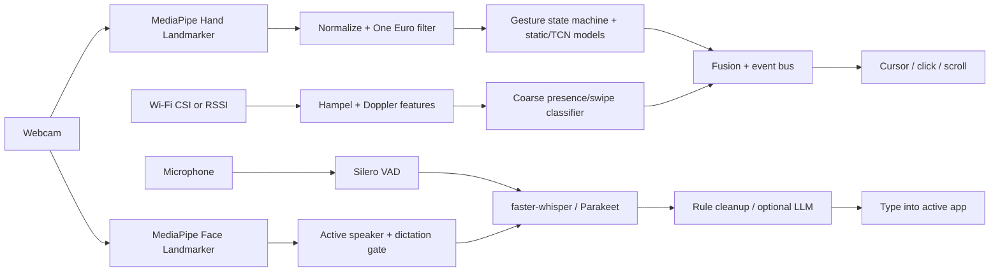

# Project Away

Hands-free PC control, free and local. Webcam hand gestures drive the cursor, push-to-talk voice typing handles text, face cues gate who is dictating, and optional Wi-Fi CSI adds coarse motion confidence.

Nothing leaves your machine unless you point the optional LLM cleanup at an endpoint yourself.

## Architecture



## Quickstart

Full per-OS instructions: [docs/INSTALL.md](docs/INSTALL.md). Wi-Fi sensing: [docs/wifi-setup.md](docs/wifi-setup.md).

```bash
pipx install ".[all]"        # Python 3.10–3.12
away setup                   # downloads models, checks camera + mic
away demo                    # synthetic end-to-end check
away run                     # or: away tray ; away autostart on
```

- **Windows:** run the `.exe` installer from Releases. It's unsigned, so choose *More info → Run anyway*.
- **macOS:** open the `.dmg`, drag to Applications, then right-click → Open. Allow Camera, Microphone, and Accessibility.
- **Linux:** use the AppImage or `.deb`. Mouse and keyboard control needs X11; Wayland is untested.

## Gestures

| Gesture | Action |
|---|---|
| Index finger move | Cursor |
| Pinch | Click |
| Double pinch | Double-click |
| Pinch and hold | Drag |
| Two fingers | Scroll |
| Open palm | Pause/clutch |
| Swipe left/right | Back/forward |

## Verified vs untested

| Area | Status |
|---|---|
| Core logic (filters, state machine, cleanup, CSI features, fusion) | 311 tests pass; ruff + mypy clean |
| Static pose model | 99.27% acc / 0.982 macro-F1 on 4,094 HaGRID v2 samples from 520 unseen people (MediaPipe-annotated, not live webcam) |
| Temporal gesture model | Synthetic only. Off by default until `away calibrate` |
| MediaPipe hands/face on real photos | Verified |
| faster-whisper + Silero VAD on synthetic speech | Verified |
| PicoScenes `.csi` parsing on sample file | Verified |
| Linux bundle, AppImage (aarch64), `.deb` | Built and launched in sandbox |
| Real webcam, mic, mouse/keyboard, tray, overlay | **Untested** |
| Windows `.exe`, macOS `.dmg` | **Built by CI, untested** |
| AX200/AX210 + PicoScenes live capture | **Untested** |
| Parakeet, LLM cleanup endpoint, Wayland | **Untested** |

## Roadmap

1. Real-hardware validation on Windows/macOS/Linux.
2. Personal calibration data → fine-tune the temporal model on real recordings.
3. Face recognition for the enrolled-user gate (currently largest face).
4. TalkNet/Light-ASD active-speaker backend.
5. Live AX210 CSI capture and a learned swipe/push-pull classifier.
6. Phone-as-second-camera / IMU fusion.

## Development

```bash
pip install -e ".[dev]"
pytest -q && ruff check . && ruff format --check . && mypy src
python scripts/mutation.py && python scripts/mutation.py --summary
```

Private project. All rights reserved by the author until a license is chosen.
