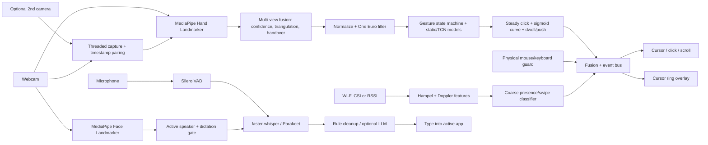

# Project Away

Hands-free PC control, free and local. Webcam hand gestures drive the cursor, push-to-talk voice typing handles text, face cues gate who is dictating, and optional Wi-Fi CSI adds coarse motion confidence.

Nothing leaves your machine unless you point the optional LLM cleanup at an endpoint yourself.

## User guide (no technical knowledge needed)

### 1. Installing

1. Download `ProjectAway-…-windows-x64-setup.exe` from the [Releases page](https://github.com/fernandogarzaaa/project-away/releases/latest).
2. Windows will warn that the app is unrecognized (it isn't code-signed yet). Click **More info → Run anyway**, then **Install**.
3. The installer then downloads the speech and tracking models, about **1.6 GB**. **This is the slow part — read this first:**
   - On a slow or unstable connection it can take **hours**, and the progress bar may **stall** at the same number for a long time. That's normal; it isn't frozen for good.
   - **If it fails, stalls for ages, or the window closes: just open Project Away again.** Each time it starts, it checks for missing models and carries on downloading **from where it stopped** — nothing already downloaded is lost. You may need to do this a few times.
   - You can also use **Start menu → Project Away: re-download models** to resume.
   - Leave the PC awake and plugged in, and avoid other big downloads while it runs.
4. When it's done, a hand icon appears in the system tray (bottom-right, by the clock — check the **^** arrow). Gestures and voice are on straight away.
5. **Have an NVIDIA graphics card?** Open **Settings → Performance → Install GPU pack** (about 570 MB, once). Voice typing gets much faster and more accurate.

### 2. Setting up your space

- **Camera:** at or just above your screen, facing you, with your hand clearly visible from about 40–80 cm away.
- **Light:** light coming from in front of you, not a bright window behind you.
- **Background:** plain is best. Busy backgrounds and other people's hands in view make tracking jumpier.
- **Two webcams (optional):** better accuracy. Add the second one in **Settings → Cameras**, then press **Calibrate** and slowly wave an open hand where both cameras can see it for about 20 seconds.

### 3. Gestures: how to project away

Hold up one hand, palm toward the screen, and point.

| Do this | What happens |
|---|---|
| **Point** with your index finger | Moves the cursor |
| **Pinch** — tap thumb and index finger together | Left-click |
| **Pinch twice** quickly | Double-click |
| **Pinch and hold**, then move | Drag (select text, move windows) — open your fingers to drop |
| **Two fingers up** (index + middle), move up or down | Scroll |
| **Four fingers up, thumb tucked in**, then move your hand up or down | **Auto-scroll**: keeps scrolling on its own, faster the further you move from where you started. Make a **fist** to stop |
| **Open palm** (thumb out too), held still for a moment | Pause / resume gestures |
| **Swipe** left or right | Left / right arrow key (previous / next slide or photo) |
| **Palm glide** — hold one hand flat, slide the other hand's index fingertip along it | Scroll, like a trackpad (two fingers slide sideways = scroll sideways) |
| **Clap once** | Turn gestures on (resume) |
| **Clap twice** quickly | Pause gestures |

**Auto-scroll, step by step:** hold up four fingers with your thumb folded across your palm (or just held
against the side of your index finger) for a moment (the cursor ring, if you turned it on, goes orange). Where
your hand is at that moment is the "middle": you do not have to move away from it first. Move your hand
a little above it to scroll up, below it to scroll down; the further away, the faster. Hold your hand still and
it keeps scrolling at that speed, so you can read a long page without moving. Moving left or right scrolls
sideways. Close your hand into a **fist** to stop (it also stops if your hand leaves the camera for more than
half a second, if you pause, or if you make another gesture). Keeping your thumb tucked in matters: with the
thumb out it is the open palm, which pauses.

**Claps:** the microphone listens for a sharp hand clap. One clap turns gestures back on; two claps within about
half a second pause them (a single clap waits that half second to make sure a second one isn't coming). Claps
are ignored while you're in the middle of saying something. If the camera can see both your hands come together
it is extra sure it was a clap. Turn it off, or make it pickier, in **Settings → Voice & input**.

**Big cursor:** while gestures are on, the Windows mouse pointer is made bigger so you can see it from across the
room. It shrinks back to your normal size whenever gestures pause, so the size also tells you whether gestures
are on. Choose the size (or 0 for off) in **Settings → Voice & input → Cursor size while gestures are active**.
On Mac and Linux the pointer itself isn't changed; the cursor ring grows instead.

**Palm-glide scroll (v0.1.14), step by step:** hold one hand up flat, palm toward the screen, fingers
together — that hand is your "trackpad". Touch the middle of that palm with the index fingertip of your other
hand and hold it there for a moment (about a sixth of a second; the cursor ring, if you turned it on, goes
cyan). Now slide the fingertip along the palm: **toward the fingers scrolls up, toward the wrist scrolls down**.
Put your **index and middle finger** on the palm together and slide **sideways** to scroll left or right. Flick
and lift, and the page keeps going for a moment and slows down, like on a phone; touch the palm again or make
any other gesture to stop it. A quick **tap** on the palm (touch and lift, without sliding) can be given an
action in **Settings → Bindings → gesture:palm_tap** (it does nothing until you do). While your fingertip is on
the palm the cursor holds still and nothing clicks, and the flat hand never pauses gestures. Speed, the dead
zone, the momentum and the rest are in **Settings → Tuning → Palm scroll**.

**Which hand is which (hand roles, v0.1.14):** Away works out by itself which hand is the *pointer* (moves the
cursor, clicks and does every one-hand gesture) and which is the *helper* (the flat "trackpad" hand). The first
hand that **points** gets the pointer (or simply the only hand in view), and it keeps it — even if the camera
mixes up left and right, or the hand disappears for up to a second. Raised your flat "trackpad" hand first?
That's fine: as soon as the other hand points, it becomes the pointer. Holding your phone in the other hand?
Pick **Settings → Voice & input → Hand roles → Right** or **Left** to use only that hand as the pointer;
**Auto** is the default. You can also say **"use left hand"**, **"use right hand"**, or **"use either hand"**
(back to Auto).

Tips for smooth control:
- **Small movements go a long way.** The cursor speeds up when you move fast and slows for precise work, so slow down near small buttons.
- **Pinch crisply** and keep your hand still while you do — the cursor locks briefly so the click lands where you aimed.
- **Rest your elbow** on the desk or armrest. Holding your arm up in the air gets tiring fast.
- Touching your real mouse or keyboard pauses gestures automatically. They come back after a second or two of not touching them.
- **F9** turns gesture control on or off at any time. The tray menu does the same.
- Several monitors? The cursor covers all of them. Say **"next monitor"**, **"previous monitor"** or **"monitor two"** to jump.
- **Your hand stays in view on its own** (auto-centering): the camera frame quietly nudges your resting hand back
  toward the middle, and a quick swing back from the edge of the camera's view doesn't drag the cursor back (like
  lifting a mouse). Lost the cursor? Say **"center"** to put it in the middle of the screen you're on.

### 4. Voice

Voice is always listening by default. Just talk, and your words are typed wherever the text cursor is.

- **Punctuation:** say "comma", "period", "question mark", "new line", "new paragraph".
- **Mistake?** Say **"scratch that"** to remove the sentence you just said.
- **Commands:** "click", "double click", "right click", "scroll up", "scroll down", "go back", "go forward", "open browser", "pause gestures", "resume gestures", "stop listening", "start listening", "use left hand", "use right hand", "use either hand", "center" (cursor to the middle of this screen), "look here" (cursor to where you're looking, after gaze calibration).
- **Shortcuts:** `Ctrl+Alt+Space` pauses/resumes listening, `Ctrl+Alt+M` mutes the mic, `Ctrl+Alt+E` lets you edit selected text by voice.
- **Tray icon colour:** green = listening, amber = not listening, red = mic off, blue = recording, grey = paused.
- **Words not being typed?** If you're looking away from the webcam, the face check may ignore you. Turn **Face gate** off in the tray menu.
- Speech is processed on your PC and never saved or uploaded.

### Shortcuts: show it once, then a gesture or a word repeats it

Something you do often, like opening your mail and starting a new message? Teach it once:

1. Open **Settings > Shortcuts** and press the big **Record a shortcut** button (or say **"record shortcut"**, or pick
   **Record a shortcut** in the tray menu).
2. Do the clicks and typing yourself, the normal way. A small red **Recording** bar shows at the top; press its **Stop**
   button when you are done (or say **"stop recording"**).
3. Give it a name, then choose what runs it: **say** a phrase ("open mail") or **make a gesture**. That's it.

To stop a shortcut while it runs, press **Esc**, move the mouse, or say **"stop"**. If a shortcut can't run (the app it
was made in isn't open, or another window is in the way), Settings > Shortcuts tells you why and shows a button that
fixes it. Shortcuts never record what you type into a password box, and a shortcut that types text stays on your PC.
**Edit steps** lets you remove or reorder steps, change pauses, add text, a key or a wait, and pick the speed.

### 5. Head and eye tracking (optional, off until you set it up)

- **Head pointer:** with your hands busy, turn your head to move the cursor and click with a wink, smile or
  eyebrow raise (turn those on in the face settings). Set `hands.cursor.head_assist: pointer`.
- **Head + hand:** `head_assist: coarse` makes the cursor jump to the part of the screen you turn toward; your
  hand does the fine aiming.
- **Eye tracking ("where am I looking?"):** Settings → Performance → **Calibrate gaze…** (or `away gaze calibrate`).
  Look at the dots on each screen until they vanish (about 2 seconds each). Afterwards Project Away knows where
  your screens are and roughly where on them you look: when you start moving your hand after resting it, the
  cursor first jumps to where you're looking, then your hand fine-tunes. Webcams are only good for "which screen
  and which area" (roughly a hand-width on the screen), not for small buttons.
- **Optional gaze model:** a learned eye-gaze network can be downloaded in Settings → Performance → Models. Its
  weights are for **research use only** (see below), so it is never installed automatically.

### 6. If something goes wrong

- **Models didn't finish downloading:** reopen the app (see Installing above). It resumes.
- **Cursor doesn't move:** check another app isn't using the camera (Zoom, Teams, the Camera app), then restart Project Away from the tray.
- **Voice is slow or lagging:** install the GPU pack (Settings → Performance, NVIDIA cards only).
- **Want to change a gesture or phrase?** Tray → **Settings…** → Bindings.
- **A camera is "too slow":** Settings → Cameras → **Test both cameras** reports any camera below 10 frames per
  second as FAILED. Project Away has already tried every format and size on it; if NVIDIA Broadcast is
  installed it can use Broadcast's camera instead (and says so). Otherwise use the other camera alone.
- **A camera never opens, but the Windows Camera app shows it:** Project Away now also tries the Camera app's
  own way of reading cameras (WinRT). Settings → Cameras → **Diagnose** shows, for every camera, which way
  works and how fast. If a camera keeps failing, Project Away stops retrying it after a while and says so; fix
  it, then press **Retry cameras** (Settings → Cameras, or the tray menu).
- **"The app crashed last time":** the details are in `crash.log` in the logs folder
  (`%LOCALAPPDATA%\ProjectAway\logs\crash.log` on Windows, next to `away.log`). Please attach it to a bug report.

## Architecture



| Module | Role |
|---|---|
| `hands/` | landmarks, One Euro filter, cursor mapping (power or sigmoid curve, per-direction speed), gesture state machine, `stabilize.py` (steady click, dwell) |
| `multicam/` | `capture.py` (enumeration, camera threads, `FramePairer`), `geometry.py` (intrinsics, pose from hands, triangulation, checkerboard), `calibration.py`, `fusion.py` (per-view confidence, best-view/weighted fusion, 3D pinch, push) |
| `face/` | face landmarker, active speaker, brow / mouth / wink triggers, optional iPhone (Live Link Face) source |
| `voice/` | always-on + push-to-talk, ASR (vocabulary as prompt + `hotwords`), cleanup, `numbers.py`, `edit.py` (edit selected text) |
| `app/` | runner (pipeline + device threads), tray, settings GUI, overlays, `autopause.py` |
| `bindings.py` / `actions.py` | trigger -> action mapping and execution |

## Quickstart

Full per-OS instructions: [docs/INSTALL.md](docs/INSTALL.md). Wi-Fi sensing: [docs/wifi-setup.md](docs/wifi-setup.md).
Experimental iPhone face tracking (free Live Link Face app over Wi-Fi): [docs/iphone.md](docs/iphone.md).

```bash
pipx install ".[all]"        # Python 3.10–3.12
away setup                   # downloads models, checks camera + mic
away demo                    # synthetic end-to-end check
away run                     # or: away tray ; away autostart on
```

**One-click installers** (Releases page) bundle every feature: tracking, dictation, tray, settings
window and on-device training (CPU PyTorch). Parakeet/NeMo is the one exception (multi-GB,
NVIDIA-oriented; use `pipx install "project-away[all,parakeet]"`). Installers are ~0.4–0.8 GB; the models
(~1.6 GB, or ~0.5 GB with Whisper `small`) download during install on Windows and on first launch elsewhere.

- **Windows:** run the `setup.exe`. It's unsigned, so choose *More info → Run anyway*, then **Install**. Models,
  start-at-sign-in, a desktop shortcut and launching the tray app are all on by default.
- **macOS:** open the `.dmg`, drag to Applications, then right-click → Open. The first launch downloads the
  models with a notification. Allow Camera, Microphone, Accessibility and Input Monitoring.
- **Linux:** run the AppImage or install the `.deb`; the first launch downloads the models. Mouse and keyboard
  control needs X11; Wayland is untested.

## Customizing controls

Every control is a **trigger → action** binding you can change without touching code: from the
**Settings** window (tray → *Settings...*, or `away settings`), from the CLI, or in `config.yaml`
(`away config path` shows where it is). A running Away reloads the file within a second of a save.

### Default bindings

| Trigger | Default action |
|---|---|
| `gesture:point` (index finger) | `mouse:move` (cursor) |
| `gesture:pinch` | `mouse:click` |
| `gesture:double_pinch` | `mouse:double_click` |
| `gesture:pinch_hold` | `mouse:drag` |
| `gesture:two_finger_scroll` | `mouse:scroll` |
| `gesture:four_finger_scroll` (thumb folded; `hands.gestures.autoscroll_enabled`) | `mouse:autoscroll` |
| `gesture:clap` / `double_clap` (microphone; `voice.clap_enabled`) | `pause:off` / `pause:on` |
| `gesture:open_palm` (hold) | `pause:toggle` (pause/resume gestures) |
| `gesture:swipe_left` / `swipe_right` | `key:left` / `key:right` |
| `gesture:palm_tap` (fingertip tapped on the helper hand's palm; `hands.palm_scroll`) | `none` (bind it to anything) |
| `face:brow_raise` (needs `face.brow_raise_toggle: true`) | `dictation:toggle` |
| `face:mouth_open` (needs `face.mouth_open_trigger: true`) | `none` |
| `face:wink_left` / `wink_right` (needs `face.wink_trigger: true`) | `mouse:click` / `mouse:right_click` |
| `gesture:dwell` (needs `hands.dwell.enabled: true`) | `mouse:click` |
| `gesture:push` (needs depth: two calibrated cameras, or `hands.multicam.push_monocular`) | `mouse:click` |
| `hotkey:ptt` (= `voice.hotkey`, Ctrl+Alt+Space) | `dictation:toggle` |
| `hotkey:mute` (= `voice.mute_hotkey`, Ctrl+Alt+M) | `mic:toggle` |
| `voice:"click"`, `"double click"`, `"right click"`, `"scroll up"`, `"scroll down"` | the matching `mouse:` action |
| `voice:"go back"` / `"go forward"` | `key:alt+left` / `key:alt+right` |
| `voice:"open browser"` | `launch:https://www.google.com` |
| `voice:"stop listening"` / `"start listening"` | `dictation:stop` / `dictation:start` |
| `voice:"command mode"` / `"dictation mode"` | `voice:command_mode` / `voice:dictation_mode` |
| `voice:"pause gestures"` / `"resume gestures"` | `pause:on` / `pause:off` |
| `voice:"next monitor"` / `"previous monitor"` | `cursor:next_monitor` / `cursor:prev_monitor` |
| `voice:"monitor one"` / `"monitor two"` / `"monitor three"` | `cursor:monitor 1` / `2` / `3` |
| `voice:"use left hand"` / `"use right hand"` / `"use either hand"` | `hands:left` / `hands:right` / `hands:auto` |
| `voice:"center"` / `"centre"` / `"center cursor"` | `cursor:center` (middle of the current monitor, re-anchors the hand) |
| `voice:"look here"` | `cursor:gaze` (jump to the gaze point; needs `away gaze calibrate`) |

**Triggers:** the gestures above plus your own (record with `away record --custom --label wave`, then
`away calibrate`), any spoken phrase (matched ignoring case and punctuation), `face:brow_raise`,
`face:mouth_open`, `face:wink_left|wink_right`, `gesture:dwell`, `gesture:push`, and any key combo
(`hotkey:ctrl+alt+k`). Two fixed hotkeys sit outside the bindings: `app.toggle_hotkey` (default F9,
gestures on/off) and `voice.edit_hotkey` (default Ctrl+Alt+E, edit the selected text by voice).

**Actions:** `none` · `mouse:click|double_click|right_click|middle_click|scroll_up|scroll_down`
(`mouse:move`, `mouse:drag`, `mouse:scroll`, `mouse:autoscroll` only on point / pinch_hold /
two_finger_scroll / four_finger_scroll) ·
`key:ctrl+tab` · `type:any text` · `launch:firefox` or `launch:https://…` (no shell) ·
`shell:command` (**off unless** `bindings.allow_shell: true`) · `dictation:toggle|start|stop` ·
`mic:toggle|on|off` · `voice:command_mode|dictation_mode|toggle_mode` · `pause:toggle|on|off` ·
`cursor:next_monitor|prev_monitor|primary_monitor|monitor N` (jump to the centre of a monitor) ·
`cursor:center` (centre of the current monitor + re-anchor; bind it to a gesture or hotkey, e.g.
`away bindings set hotkey:ctrl+alt+c cursor:center` or `away bindings set gesture:palm_tap cursor:center`) ·
`cursor:gaze` (jump to where you look) ·
`hands:auto|right|left|any` (which hand is the pointer until the app restarts).

### Multiple monitors

The cursor moves across every monitor (v0.1.6; before that it was stuck on the primary). `away monitors`
lists them, numbered 1..N **left to right** (then top to bottom), with where the list came from: Windows
`EnumDisplayMonitors`, macOS Quartz/AppKit, Linux `screeninfo` or `xrandr --listmonitors`, falling back to the
primary monitor only (with the reason) when none works. The same list is in `away hardware` and the selftest.

- **Layouts:** side by side, stacked, a monitor left of / above the primary (negative coordinates), mixed
  sizes. The cursor is always clamped onto a real monitor, never into the gap beside a smaller screen.
- **Speed:** relative-mode speed is measured against the **primary** monitor, so slow, precise moves feel
  exactly as on one screen. Only fast moves get extra reach on a bigger desktop:
  `(desktop width / primary width) ** hands.cursor.monitor_reach`. With three equal monitors and the default
  `monitor_reach: 0.5` a quick flick goes ~1.7x further, so crossing all three takes a few flicks rather than
  three times the arm sweep. `0` = no extra reach, `1` = scales fully with the desktop.
- **Jump:** say "next monitor", "previous monitor" or "monitor two" (Whisper writing "monitor 2" works too),
  or bind `cursor:next_monitor` / `cursor:monitor 3` to any gesture or hotkey. A held drag stays held, so
  "next monitor" while dragging carries a window across.
- **Which monitors:** `hands.cursor.monitors: all` (default) | `primary` | `[1, 3]`.
- **Hot-plug:** monitors are re-detected every `hands.cursor.monitor_refresh_s` (3 s; `0` = only at start),
  no restart needed.
- **Windows DPI:** the app makes itself per-monitor DPI aware at startup (before pynput/tkinter), so monitor
  rectangles and cursor positions are both physical pixels on mixed-scaling setups. `AWAY_DPI_AWARE=0` turns
  that off.

```yaml
hands:
  cursor:
    monitors: all          # all | primary | [1, 3]
    monitor_reach: 0.5     # extra reach for fast moves on a wide desktop
    monitor_refresh_s: 3   # re-detect plugged/unplugged monitors
```

### Per-app profiles

`default` holds the full map. Any other profile names the apps (process names, case-insensitive,
`.exe` optional) it applies to and overrides only the triggers it lists; everything else falls through
to `default`. `active_profile: auto` switches profile with the focused app (Linux needs `xdotool`);
`away profile use chrome` pins one. A profile can also carry its own hand and face `tuning:` (Settings →
Tuning → Save as profile..., see [The Tuning tab](#the-tuning-tab)).

### CLI

```bash
away bindings list [--profile chrome] [--json]
away bindings set gesture:swipe_left key:alt+left
away bindings set "voice:new tab" key:ctrl+t --profile chrome
away bindings reset [TRIGGER] [--profile NAME | --all]
away bindings export my-controls.yaml        # or "-" for stdout
away bindings import my-controls.yaml [--replace]   # default merges
away profile list | use NAME|auto | new NAME --apps chrome chrome.exe [--copy-from default] | remove NAME
away voice show | mode always_on|push_to_talk|toggle | wake-word away|off | intent dictation|command | sensitivity 0.6
away settings                                # GUI editor (tkinter); prints CLI help when there is no display
away update --check                          # current vs latest release (exit 0 up to date, 10 update available)
away update [--yes]                          # download, verify SHA-256, install (see "Updates")
away hardware [--json]                       # detected CPU/RAM/GPU + the performance profile and why
away gpu install | status | remove           # NVIDIA GPU pack (cuBLAS 12) for Whisper on CUDA
away iphone listen | compare [--seconds N]   # experimental iPhone face source (docs/iphone.md)
away gaze calibrate | test [--seconds N] | clear [--all] | status    # eye tracking + the screen map
away gaze model status | install l2cs|mobilegaze [--accept-license] | remove NAME   # optional gaze network
```

Invalid configs fail with every problem listed and its YAML path, e.g.
`bindings.profiles.default.gestures.pinchh: unknown gesture 'pinchh' (did you mean 'pinch'?)`.

### Tunables

Every Settings tab scrolls (scroll bar or mouse wheel over the tab); the Save / Reset / Import / Export /
Close bar and the status line below it stay visible at any window size (v0.1.10).

#### The Tuning tab

**Settings → Tuning** groups every slider by area in collapsible sections: **Cursor, Clicks, Scroll, Gestures,
Face, Head & eyes, Voice, Other** (a section with nothing in it is hidden). Each slider has a plain-language
name, a grey line saying what raising or lowering it does, its current value with units (`0.32 palm`,
`800 ms`, `2.2×`) and a **↺** button that puts just that slider back to its default (greyed out while it is at
the default). Each section has **Reset section**.

- **Presets: Precise / Balanced / Fast.** Balanced is the shipped defaults. Precise is a slower, steadier
  pointer with a tighter pinch and more smoothing; Fast is a quicker pointer, less smoothing and an easier
  pinch. The line under the buttons says which preset your values match ("custom" once you move a slider).
- **Sensitivity** (master slider): scales cursor speed, acceleration, the hold-still zone and the pinch
  thresholds together around their defaults (the middle = defaults; right = up to 2× speed, half the dead zone,
  a 25 % looser pinch; left = the opposite). `pinch_off` moves with `pinch_on`, so the click hysteresis is kept.
  It shows "mixed" once one of those sliders was moved on its own.
- **Undo** reverts the last change (a stack of 100 steps; one slider drag or one preset is one step).
- **Save as profile...** keeps your hand and face tuning (whatever differs from the defaults) in a per-app
  profile, new or existing, under `tuning:` in that profile. While that app is focused the app uses those
  values; everywhere else it uses the global ones. Voice, camera and app-wide settings stay global. Click
  **Save** to write it to the config file. YAML:

  ```yaml
  bindings:
    profiles:
      chrome:
        apps: [chrome]
        tuning: {hands.cursor.gain: 3.0, hands.gestures.pinch_on: 0.36}
  ```

- **Live view: why did a gesture (not) fire?** Start it and the tab borrows the camera from the running app
  (like the Test gesture tab; it is handed back when you stop or close the window), draws your hand skeleton
  (pointer in blue, the helper hand in grey) and shows live gauges against their thresholds (the red mark):
  **pinch distance** vs `pinch_on`, **thumb fold** vs `autoscroll_thumb_fold`, **index finger out** (fingers
  count as out above 1.1; how many of four are up) and **fingertip to palm** vs `palm_scroll.depth_threshold`
  (needs both hands). A gauge turns green when its condition is met, so you can see which part of a gesture
  was missing. Moving a slider moves the red mark at once.
- **Auto-tune a gesture** (Pinch click, Auto-scroll thumb fold, Palm scroll depth): press Start, do the
  gesture 5 times when asked (2 s each, with a countdown), then do "something else" 5 times (for the pinch:
  point and move without pinching; for the thumb: an open palm with the thumb out; for palm scroll: hover the
  fingertip just above the palm). For each try the most gesture-like moment is taken (10th percentile, so one
  bad frame does not count) and the threshold that best separates the two sets is suggested (best balanced
  accuracy, the middle of the widest gap). You see before → after and whether the two sets overlapped;
  **Apply** sets it (undoable; for the pinch, `pinch_off` moves by the same amount) and saves the 10 tries as
  labelled clips in your recordings folder (`away record` format with a shared `session_id`, labels
  `pinch_click`/`move`, `four_finger_scroll`/`palm_clutch`, `palm_scroll`/`move`) so `away calibrate` can use
  them for your personal classifier. Note that `four_finger_scroll` and `palm_scroll` become extra classes of
  the temporal model the next time you calibrate.

New tunables added to `away.config.tunable_ranges` appear in the tab automatically: an entry in
`away.app.tunables.TUNABLE_META` gives the section, title, help line and unit; without one the section comes
from the setting's name (`head`, `gaze`, `eye`, `auto_center` → Head & eyes; `hands.cursor.` → Cursor;
`voice.` → Voice...; anything else → Other).

Sliders in the Settings window, or in YAML: `hands.cursor.gain` (sensitivity), `dead_zone`,
`acceleration`, One Euro `min_cutoff` / `beta` / `d_cutoff`; `hands.gestures.pinch_on` / `pinch_off`
(pinch threshold), `scroll_gain` (scroll speed), `swipe_min_dx` + `swipe_max_time` (swipe velocity =
distance / time), `double_pinch_window`, `drag_hold`, `clutch_hold`; `voice.vad_sensitivity`,
`end_silence_ms`, `max_utterance_s`. Each is range-checked.

v0.1.9 additions:

- **Big cursor** (`hands.cursor.big_cursor_size`, 0 = off, 1-5 = 1.5x/2x/3x/4x/6x of 32 px, default 2): on
  Windows the accessibility cursor size (`HKCU\Control Panel\Cursors\CursorBaseSize`) is raised while gesture
  control is active and put back on pause, auto-pause, clutch, F9, double clap, disable and quit (at most one
  change per 300 ms so auto-pause flapping does not thrash it). Your original size is saved to
  `big_cursor.json` in the data folder first; if Away crashes while the cursor is big, the next start restores it.
- **Hand choice** (`hands.max_hands: 2`): MediaPipe looks for two hands. Two-hand detection is only run every
  few frames until a second hand actually appears, so one hand costs about the same CPU as before.
  `max_hands: 1` turns it off (and palm-glide scroll with it). v0.1.9's `hands.prefer` is replaced by
  `hands.roles` (below) in v0.1.14; an old `prefer: right|left` becomes `roles.mode: right|left` and
  `prefer: any` becomes `roles.mode: auto` automatically.
- **Auto-scroll** (`hands.gestures.autoscroll_*`): `autoscroll_enabled`, `autoscroll_hold` (0.2 s before it
  starts), `autoscroll_thumb_fold` (0.95, v0.1.16: the thumb counts as folded below this thumb-fold ratio and
  stays folded until 0.1 above it; it was a fixed 0.75, which a real hand rarely reached, so the pose read as
  the open palm and paused gestures instead; raise it if auto-scroll is still hard to start, lower it if an open
  palm starts it), `autoscroll_dead_zone` (0.15 palm lengths, was 0.25), `autoscroll_gain` (20 notches/s per palm
  length beyond the dead zone, was 12 on a power curve; speed is now proportional to the distance from the
  neutral point), `autoscroll_max_speed` (30 notches/s), `autoscroll_stop_hold` (fist, 0.2 s),
  `autoscroll_horizontal`. The neutral point is where the hand is while the pose is held (the average over the
  hold), so scrolling starts from there. Four fingers with the thumb folded always win over the open-palm pause:
  a hand whose thumb is neither clearly folded nor clearly out never toggles pause. Offsets are measured in palm
  lengths, so it feels the same near or far from the camera. `autoscroll_thumb_fold` is in Settings → Tuning.
- **Claps** (`voice.clap_*`): `clap_enabled`, `clap_sensitivity` (0.5), `clap_double_window` (0.6 s),
  `clap_require_hands` (only when the camera sees both hands close together). Detection uses the voice
  microphone: a sharp, short (under ~50 ms), broadband transient that is far louder than the moment before it.
  Two hands close together on camera lower the bar; with no camera frames it is stricter. Ignored while you are
  mid-utterance and while the mic is muted. The Settings **Test gesture** tab shows claps as well as gestures.

v0.1.14 additions:

- **Hand roles** (`hands.roles`): `mode: auto` (default; the first hand that points, or the only hand in view, is
  the pointer) `| right | left` (that real hand, MediaPipe's label corrected for the mirrored image) `| any` (the
  first hand seen, whatever its pose; config only). `release_s: 1.0`: the pointer keeps its role while it is out
  of view this long (it is released sooner when it was last seen at the image border). Hands are told apart
  frame to frame by palm-centre position and size (a minimum-cost assignment), not by MediaPipe's handedness
  label, which flips; the label is only a weak, smoothed prior (and what `right`/`left` read, with hysteresis).
  A lone hand that has only held a flat palm hands the role to the first hand that points. Only the pointer
  drives the cursor, clicks and gestures; the helper feeds palm-glide scroll. A helper that becomes the pointer
  (the other hand left) cannot pause with its open palm until it has shown another pose; when the role moves to
  the other hand, a running drag ends and the cursor re-anchors without a jump.
- **Palm-glide scroll** (`hands.palm_scroll`): `enabled: true`, `engage_s: 0.15` (fingertip on the palm this
  long before it scrolls), `depth_threshold: 0.6` (fingertip at most this far off the palm plane, in palm
  lengths; 0 = no depth check), `margin: 0.25` (palm outline padding, palm lengths), `gain: 12` (wheel notches
  per palm length of glide), `dead_zone: 0.05` (palm lengths; also the most a tap may move), `invert: false`,
  `horizontal: true` (index + middle = sideways), `momentum: true`, `friction: 4.0` (1/s; speed ×
  e^(−friction·t) after the lift). It engages when the helper is flat (four fingers out), the pointer's index
  fingertip falls inside the palm outline (wrist, thumb base, the four knuckles) and is near the palm plane. The
  glide is measured in the palm's own frame (wrist → middle knuckle = up), so a rotated or tilted palm scrolls
  the same way. With one camera, depth comes from MediaPipe's relative z and the hands' apparent sizes (both
  palms are assumed to be the same size); with two calibrated cameras the triangulated 3D points of both hands
  are used. If the helper's landmarks drop out or jump while the fingertip covers it, the last good palm is used
  for 0.3 s. The fingertip is smoothed with the One Euro filter. A tap (touch and lift within 0.25 s) fires
  `gesture:palm_tap`. While engaged, the pointer's cursor movement, clicks, four-finger auto-scroll and
  open-palm pause are suppressed.

Pointer accuracy:

- **Steady click** (`hands.cursor.click_freeze: true`): the cursor freezes while the pinch is closing
  (ratio below `pinch_on * (1 + freeze_margin)`), and the click lands where the cursor was
  `click_rewind_ms` (100) before closing began, because closing thumb and index drags the index tip.
  Drags unfreeze immediately.
- **Curve** (`hands.cursor.curve`): `sigmoid` (default) gives a slow plateau (`sigmoid_low`) for precise
  work and a fast plateau (`sigmoid_high`) with `sigmoid_mid` / `sigmoid_slope` in between. `power`
  is the original `|d|^acceleration` curve. `speed_up/down/left/right` scale each direction, for
  limited reach or an angled camera. The sigmoid idea comes from Google Project Gameface (Apache-2.0)
  and is re-implemented.
- **Dwell click** (`hands.dwell`): rest the cursor within `radius_px` for `time_s` and `gesture:dwell` fires.
- **Face clicks**: `face.wink_trigger` / `wink_threshold` / `wink_open_max` / `wink_hold`, plus
  `brow_threshold`, `mouth_threshold` and the hold times. Thresholds are per user, so tune them in Settings.
  `face.source: webcam|iphone|auto` (default `webcam`) can take the blendshapes from an iPhone's TrueDepth
  camera instead; see [docs/iphone.md](docs/iphone.md) (experimental).
- **Cursor ring** (`cursor_overlay: true` or `away run --cursor-overlay`): a small ring by the pointer
  that fills as the pinch closes, turns solid on pinch, blue while dragging, purple while dwelling,
  orange with an arrow while auto-scrolling and grey when paused.
- **Auto-pause** (`app.auto_pause: true`): touching the real mouse or keyboard pauses gesture output
  until it has been idle for `app.auto_pause_idle_ms`. Away's own synthetic input is ignored.

Dictation extras: the vocabulary file is passed to faster-whisper as `initial_prompt` and as
`hotwords` (when the installed version supports it; 1.2.1 does). The prompt holds only the vocabulary
(`Vocabulary: a, b, c.`), never the focused app: Whisper repeats its prompt on short or noisy audio, and
up to v0.1.5 that typed "Dictating into <app>." into the app. Since v0.1.6 every transcript (push-to-talk,
always-on and the edit hotkey) is filtered before it is typed: prompt echoes ("Vocabulary: ...",
"Dictating into ...") and bare lists of vocabulary terms are dropped or stripped, segments with a high
`no_speech_prob` *and* a low `avg_logprob` are discarded, and stock silence phrases ("Thank you.",
"Thanks for watching!", "Please subscribe") are dropped when the utterance is under 2 s. A phrase you bound
as a voice command is never filtered. Dropped transcripts show in the log as `dropped: <reason>`.
`voice.numbers_as_digits` turns
"twenty five" into 25 from `numbers_min_value` (10) up. `voice.edit_hotkey` works like this:
select text, press the hotkey, say an instruction ("uppercase", "replace cat with dog", "clean it up",
"make it a bullet list", or anything else when an LLM endpoint is configured), then press it again.

### Voice input modes

`voice.mode` is `always_on` (default), `push_to_talk` (hold `voice.hold_key`) or `toggle` (press
`voice.hotkey`).

Always-on listens continuously, cuts speech into utterances with an energy VAD (end-pointing after
`end_silence_ms` of silence) and decides per utterance:

- **Wake word on** (`voice.wake_word_enabled: true`, `wake_word: away`): only utterances starting with
  the wake word count ("away, scroll down"). A bare "away" opens a `wake_window` for the next utterance.
- **Wake word off:** text is typed only when the face gate agrees that you are at the screen and your
  mouth is moving (active-speaker detection), so TV or background talk is ignored. A visible face whose
  mouth moves counts even when the head is turned (off-axis webcam), and a short gap in face tracking
  while the CPU is busy is tolerated. Since v0.1.12 "mouth moving" is judged against your own resting
  mouth level (a webcam at arm's length and off-angle sees small movements), and when your enrolled face
  is at the screen and facing the camera in at least 60% of an utterance's frames it is typed even with
  weak mouth motion, unless another face is clearly the speaker. Each `voice.utterance` log line carries
  the gate's evidence (face frames, frontal fraction, speaking fraction, mouth score and threshold). After
  10 rejections in a row the tray suggests turning the gate off (tray menu **Face gate**, or Settings). With the face gate off (`face.gate_dictation: false`), speech
  is typed without a wake word. With no camera, `voice.ambient_fallback: commands_only` (default) runs
  bound phrases but types nothing.
- If speech recognition cannot keep up (e.g. a big model on the CPU), a short backlog is kept, the oldest
  utterance is dropped, and you get one notification saying so.
- `voice.intent: command` never types, it only runs voice commands. Say "command mode" /
  "dictation mode" to switch.
- "stop listening" / "start listening", the mute hotkey and the tray's **Mic on** item control it.
  The tray icon shows the state (green active, red mic off, amber not listening, blue recording, grey paused).
- Audio is kept in memory only and dropped after transcription. Nothing is written to disk.

`app.always_on: true` (default) makes gestures and voice active as soon as the app starts;
`false` starts paused and muted until you resume from the tray. `app.start_minimized: false` also opens
Settings at launch.

### Example `config.yaml`

```yaml
app:
  always_on: true
  start_minimized: true
voice:
  mode: always_on            # always_on | push_to_talk | toggle
  wake_word_enabled: false
  wake_word: away
  intent: dictation          # dictation | command
  vad_sensitivity: 0.5
  mute_hotkey: <ctrl>+<alt>+m
hands:
  cursor: {curve: sigmoid, gain: 2.2, dead_zone: 0.004, min_cutoff: 1.0, beta: 0.02, click_freeze: true}
  gestures: {pinch_on: 0.32, pinch_off: 0.45, scroll_gain: 40.0, swipe_min_dx: 0.25, swipe_max_time: 0.45}
bindings:
  active_profile: auto
  allow_shell: false
  custom_gestures: [wave]
  profiles:
    default:
      gestures:
        swipe_left: key:alt+left
        swipe_right: key:alt+right
        wave: launch:https://calendar.google.com
      voice:
        "screenshot": key:cmd+shift+s
      hotkeys:
        ctrl+alt+d: type:Best regards,
    chrome:
      apps: [chrome, chrome.exe, Google Chrome]
      gestures:
        two_finger_scroll: key:ctrl+tab
      voice:
        "new tab": key:ctrl+t
        "close tab": key:ctrl+w
    code:
      apps: [code, Code.exe]
      gestures:
        open_palm: key:ctrl+shift+p   # open palm no longer pauses in VS Code
```

## Multi-camera

A laptop webcam and an external camera can work together. A hand that one camera sees edge-on, or
that is occluded, is usually clear in the other.

```bash
away cameras list                 # device names (V4L2 / Windows DirectShow / macOS) without opening them
away cameras use "HD User Facing" # single-camera mode: pick the camera by name
away cameras add 2                # index, /dev/video2, or part of the name ("brio"); saved by name
away cameras test                 # can all configured cameras stream at the same time? (~10 s)
away cameras test --save          # ...and save the combination that works (e.g. secondary at 320x240 MJPG)
away cameras diagnose [NAME]      # every camera x every backend: native formats, does each mode open, fps
away calibrate-cameras            # wave an open hand through both views for ~20 s
away calibrate-cameras --method checkerboard --checkerboard 9x6 --square-mm 25   # accurate option
away calibrate-cameras --print-board board.png --checkerboard 9x6                # printable board
```

The same is available in **Settings → Cameras** (device pickers, roles, calibrate button, live
per-camera confidence). *Calibrate* runs `calibrate-cameras` as a separate process (in the installed
Windows app that is `ProjectAway.exe calibrate-cameras`, not `python -m away`), borrows the cameras from
the running app, shows progress in the status line and ends with "calibrated, reprojection error X px" or
the error. Its full output is saved as `calibration.log` next to `calibration-status.json` in the data folder.

**Two cameras at the same time (v0.1.15).** The app, Settings' *Live confidence* and *Test both cameras*,
`away calibrate-cameras` and `away cameras test` now all open the cameras the same way: the primary first,
then each other camera once the primary has delivered its first frame (at most 8 s later), one after another
on Windows, with the same fallbacks (MJPG/YUY2/NV12, the device default, and for a secondary 320x240 and
320x240 @ 15 fps, then the NVIDIA Broadcast camera if `hands.virtual_fallback`). *Live confidence* shows each
camera's state in the Confidence column (`opening…`, the confidence, `no frames`, or a short error) and the
mode that worked in the status line. *Calibrate* and *Live confidence* never run together: Calibrate stops the
live view and waits until its cameras are released, and keeps them borrowed from the app across the hand-over.
If the secondary still fails, calibration retries it once at 320x240 MJPG after the primary is open. A camera
that only works in a fallback mode is remembered by name (`camera-modes.json` in the data folder) and opened
in that mode right away at the next start. *Test both cameras* / `away cameras test` streams every camera for
~10 s and reports backend, mode, measured fps, frames and errors; if they do not all stream at the configured
size it tries the secondary at 320x240 MJPG @ 15 and offers to save what works. While the app is still
probing a slow camera it now says it holds the cameras and lets go as soon as Settings or calibration asks.

**Slow cameras, honest verdicts and the NVIDIA Broadcast fallback (v0.1.16).** On the reported laptop the
built-in camera "worked" at 1.0 fps (10 frames in 10 s, the same at 320x240, so not USB bandwidth) and the test
still said both cameras stream together. Now:

- `hands.min_camera_fps` (default **10**): a camera measured below it is **FAILED (too slow: X fps)**, never
  "ok", in `away cameras test` / *Test both cameras*, in *Live confidence* and in `away.log` (each camera's
  measured rate is logged once it has streamed 5 s). Calibration measures every camera first and refuses with a
  clear message when one is too slow (instead of "no secondary camera could be calibrated").
- Every mode tried is measured for ~1.5 s (not just one frame), and the fastest wins: a mode at or above the
  minimum is used at once; otherwise every FOURCC (MJPG, YUY2, NV12, the driver's format) is tried with
  `CAP_PROP_FPS` set, on DirectShow and then on Media Foundation (at its own index), at the configured size,
  640x480 and 320x240 (at most ~60 s, once). Each attempt is one line in `away.log`: backend, the FOURCC, size
  and fps the driver reports back, exposure / auto-exposure (logged only; auto-exposure is never changed) and
  the measured fps. The best mode is remembered per camera name in `camera-modes.json` with its measured rate;
  a camera that stayed too slow is checked in that one mode at the next start instead of being searched again.
- If a camera stays below the minimum in every mode and a free `Camera (NVIDIA Broadcast)` is listed, it is
  used instead when `hands.virtual_fallback: true` (default), but only if Broadcast itself reaches the minimum.
  The slow camera is closed first and not kept open (Broadcast usually shows that same camera). The test,
  *Live confidence* and the log say "using Camera (NVIDIA Broadcast) instead (HD User Facing is too slow ...)";
  `away cameras test --save` / *Save* writes Broadcast's camera into `hands.cameras`. With
  `virtual_fallback: false` the test only offers it.

**WinRT MediaCapture backend, diagnose, retries that back off (v0.1.19).** On the reported Acer the built-in
camera ("HD User Facing") never opens through OpenCV's DirectShow or Media Foundation (a fast "did not open",
even when it is the only camera), while the Windows Camera app shows it smoothly. The Camera app uses WinRT
`MediaCapture` through the Windows Camera Frame Server, so Project Away can now too:

- **WinRT backend** (`away.multicam.winrt_capture`, Windows only, pywinrt packages: the `[winrt]` extra, part of
  `[all]` and bundled in the Windows installer). The camera is found by its name among WinRT's source groups;
  `MediaCapture` is opened with exclusive control (so the format can be chosen), else shared read-only (the
  current format, when another app controls it). The native format closest to the configured one is used:
  30 fps first, then the smallest size that covers the configured one, up to 1280x720, downscaled to fit the
  configured size (aspect ratio kept). Frames come from a `MediaFrameReader` as BGRA8 and are converted to BGR
  on the capture's own thread / asyncio loop; the rest of the app reads them like an OpenCV camera.
- **Order** (`hands.camera_backend: auto`, the default): DirectShow → Media Foundation → **WinRT** (when both
  failed or stayed below `hands.min_camera_fps`) → the slow-camera sweep → the NVIDIA Broadcast fallback. A
  camera WinRT opened is remembered in `camera-modes.json` as backend `WinRT` with its native format and opened
  that way first next time. `dshow`, `msmf` or `winrt` use that backend alone (virtual cameras such as NVIDIA
  Broadcast always use DirectShow). Settings → Cameras → *Capture backend* sets it. `away.log` names the format,
  sharing mode and output size WinRT used.
- **HD sweep**: the slow-camera sweep now also tries 1280x720 (MJPG and the driver's format) last; HD frames are
  downscaled to the configured size.
- **Honest MJPG**: the FOURCC is set before the size, read back, set once more after the size when the driver
  reports another one, and a camera that ignores it is logged as such ("asked for MJPG but the driver reports
  YUY2") instead of being described as MJPG.
- **`away cameras diagnose [NAME] [--seconds 1]`** and Settings → Cameras → **Diagnose**: for each camera and each
  backend (DirectShow, Media Foundation, WinRT; elsewhere OpenCV's default) the native formats where the backend
  can list them (WinRT can; OpenCV cannot list DirectShow / Media Foundation formats, so common modes are tried:
  the configured size in MJPG, YUY2, NV12 and the driver's format, 1280x720 and 320x240), whether each opens, and
  the measured fps or the error. The cameras are borrowed from the running app first. The test and diagnose
  output in Settings is now a scrollable, word-wrapped text box (long lines were cut off).
- **Retries back off and stop.** v0.1.17 re-probed a dead camera every 45 s forever (306 times in a day). Now the
  failed cameras are re-probed after `hands.camera_retry_s` (45 s), then 90, 180, 360, 720 s, capped at
  `hands.camera_retry_max_s` (900 s = 15 min), and after `hands.camera_retry_limit` (8) failures in a row the app
  stops, says so once (tray notification, a red line in Settings → Cameras) and waits for **Retry cameras**
  (tray menu, or Settings → Cameras). `camera_retry_limit: 0` never stops. The same back-off applies when no
  camera works at all. A re-probe never reopens the camera that is tracking (it is an error instead, if the
  failed camera's name now resolves to it), and a camera already measured too slow in this session is checked in
  its remembered mode only, not swept again.
- **Settings → Cameras**: the Device picker shows the current camera (it was blank until a row was selected), the
  only camera is selected for editing and its Role defaults to primary.

**Crash capture (v0.1.16).** The tray app, the Settings window, the CLI and the installed exe all write
`crash.log` in the logs folder next to `away.log` (`%LOCALAPPDATA%\ProjectAway\logs\crash.log` on Windows;
`data_dir()/logs` elsewhere): a timestamped line when each process starts, a dump of every thread on a fatal
error (Python `faulthandler`), and any uncaught exception (main thread or worker thread, also in `away.log`).
At the next start a crash found there is logged and shown in the tray tooltip and a notification, and in the
Settings status line: "the app crashed last time; details in crash.log". The camera hand-over was hardened at the
same time: the app now acknowledges a hand-over only once none of its cameras is open or still opening (an open
in progress gives up), the camera test waits for that confirmation before it opens anything, reading the hand-over files
retries through Windows' brief sharing violations (one could make Settings think the app held no camera), and no
worker thread touches Tk any more (Settings and the cursor overlay marshal every update to the Tk thread).
In YAML:

```yaml
hands:
  cameras:                       # empty (default) = single-camera mode, unchanged
    - {device: 0, role: primary, width: 640, height: 480, fps: 30, hfov_deg: 70}
    - {device: "Logitech BRIO", role: secondary, width: 1280, height: 720, fps: 30, hfov_deg: 78}
  multicam:
    fusion: weighted             # weighted | best_view
    pair_tolerance_ms: 40
    dropout_ms: 300
    handover_decay_s: 1.0
    use_3d_pinch: true
    push_distance_m: 0.06
    push_time_s: 0.35
```

**Cameras are chosen by name (v0.1.11).** Settings and `away cameras use/add` save the camera's name
(`hands.camera_index: "HD User Facing"`, or `device:` in `hands.cameras`) plus its current index as a hint
(`camera_hint` / `index_hint`). The name is resolved to the camera's current index at every open, including
retries, so a hot-plugged camera can never take its place; two cameras with the same name are told apart by
their Windows DevicePath or `NAME #2`. Plain integer indices still work. On Windows the list is DirectShow's
own (`ICreateDevEnum`, the order `cv2.CAP_DSHOW` uses; WMI/PnP only as a logged fallback) and every camera,
single or multi, is opened with DirectShow (Media Foundation only as a logged fallback). **Virtual cameras**
(NVIDIA Broadcast, OBS Virtual Camera, Iriun, DroidCam, Camo, Snap Camera, ManyCam, XSplit...) are marked
`(virtual)` and never picked automatically: an old integer index that now lands on one (NVIDIA Broadcast is
often DirectShow camera 0) is moved to the first real camera, with a line in `away.log`. Choose one by name
to use it anyway. The camera list (source, index, name, virtual) is logged at start-up and when it changes.

**Pixel format and busy cameras (v0.1.12).** Every camera is opened in MJPG (`hands.camera_fourcc` for a
single camera, `fourcc:` per entry in `hands.cameras`; `""` = let the driver choose, which is usually
uncompressed YUY2) and counts as open only once a frame arrives; a camera that sends nothing in MJPG is
retried in its default format. A second camera that will not stream while another one is open is retried
at 320x240, then 320x240 at 15 fps (two USB 2.0 webcams can exceed the bus); the mode that worked is logged
and reused for the rest of the session. Errors now say whether a camera *did not open* or *opened but sent
no frames*. **Media Foundation (v0.1.13):** when DirectShow cannot use a camera, it is opened with Media
Foundation at the index *Media Foundation's own list* gives it (matched by device path, else by name);
v0.1.12 and older reused the DirectShow index, but Media Foundation numbers cameras differently (it does
not list DirectShow-only virtual cameras such as NVIDIA Broadcast), so the fallback hit the wrong camera.
DirectShow is tried in MJPG, YUY2 and NV12 at the configured size, without a format, and with nothing
forced; every attempt is logged. **NVIDIA Broadcast:** when a physical camera still cannot be opened and
`Camera (NVIDIA Broadcast)` is listed, the log and a notification say "<camera> could not be opened directly;
NVIDIA Broadcast's camera shows the same picture." With `hands.virtual_fallback: true` (default) Project
Away then opens the one free Broadcast camera instead and logs it.
Choosing `Camera (NVIDIA Broadcast)` by name works for the single camera and in a multi-camera set.

How it works:

1. **Capture.** Each camera runs in its own thread and stamps frames on arrival. The primary camera
   sets the pace. Each secondary contributes the frame nearest in time, if it falls within
   `pair_tolerance_ms`. A camera that stays silent for `dropout_ms` is treated as dropped and the
   others carry on.
2. **Per-view confidence.** Each view is scored on the MediaPipe handedness score, the share of
   landmarks inside the image, hand size in pixels, and sharpness (Laplacian variance of the hand
   crop, which drops with motion blur).
3. **Fusion.**
   - **Uncalibrated:** `best_view` takes the most confident view. `weighted` averages the views by
     confidence after mapping secondaries into the primary image with an alignment learned while both
     cameras see the hand.
   - **Calibrated**, with both cameras seeing the hand: the 21 landmarks are triangulated
     (`cv2.triangulatePoints`). Reprojecting them into the primary view drives the cursor, and the
     3D points give true depth.
4. **Depth uses.**
   - **`gesture:push`:** the hand moves `push_distance_m` toward the screen within `push_time_s`.
     The primary camera is assumed to sit at the screen. The gesture is bindable and clicks by default.
   - **3D pinch:** the pinch ratio comes from 3D distances, so a thumb and index that only overlap from
     one angle no longer click.
5. **Occlusion handover.** When one view loses the hand, tracking continues from the other. The jump
   between estimates is absorbed by an offset that fades over `handover_decay_s`, so the One Euro
   filter sees a continuous signal and the cursor does not jump.

**Calibration.** The hand-motion path pairs MediaPipe landmarks across views and runs
`cv2.findFundamentalMat` (RANSAC, then a least-squares refit on the inliers) → `E = K2ᵀ F K1` →
`cv2.recoverPose`. Intrinsics are approximated from `hfov_deg`, and the translation is scaled so the
median palm (wrist to middle knuckle) is `palm_length_m` (9 cm). Depth is therefore approximately
metric; real palms vary by about 10–15%. The checkerboard path runs `calibrateCamera` per camera, then
`stereoCalibrate` with the real square size. Either way the extrinsics go to
`<data dir>/camera_extrinsics.json` and the reprojection error is printed.

Each view runs its own MediaPipe instance in sequence, so two cameras cost about twice the CPU of one.

A camera that cannot be opened or sends no frames is skipped with a notification and tracking continues
on the one that works, so a wrong or busy secondary camera never stops hand tracking.

**Two webcams on Windows (v0.1.8):** at start-up each camera gets up to 12 s to send its first frame
(Windows can take several seconds to open a USB webcam), and on Windows the cameras open one after
another. A camera only counts as failed when it reports an error or stays silent past that deadline, and
the notification names just that camera and why ("open error: ..." or "no frames within 12 s"). After
falling back to one camera, the missing one is re-checked in the background every 45 s (backing off to
10 min if it keeps failing) without interrupting tracking; when it works again fusion switches back on
and you get one "cameras back" notification. If no camera works at all, nothing claims to be tracking:
the app says so once and keeps retrying. The Cameras tab's device list now always shows the cameras the
app is holding and the configured ones, even when Windows' device query fails.

**Sharing the camera with Settings (v0.1.6):** webcams are exclusive on Windows, so while the app tracks
your hand, Settings' *Test gesture*, *Live confidence* and *Calibrate* (and `away calibrate-cameras`) ask
the running app to hand the cameras over: it pauses tracking, releases them, and takes them back when
the test ends or the window closes (a small heartbeat file in the data folder; a crashed Settings window
releases its claim within 5 s). The Cameras tab lists the default camera in single-camera mode and marks
the one the app is using. If a camera still cannot be opened, you are told it is in use by Project Away
or another app instead of a bare "permission denied".

## Auto-centering, head tracking and eye tracking (v0.1.19)

All of it reuses what already runs: the hand landmarks and the Face Landmarker (whose facial transformation
matrix and iris points are now read too). No new model is needed; the optional gaze network is an opt-in
download. Everything is pure logic with unit tests (`tests/test_autocenter.py`, `test_headpose.py`,
`test_gaze.py`, `test_gaze_models.py`, `test_headgaze.py`).

**Auto-centering** (`hands.cursor.autocenter.*`, on by default):

- *Soft recenter* (relative mode): strokes away from the target get up to `soft_strength` (12 %) more gain at the
  frame edge, strokes back the same less, so over many out-and-back strokes the resting hand drifts toward the
  middle of the camera frame. The cursor never jumps.
- *Comfort zone*: an EMA (`comfort_tau_s`) of where the hand rests (slower than `rest_speed`). Absolute mode
  centres its active region there, applied only when the hand re-anchors so a resting hand never drifts the
  cursor; `target: comfort` makes it the soft-recenter target in relative mode too.
- *Edge re-anchor*: in the `edge_margin` band of the frame, a swing back faster than `edge_return_speed` is a
  "lift": the cursor stays put and re-anchors when the hand slows down or is back in the inner frame.
- *Center*: voice "center", or `cursor:center` on any gesture/hotkey.

**Head tracking** (`hands.cursor.head_assist: off|coarse|pointer`, `hands.cursor.head.*`, off by default):
yaw/pitch/roll from the facial transformation matrix (One Euro filtered; the sign is aligned with the on-screen
nose movement so a mirrored camera cannot invert it). `pointer`: head-turn deltas move the cursor while no hand
points (Gameface-style; click with the existing wink/smile/brow/mouth triggers). `coarse`: the head picks one
of `coarse_cols` x `coarse_rows` zones per monitor (hysteresis `coarse_hysteresis`, dwell `coarse_dwell_s`) and
the cursor jumps there; the hand refines. `monitor_switch: true` (needs the screen map): a head turn held
`switch_dwell_s` and `switch_margin` degrees closer to another monitor moves the cursor there; glances do not.
The speech gate also uses the head pose: a face turned toward the screens (the calibrated pose range, or the
user's usual pose within `gate_tolerance` degrees) counts as facing them even when an off-axis webcam sees it
turned.

**Eye tracking and the screen map** (`gaze.*`; nothing acts until `away gaze calibrate` ran for the current
camera and monitor layout): features are the iris centres (Face Landmarker points 468-477) relative to the eye
corners, eyelid opening, head yaw/pitch/roll and face position/size, plus the optional network's yaw/pitch.
Calibration shows `points_per_monitor` (9) dots on every selected monitor and fits a ridge regression with
quadratic terms (`ridge_alpha`) to virtual-desktop pixels, stored per camera name in
`gaze-calibration.json` in the config folder, with its leave-one-dot-out error. **The screen map is the
calibration**: it knows which monitor and roughly where. Expect about 2-4 degrees with a webcam (a few hundred
pixels at arm's length), so it is for "which screen / which area", never for small targets.

- *Look-to-jump* (MAGIC pointing, `look_to_jump`): when the hand starts moving after resting `jump_idle_s`
  (0.6 s) and the gaze point is more than `jump_min_px` away, the cursor warps there first, then the hand
  refines. `jump_across_monitors_only: true` limits it to looking at another monitor.
- *Drift correction* (`drift_correction`): every click nudges the model's offset by `drift_rate` toward the
  click (you look where you click), bounded by `drift_max_px` and ignored beyond `drift_max_err_px`; the offset
  is saved with the calibration when the app exits.
- The app reloads the calibration file by itself (Settings runs `away gaze calibrate` in its own process); a
  changed monitor layout disables it until you recalibrate.

**Optional learned gaze model** (`gaze.model: auto|iris|l2cs|mobilegaze`; `auto` = `l2cs` when downloaded and
onnxruntime offers a GPU provider, else `mobilegaze` when downloaded, else `iris`): an L2CS-Net-style network
(90-bin yaw/pitch classifier, 448x448 face crop) from github.com/yakhyo/gaze-estimation, run with onnxruntime on
the Face Landmarker's face box at most `gaze.model_rate_hz` (10) times a second, CUDA first when available. Its
yaw/pitch become two extra features of the same calibration, so recalibrate after installing one; the running
app picks a newly downloaded model up without a restart.

| Model | File | Size | Measured cost per run |
|---|---|---|---|
| `l2cs` | ResNet-18 (`resnet18_gaze.onnx`) | 45 MB | ~117 ms on 2 CPU cores (ARM Neoverse-V2); GPU untested |
| `mobilegaze` | MobileOne-S0 (`mobileone_s0_gaze.onnx`) | 5 MB | ~21 ms on 2 CPU cores |

**License notice:** the code is MIT, but both networks were trained on the
[Gaze360](https://github.com/erkil1452/gaze360/blob/master/LICENSE.md) dataset, whose license is **research use
only** and excludes models trained on it from commercial applications. They are therefore an explicit opt-in
(`away gaze model install NAME --accept-license`, or the confirm dialog in Settings → Performance → Models),
downloaded from the author's GitHub release with a pinned SHA-256 (resumable, through the same downloader as
Whisper), and **never bundled in the installers**. Setup only mentions them.

```yaml
hands:
  cursor:
    autocenter: {enabled: true, soft_recenter: true, soft_strength: 0.12, target: frame,
                 comfort_zone: true, comfort_tau_s: 20, edge_reanchor: true, edge_margin: 0.08}
    head_assist: "off"          # off | coarse | pointer
    head: {monitor_switch: false, switch_dwell_s: 0.6, switch_margin: 4, gate_tolerance: 25}
gaze:
  enabled: true                 # still needs `away gaze calibrate`
  model: auto                   # auto | iris | l2cs | mobilegaze
  look_to_jump: true
  jump_idle_s: 0.6
  jump_min_px: 250
  jump_across_monitors_only: false
  drift_correction: true
```

## Hardware auto-tuning and GPU

`away hardware` shows the detected CPU, RAM, disk and GPU (NVIDIA via NVML / `nvidia-smi`, others via
WMI or `lspci`, Apple Silicon) and the profile picked from them: Whisper model, CPU or CUDA, compute type,
threads, beam size, camera resolution/fps and face-tracking frame skipping, each with the reason. Explicit
settings (`performance.mode: auto|cpu|gpu`, `voice.device`, `voice.asr_model`, `performance.*`) win.

NVIDIA GPUs: the one-click installers ship CPU-only; setup (or *Settings > Performance*, or
`away gpu install`) downloads the **GPU pack**, the cuBLAS 12 libraries from NVIDIA's official PyPI wheel
(~570 MB, SHA-256 verified). That is the only CUDA library CTranslate2 4.8 loads. pip installs:
`pip install nvidia-cublas-cu12==12.8.4.1`. If CUDA fails (at startup or later), dictation falls back to
the CPU **with the CPU-sized model** from the profile (not large-v3-turbo, which cannot keep up on most
CPUs) and says why; the tray offers *Install GPU pack* (one notification, then a menu item). A
`voice.asr_model: large-v3-turbo` written by v0.1.4's setup is migrated to `auto` (configs now carry
`config_version: 2`; a model you pick from now on is kept). Details: [docs/INSTALL.md](docs/INSTALL.md#hardware-auto-tuning-and-the-nvidia-gpu).

## Updates

The installed app checks GitHub Releases when the tray starts and every 24 hours. When a new version is out
you get a notification and an **Update to vX.Y.Z** tray item; clicking it downloads the installer for your
system, checks its SHA-256 (from the GitHub API `digest`, or the release's `SHA256SUMS.txt`; an unverifiable
file is refused), installs it and restarts the app. Windows runs the Inno Setup installer silently; macOS
swaps the `.app` from the `.dmg` after the app quits; an AppImage is replaced in place; a `.deb` is installed
with `pkexec apt install` only after you confirm. pip/pipx installs are never touched: run
`pipx upgrade project-away`.

```yaml
updates:
  check: true          # false = never contact GitHub
  auto_install: false  # true = install silently when gestures are paused or idle (never for .deb)
  channel: stable      # beta = also offer pre-releases
```

The only network request is an anonymous `GET` to the public GitHub Releases API; nothing about you is sent.
Same options under **Settings → Voice & input**; from a terminal: `away update --check` / `away update --yes`.
The tray also has **Check for updates**, which always tells you the result; a check that fails (offline
at sign-in) is retried after 30 minutes instead of the next day.

**Windows updates (v0.1.10):** the installer is downloaded to `%LOCALAPPDATA%\ProjectAway\updates`,
verified, and started by a plain batch file next to it (`away-update.cmd`, run hidden by `cmd.exe`; no
PowerShell). It logs every step to `%LOCALAPPDATA%\ProjectAway\logs\update-helper.log`, waits until
Project Away (and the Settings window) has closed, runs the installer silently and records its exit code.
Before quitting, the app checks that the helper is really running (its first log line, or the process still
alive after 3 seconds); if not, it starts the installer directly instead. The app quits by itself (forced
after a few seconds if something hangs), the installer writes `logs\update-install.log`, and the app
restarts. On the next start you get "Project Away was updated to vX", "The update to vX is still
installing" (with the helper's last step), or "The update to vX did not install" with the reason, the
helper's last log line and the remedy: **right-click the tray icon → Run update installer**, which opens
the kept installer normally (visible, like a double-click). Every step is logged to `away.log`.

**Upgrading from v0.1.9 or older:** those copies still use the old PowerShell helper, which did not run the
installer on some Windows 11 PCs. If the tray update to v0.1.10 does not take, download
`ProjectAway-0.1.10-windows-x64-setup.exe` from the releases page and run it once by hand (quit Project
Away first). Updates after that use the new helper.

The v0.1.10 → v0.1.11 update is the first one installed by the batch helper on a real PC. If it does not
take, use **Run update installer** in the tray, or run `ProjectAway-0.1.11-windows-x64-setup.exe` by hand.

**v0.1.12 helper:** the installer's exit code decides the outcome, not just the version number: a non-zero
code (e.g. Inno Setup 5, aborted on a locked file) is reported as an incomplete update with the **Run update
installer** item, even when the version already matches. The helper force-closes `ProjectAway.exe` and its
child processes, retries a failed installer once after 5 s, clears the PyInstaller variables it inherited,
and restarts Project Away itself after the installer finishes unless the installer's own relaunch already
did (it watches for the app for up to 10 s first, so there is never a second copy).

## Shortcuts: teach by demonstration (v0.1.20)

A shortcut (``macro`` in code and config) is a recorded list of steps that any gesture, voice phrase or hotkey runs
through the normal bindings with the action **`macro:<id>`** (for example `voice: {open mail: macro:open_mail}`).
`macro_control:record | stop_recording | toggle_recording | stop` drive recording and stop a running shortcut; the
default voice phrases are "record shortcut" / "record macro", "stop recording" and "stop".

**Recording** (Settings > Shortcuts, the tray, voice, or `away shortcut record`) captures your own mouse and keyboard
with pynput, with timing:

- clicks (single/double, any button, ctrl/shift/alt/cmd held), drags with their path, wheel scrolls, typed text
  (one step per run of characters) and key presses (`enter`, `ctrl+c`, a lone Windows key);
- each click is stored at its screen position **and relative to the window it landed in**, plus the app (process),
  the window title and, on Windows, the **UI Automation name of the control** under the pointer (e.g. "Send");
- Project Away's own input is left out: every synthetic event Away sends (gesture clicks, voice commands, replays)
  is marked, and on Windows every event the OS flags as injected is dropped too; clicks on Away's own windows (Settings,
  the Recording bar) and the tray click that stops a recording are dropped;
- **every keystroke is skipped while a password box has focus** (UI Automation `IsPassword`, or a classic Edit control
  with `ES_PASSWORD`). Where that can't be checked (macOS, Linux, or Windows without UI Automation) typed characters are
  not recorded at all unless `macros.record_text_without_password_check: true`; keys like enter, tab and ctrl+c still are;
- pauses longer than `macros.max_delay_s` are shortened.

A recording started from voice or the tray is saved as "Shortcut N"; name it and pick a gesture or phrase in Settings.

**Replay** runs on a worker thread while gesture output is paused:

- a click is aimed at the recorded control found again by name (Windows UI Automation), else at the same spot
  relative to the app's window (so moving the window is fine), else at the screen position (macOS/Linux);
- it is **refused** when the app is not open, another app covers the spot, the window got too small, or (for text and
  keys) another app has focus, unless the shortcut (Edit steps > "Allow it to click and type in any app") or
  `macros.allow_other_app` allows it; text is never typed into a password box;
- **stop** any time: `macros.abort_hotkey` (Esc), real mouse movement (`macros.abort_on_mouse_move`), voice "stop",
  tray "Stop shortcut". Keys and buttons held by a step are always released;
- speed per shortcut: 1x, 2x or instant (waits you add yourself always wait their full time).

**Storage and privacy.** One JSON file per shortcut in `<data dir>/macros` (local, never the roaming config folder).
A shortcut that types text is marked `sensitive`: owner-only file permissions on macOS/Linux, a lock in the list, and
export refuses it unless you confirm ("Export anyway" / `--include-private`). The outcome of the last replay is kept in
`_last_result.json` there, so Settings can show what went wrong with a fix button.

```bash
away shortcut list                                  # alias: away macro
away shortcut record [--name "Open mail"] [--seconds 10]
away shortcut bind open_mail --say "open mail" | --gesture palm_tap [--replace]
away shortcut run open_mail [--speed 1x|2x|instant]
away shortcut show | rename | delete | unbind ID
away shortcut export FILE [ID ...] [--include-private]
away shortcut import FILE [--overwrite]
```

Config (`macros:` in config.yaml, all optional):

| Key | Default | Meaning |
|---|---|---|
| `enabled` | `true` | master switch |
| `abort_hotkey` | `esc` | a physical press stops a running shortcut (`""` = none) |
| `abort_on_mouse_move` / `abort_move_px` | `true` / `40` | moving the real mouse this far stops it |
| `allow_other_app` | `false` | replay even into another app than recorded |
| `default_speed` | `1x` | speed of new recordings (`1x`, `2x`, `instant`) |
| `max_delay_s` | `3.0` | longer recorded pauses are shortened to this |
| `min_gap_s` | `0.05` | smallest gap between steps (so apps keep up at "instant") |
| `record_away_input` | `false` | also record the clicks/keys Project Away itself produced |
| `record_text_without_password_check` | `false` | record typed text where password boxes can't be detected |
| `use_ui_automation` | `true` | Windows: remember and find controls by name |
| `store_dir` | `""` | shortcut folder (`""` = `<data dir>/macros`) |

## Verified vs untested

| Area | Status |
|---|---|
| Core logic (filters, state machine, cleanup, CSI features, fusion, bindings, dispatch, always-on voice policy, auto-centering, head and gaze logic) | 1659 tests collected on Linux (272 new in v0.1.19; on Linux without the optional extras 6 skip: torch training, faster-whisper, the real DirectShow / Media Foundation / pywinrt checks) (the Settings-window test runs under Xvfb and is skipped without a display; the real DirectShow and Media Foundation enumeration tests run only on Windows); ruff + mypy clean |
| Multi-monitor cursor | Geometry, mocked Windows enumeration, xrandr/AppKit parsing, DPI fallback chain and jump actions unit-tested; **untested on real multi-monitor / mixed-DPI hardware** |
| Camera hand-over to Settings | Protocol and the app's camera loop tested with fake frames across two "processes"; **untested with a real exclusive Windows webcam** |
| Hardware detection + tuning profiles | Unit-tested with recorded outputs (RTX 2060 6 GB, GTX 1050 2 GB, no-GPU 4-core 8 GB, Apple M1, old driver, `nvidia-smi` missing/timeout); detection run on the Linux aarch64 build sandbox |
| GPU pack | Real `nvidia-cublas-cu12` 12.8.4.1 wheels downloaded, SHA-256 verified and extracted (Windows: 568 MB download, 788 MB kept; Linux x86-64: 594 / 868 MB); the DLLs import only each other + KERNEL32 |
| Whisper on an NVIDIA GPU (CUDA) | **Untested** (no GPU in the build sandbox); CPU fallback path unit-tested |
| Download link expiry (HTTP 403 after ~1 h) | Re-resolve + mid-chunk resume tested against a local fake Hub; interrupt + resume of `large-v3-turbo` verified against the real Hub |
| Whisper hallucination filter (prompt echo, silent segments, stock phrases) | Unit-tested with fake segments and fake ASR through push-to-talk, always-on and edit; **not yet measured on real noisy recordings** |
| Multi-camera geometry | Synthetic: two virtual cameras with known extrinsics. Pose from noisy (0.5 px) hand landmarks within 1.5°, palm-scaled baseline within 10%, exact noise-free triangulation, checkerboard stereo calibration under 0.5 px |
| Multi-camera fusion | Synthetic: best-view and weighted selection, timestamp pairing and dropout, occlusion handover with no jump, push gesture, 3D pinch rejecting an edge-on false pinch, Cameras-tab model |
| Real two-camera capture, calibration and fusion | **Untested** (no cameras in the build sandbox) |
| Two-webcam start-up, fallback and retry (v0.1.8) | Real capture threads, probe, fallback, background retry and recovery tested with simulated slow/failing/silent cameras; **untested with real Windows MSMF/DirectShow webcams** |
| Windows camera enumeration and naming (v0.1.11) | DirectShow list parsing/order, virtual-camera flags, name/DevicePath/`#k` resolution across hot-plug, legacy-index remap (NVIDIA Broadcast at 0, built-in at 1, USB at 2), DirectShow-first opening with logged MSMF fallback, Settings role/gating and retry labels unit-tested with a fake enumerator and fake OpenCV; the ctypes COM enumeration runs on the Windows CI runner against the DirectShow filter category (no camera there); **untested on a real PC with cameras (the reported Acer Predator with NVIDIA Broadcast)** |
| Two cameras at once: shared start-up, Live confidence status, Calibrate/Live exclusion, `away cameras test`, kept modes (v0.1.15) | Shared sequential start-up (primary first, settle delay, one opener) used by the app, Live confidence, calibration and the camera test; per-camera status and mode; mutual exclusion and the stop-and-wait hand-over; calibration lease, low-res retry; modes kept per camera name; the app letting go while it probes; and the whole sequence (app holds both cameras → lease → Live confidence → Calibrate in a second "process" → hand back) tested with a simulated USB bus that rejects a second open of a held device and has no room for two 640x480 YUY2 streams; **untested on the real laptop (JoyCam + HD User Facing)**: whether its USB controller carries both webcams at once, and in which mode, can only be shown there (run *Test both cameras*) |
| Camera opening modes, Media Foundation index mapping and NVIDIA Broadcast fallback (v0.1.12/v0.1.13) | MJPG-before-size, frame-verified opens, MJPG/YUY2/NV12/no-FOURCC/device-default retries, Media Foundation opened at its own index (fake MF enumerator ordered differently from DirectShow; the ctypes `MFEnumDeviceSources` enumeration itself has not run on Windows), 320x240 / 15 fps fallback for a second camera with the mode kept per session, open-failed vs no-frames errors, bandwidth and Broadcast hints, the automatic Broadcast fallback and explicit Broadcast choice unit-tested with a fake OpenCV; **untested on the real Acer Predator (JoyCam + HD User Facing + NVIDIA Broadcast)** |
| Face gate leniency (v0.1.12) | Adaptive mouth threshold and the frontal-presence rule replayed against the gate numbers in the user's v0.1.11 log, plus no-face / other-speaker negatives; head-pose (frontal) estimate from the face mesh unit-tested on synthetic points; **not measured on a real webcam** |
| Windows auto-update (v0.1.10) | Batch helper text and quoting (real and odd paths), launch flags, liveness check and fallbacks, forced exit, still-installing/failed report, Run update installer item, download/verify and logging unit-tested on Linux; v0.1.12 retry/relaunch/exit-code logic checked by text tests and a small interpreter of the relaunch block; **`away-update.cmd` has not been run by a real cmd.exe, and the silent Inno upgrade is untested on a real Windows desktop** |
| Steady click, sigmoid curve, dwell, wink, auto-pause guard, cursor ring states, numbers to digits, edit-selection rules | Logic unit-tested with synthetic input |
| Settings window layout (v0.1.10) | DPI awareness before Tk, `tk scaling` from the real DPI, 10 pt fonts, button padding, scrollable tabs with a pinned bottom bar and a separate wrapped status row; size/scale/wheel/status helpers unit-tested, window rendered and wheel-scrolled under Xvfb at 96 and 144 dpi on a 1366x768 screen; **untested on a real Windows desktop at 125 %/150 % and across mixed-DPI monitors** (Tk 8.6 does not rescale when the window moves to a monitor with a different DPI) |
| Big cursor (v0.1.9) | Controller, crash marker, debounce and pause wiring unit-tested with a fake backend; **the Windows registry + `SystemParametersInfo` resize is untested on a real Windows desktop** |
| Hand choice (v0.1.9) | Selection, mirroring and two-hand probing unit-tested with fake landmarkers; the handedness convention was checked on real photos (raw vs flipped) with MediaPipe 0.10.18; **untested with a live webcam and two real hands** |
| Hand roles (v0.1.14) | Track identity by position and size, stickiness, label flips (both hands, every frame), hands with the same label, release after loss and at the frame border, promotion of the helper, the flat-hand-first handover, right/left hysteresis, mode changes, voice commands and the `hands.prefer` migration unit-tested with synthetic hands and fake landmarkers; **untested with a live webcam and two real hands** (MediaPipe's real two-hand tracking, hands overlapping); with two cameras each camera assigns roles on its own (not cross-checked between views) |
| Palm-glide scroll (v0.1.14) | Engage/disengage geometry on upright, rolled, sideways, upside-down, tilted and turned palms, local-frame direction, horizontal two-finger scroll, gain and dead zone, momentum decay and its interruption, tap timing, occlusion hold and jump rejection, the 3D path, and suppression of cursor/clicks/clutch/auto-scroll unit-tested with synthetic hands projected through a pinhole; Settings fields checked headless and the window rendered under Xvfb; **untested on real hardware**: MediaPipe's z on a fingertip touching the other hand, landmark quality while one hand covers the other, and the feel of the default depth threshold, gain and friction are not measured |
| Four-finger auto-scroll (v0.1.9; v0.1.16 threshold, neutral point, proportional speed) | State machine, the configurable thumb-fold threshold with hysteresis, four-fingers-beat-the-clutch, the neutral point (mean of the hold) and the proportional speed unit-tested with synthetic hands; the thumb-fold measure checked on 11 real photos (folded 0.2-0.4, open palm 1.3-1.5); **the new 0.95 default is a judgment call, untested on the user's real hand** (only a live try shows whether it now triggers reliably without catching open palms) |
| WinRT MediaCapture backend (v0.1.19) | Native-format choice (30 fps first, covering size up to 1280x720, FOURCC ranking), BGRA→BGR conversion, downscaling, exclusive → shared read-only fallback, set-format failure, reader start failure, open/read timeouts, the open chain order (DirectShow → Media Foundation → WinRT → sweep → NVIDIA Broadcast), single-backend settings, remembering the WinRT native mode and `away cameras diagnose` unit-tested against a fake WinRT API and fake OpenCV; on the Windows CI runner the real pywinrt packages import and the real asyncio plumbing runs against WinRT with no camera attached; **untested on real hardware**: whether WinRT really opens the Acer's "HD User Facing" (and at what rate), the real frame conversion path (`SoftwareBitmap` → BGRA8 buffer), exclusive vs shared behaviour while NVIDIA Broadcast holds the camera, and the frozen installer's WinRT bundle on a real PC |
| Camera retry back-off, stop and Retry cameras; honest MJPG read-back; Settings camera fixes (v0.1.19) | Back-off schedule, stop after the limit with one notice, Retry cameras from the tray and from Settings (request file), the no-camera back-off, never reopening a held camera during a probe, the FOURCC set/read-back order and the "driver ignores MJPG" log tested with fakes; the Settings Cameras tab (Device picker filled, Role primary, wrapped output, Diagnose / Retry cameras) rendered under Xvfb; **untested on the real laptop** (whether JoyCam takes MJPG after the second set, and the tray item on a real Windows desktop) |
| Slow-camera handling, `hands.min_camera_fps`, NVIDIA Broadcast fallback (v0.1.16) | Per-mode fps measurement, the fastest-mode choice, the DirectShow → Media Foundation sweep (a fake 1-fps camera that reaches 30 fps only in MJPG on Media Foundation), remembered modes, an always-slow camera replaced by Broadcast (closed first; Broadcast must reach the minimum), the FAILED verdicts in the test / Live confidence / log, saving Broadcast, and calibration refusing a slow camera unit-tested with a fake OpenCV on a fake clock; **untested on the real laptop**: why HD User Facing runs at 1 fps (driver, low-light exposure, Broadcast holding it) and whether any mode or Broadcast fixes it can only be shown there (`away.log` now lists every attempt) |
| Crash capture (v0.1.16) | `faulthandler` set-up, the uncaught-exception hooks, the next-start report (once, and shared with Settings), rotation and the C++-exception noise filter unit-tested with simulated crashes; the hand-over wait and the Tk-thread queue unit-tested; **not yet exercised by a real native crash**, and the cause of the first-run Test crash is not proven (crash.log will show it if it happens again) |
| Clap control (v0.1.9) | Detector tested on synthetic claps vs vowels, plosives, beeps and noise, plus timing and dictation gating; **untested with a real microphone and room** |
| faster-whisper `hotwords` | Parameter verified on the installed faster-whisper 1.2.1 by signature; **not run on real speech** |
| Cursor ring window, pynput auto-pause listeners, F9 / edit hotkeys, clipboard edit flow | **Untested** on real desktops |
| Static pose model | 99.27% acc / 0.982 macro-F1 on 4,094 HaGRID v2 samples from 520 unseen people (MediaPipe-annotated, not live webcam) |
| Temporal gesture model | Synthetic only. Off by default, and stays off after `away calibrate` (v0.1.17): enable `hands.gestures.use_model` yourself once its holdout metrics look right and it works on your real gestures |
| MediaPipe hands/face on real photos | Verified |
| faster-whisper + Silero VAD on synthetic speech | Verified |
| PicoScenes `.csi` parsing on sample file | Verified |
| Linux bundle, AppImage (aarch64), `.deb` | Earlier lean bundle (without torch) built and launched in the sandbox; the full bundle is CI-verified on tag only |
| Settings window (tkinter) | Model logic unit-tested; window smoke-tested under Xvfb (Linux) only |
| Always-on voice | End-pointing, wake word and face-gate policy tested with synthetic audio; **untested with a real mic/ASR** |
| Per-app profile detection (active window process) | **Untested** on real desktops (Windows API / osascript / xdotool) |
| Real webcam, mic, mouse/keyboard, global hotkeys, tray, overlay | **Untested** |
| Installer one-click flow (non-interactive `setup --yes` with no stdin, windowed-exe streams, first-launch download, Inno options) | Logic unit-tested (`tests/test_installer.py`) |
| Frozen bundle with every feature (`away selftest`: torch, onnx, onnxruntime, MediaPipe, OpenCV, faster-whisper + Silero VAD, PortAudio, tkinter, pynput, pystray) | All 13 checks pass in the dev venv (Linux aarch64). The frozen build with the new bundle was **not completed in the sandbox** (too slow on its filesystem). Windows/macOS/Linux x86_64: **CI-verified on tag only** (the release workflow fails if any check fails) |
| Windows `.exe` installer, macOS `.dmg` | **CI-built and smoke-tested on tag only; untested on real hardware** |
| Auto-update (`away update`, tray item) | Version compare, asset choice, SHA-256 verify, command lines and AppImage replace unit-tested with no network (`tests/test_updater.py`); real installs on each OS **untested** |
| Auto-centering (v0.1.19) | Soft-recenter gain and its closed-trip drift, comfort-zone EMA, region shift, edge clutch on every edge, mapper integration (relative and absolute) and `cursor:center` unit-tested with synthetic hand paths; **untested with a live webcam**: the default strength/margins are not tuned on a real hand |
| Head tracking (v0.1.19) | Matrix → yaw/pitch/roll round trips, the matrix output switched on and read from a real MediaPipe Face Landmarker run on a portrait photo (mirrored and not; MediaPipe 1.1.0 on Linux aarch64), sign alignment, filters, pointer, coarse zones, monitor-switch hysteresis/dwell and the face-gate use unit-tested; **untested with a live webcam**: pointer feel, coarse zones and the switch thresholds are not tuned |
| Eye tracking + screen map (v0.1.19) | Iris features (invariant to face position, size and roll), ridge fit/predict with leave-one-dot-out error, calibration session, per-camera storage, layout check, look-to-jump, drift correction and the pipeline wiring tested with a synthetic user (head + eyes) on two monitors; iris points read from the real Face Landmarker on a photo; **the Tk calibration screens, `away gaze test` and real accuracy are untested** (no camera or display with a person in the sandbox), so the 2-4 degree figure is the literature value for webcam gaze, not a measurement |
| Optional gaze networks (v0.1.19) | Real downloads through fastdl with the pinned SHA-256, both ONNX files run with onnxruntime 1.31 on a real face crop (CPU, 2 ARM cores); decoding, crop, rate limit, auto resolution, license opt-in, Settings Models list (rendered under Xvfb) and CLI tested with a fake session; **CUDA/DirectML untested; whether the network improves the screen map on a real user is untested** |
| iPhone face source (Live Link Face) | Parser, listener, auto fallback and CLI unit-tested with synthetic packets and a UDP loopback; **untested with a real iPhone** |
| Settings → Tuning (sections, presets, master sensitivity, undo, per-app tuning, live gauges, auto-tune) (v0.1.19) | Grouping, presets, sensitivity mapping, threshold selection, undo, per-app tuning (parse, validate, live switch in the pipeline), the auto-tune session, clip saving and the camera worker unit-tested with fake frames (`tests/test_tuning_tab.py`, `tests/test_autotune.py`); the tab itself is smoke-tested under Xvfb; **live view and auto-tune untested with a real camera** |
| Tuning tab with the head / gaze sliders (v0.1.19) | All 28 auto-centering, head and gaze tunables land in Head & eyes with titles, help and units; presets, master Sensitivity and Reset section keep them apart; per-app profile tuning of the auto-centering / head keys validates, applies (ints rounded) and switches live in the pipeline, `gaze.*` is refused per app; Sensitivity still orders cursor speed with soft recenter on (`tests/test_v0119_integration.py`); the merged Settings window (Tuning sections, Performance → Models) rendered under Xvfb; **untested on a real desktop with a real camera** |
| Shortcuts: model, recording, replay, Settings, CLI (v0.1.20) | Step building (clicks, double-clicks, drags, scroll merging, text runs, combos, lone modifiers, pause capping), JSON round trip and validation, store/import/export with the private-shortcut rule, the recorder's filters (Away's own marked input, Windows-injected events, own windows, the recording bar, the tray click, password boxes, no-password-check mode), window-relative and control-name aiming, every refusal and its fix, abort by hotkey/mouse/voice, key and button release on errors, speeds, the bindings/dispatcher route for `macro:` and `macro_control:`, the Settings model (record, name, bind, take over a gesture, rename, delete, fixes, step editor), the CLI and the tray items unit-tested with fake listeners, backends and window APIs (`tests/test_v0120_macros.py`); **untested on a real desktop**: the pynput listener and replay backend, the Tk Shortcuts tab and Recording bar (Tk was not available in the build sandbox, not even under Xvfb), and the Windows ctypes window lookup and UI Automation calls (vtable slots follow UIAutomationClient.h but have never run) |
| Shortcuts: own-input filtering on macOS/Linux | Marked-input filtering tested (gesture output, replays and dictated text all report to the marker); **Windows' injected flag does not exist there**, so input from other automation tools is recorded, and the marker is time-based (events arriving more than 0.15 s after Away's call returned would be recorded) |
| AX200/AX210 + PicoScenes live capture | **Untested** |
| Parakeet, LLM cleanup endpoint, Wayland | **Untested** |

## Changes in v0.1.19

**Cameras: WinRT MediaCapture backend, `away cameras diagnose`, retries that back off.** Built-in cameras that
OpenCV's DirectShow and Media Foundation cannot open (the reported Acer "HD User Facing") are tried through
WinRT `MediaCapture`, the API the Windows Camera app uses (`hands.camera_backend: auto|dshow|msmf|winrt`; pywinrt
packages in the `[winrt]` extra, part of `[all]` and bundled in the Windows installer). `away cameras diagnose`
(and **Diagnose** in Settings → Cameras) lists every camera x backend with its native formats and the fps each
mode really delivers. A failing camera is retried with a back-off and stops after `hands.camera_retry_limit`
failures with one notice; **Retry cameras** in the tray and in Settings probes again at once. MJPG is reported
honestly (read back after setting it). See "Multi-camera" above. The Windows installer drops pywinrt's bundled
`msvcp140.dll` (an old 14.29 copy that made onnxruntime crash when it loaded first) and the backend preloads the
system VC++ copy before importing pywinrt.

**Auto-centering, head tracking, eye tracking and the screen map**, plus an opt-in learned gaze model and a Models
list in Settings → Performance. See "Auto-centering, head tracking and eye tracking (v0.1.19)" above. New voice
commands: "center", "look here". New CLI: `away gaze calibrate|test|clear|status`, `away gaze model
install|status|remove`.

**Settings → Tuning redesign.** Sliders grouped in collapsible sections (Cursor, Clicks, Scroll, Gestures, Face,
Head & eyes, Voice, Other) with plain-language names, help lines, units and per-slider reset; Precise / Balanced /
Fast presets, a master Sensitivity slider, Undo, **Save as profile...** (per-app hand and face tuning under
`tuning:` in a bindings profile, applied live when that app is focused), a live view with gauges against the
thresholds, and auto-tune for the pinch, auto-scroll thumb fold and palm-scroll depth. See "The Tuning tab" above.
The 28 auto-centering, head and gaze sliders (`hands.cursor.autocenter.*`, `hands.cursor.head.*`, `gaze.*`) sit in
**Head & eyes**; presets and the master Sensitivity slider do not touch them. Per-app profiles may tune the
auto-centering and head sliders (they are hand-cursor settings); `gaze.*` stays global, like voice and cameras.

## Changes in v0.1.18

**Experimental iPhone face source.** `face.source: webcam|iphone|auto` can take ARKit blendshapes from the free
Live Link Face app over Wi-Fi (UDP) instead of the webcam, with `away iphone listen|compare` to check the link and
an automatic webcam fallback when the phone goes quiet. Unit-tested with synthetic packets and a UDP loopback;
untested with a real iPhone. See [docs/iphone.md](docs/iphone.md). The repository now ships an MIT `LICENSE` file
matching the package metadata.

## Changes in v0.1.17

**Honest temporal gesture evaluation.** Training the temporal gesture model now keeps separate train, validation and
test splits, grouped by `session_id`/`subject_id` so frames from one recording never land on both sides. With fewer
than 3 recording groups no recorded holdout score is reported (a warning explains why). **The learned gesture model
stays opt-in after calibrate:** `away calibrate` prints the metrics but no longer turns on
`hands.gestures.use_model`; review them, test on real gestures, then enable it yourself.

## Roadmap

1. Real-hardware validation on Windows/macOS/Linux.
2. Personal calibration data → fine-tune the temporal model on real recordings.
3. Face recognition for the enrolled-user gate (currently largest face).
4. TalkNet/Light-ASD active-speaker backend.
5. Live AX210 CSI capture and a learned swipe/push-pull classifier.
6. Phone-as-second-camera / IMU fusion.
7. Real-hardware tuning of multi-camera fusion; parallel per-camera landmark inference.

## Development

```bash
pip install -e ".[dev]"
pytest -q && ruff check . && ruff format --check . && mypy src
python scripts/mutation.py && python scripts/mutation.py --summary
```

Private project. All rights reserved by the author until a license is chosen.
