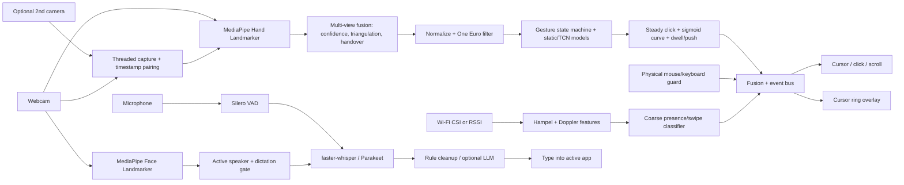

# Project Away

Hands-free PC control, free and local. Webcam hand gestures drive the cursor, push-to-talk voice typing handles text, face cues gate who is dictating, and optional Wi-Fi CSI adds coarse motion confidence.

Nothing leaves your machine unless you point the optional LLM cleanup at an endpoint yourself.

## Architecture



| Module | Role |
|---|---|
| `hands/` | landmarks, One Euro filter, cursor mapping (power or sigmoid curve, per-direction speed), gesture state machine, `stabilize.py` (steady click, dwell) |
| `multicam/` | `capture.py` (enumeration, camera threads, `FramePairer`), `geometry.py` (intrinsics, pose from hands, triangulation, checkerboard), `calibration.py`, `fusion.py` (per-view confidence, best-view/weighted fusion, 3D pinch, push) |
| `face/` | face landmarker, active speaker, brow / mouth / wink triggers |
| `voice/` | always-on + push-to-talk, ASR (vocabulary as prompt + `hotwords`), cleanup, `numbers.py`, `edit.py` (edit selected text) |
| `app/` | runner (pipeline + device threads), tray, settings GUI, overlays, `autopause.py` |
| `bindings.py` / `actions.py` | trigger -> action mapping and execution |

## Quickstart

Full per-OS instructions: [docs/INSTALL.md](docs/INSTALL.md). Wi-Fi sensing: [docs/wifi-setup.md](docs/wifi-setup.md).

```bash
pipx install ".[all]"        # Python 3.10–3.12
away setup                   # downloads models, checks camera + mic
away demo                    # synthetic end-to-end check
away run                     # or: away tray ; away autostart on
```

**One-click installers** (Releases page) bundle every feature: tracking, dictation, tray, settings
window and on-device training (CPU PyTorch). Parakeet/NeMo is the one exception (multi-GB,
NVIDIA-oriented; use `pipx install "project-away[all,parakeet]"`). Installers are ~0.4–0.8 GB; the models
(~1.6 GB, or ~0.5 GB with Whisper `small`) download during install on Windows and on first launch elsewhere.

- **Windows:** run the `setup.exe`. It's unsigned, so choose *More info → Run anyway*, then **Install**. Models,
  start-at-sign-in, a desktop shortcut and launching the tray app are all on by default.
- **macOS:** open the `.dmg`, drag to Applications, then right-click → Open. The first launch downloads the
  models with a notification. Allow Camera, Microphone, Accessibility and Input Monitoring.
- **Linux:** run the AppImage or install the `.deb`; the first launch downloads the models. Mouse and keyboard
  control needs X11; Wayland is untested.

## Customizing controls

Every control is a **trigger → action** binding you can change without touching code: from the
**Settings** window (tray → *Settings...*, or `away settings`), from the CLI, or in `config.yaml`
(`away config path` shows where it is). A running Away reloads the file within a second of a save.

### Default bindings

| Trigger | Default action |
|---|---|
| `gesture:point` (index finger) | `mouse:move` (cursor) |
| `gesture:pinch` | `mouse:click` |
| `gesture:double_pinch` | `mouse:double_click` |
| `gesture:pinch_hold` | `mouse:drag` |
| `gesture:two_finger_scroll` | `mouse:scroll` |
| `gesture:open_palm` (hold) | `pause:toggle` (pause/resume gestures) |
| `gesture:swipe_left` / `swipe_right` | `key:left` / `key:right` |
| `face:brow_raise` (needs `face.brow_raise_toggle: true`) | `dictation:toggle` |
| `face:mouth_open` (needs `face.mouth_open_trigger: true`) | `none` |
| `face:wink_left` / `wink_right` (needs `face.wink_trigger: true`) | `mouse:click` / `mouse:right_click` |
| `gesture:dwell` (needs `hands.dwell.enabled: true`) | `mouse:click` |
| `gesture:push` (needs depth: two calibrated cameras, or `hands.multicam.push_monocular`) | `mouse:click` |
| `hotkey:ptt` (= `voice.hotkey`, Ctrl+Alt+Space) | `dictation:toggle` |
| `hotkey:mute` (= `voice.mute_hotkey`, Ctrl+Alt+M) | `mic:toggle` |
| `voice:"click"`, `"double click"`, `"right click"`, `"scroll up"`, `"scroll down"` | the matching `mouse:` action |
| `voice:"go back"` / `"go forward"` | `key:alt+left` / `key:alt+right` |
| `voice:"open browser"` | `launch:https://www.google.com` |
| `voice:"stop listening"` / `"start listening"` | `dictation:stop` / `dictation:start` |
| `voice:"command mode"` / `"dictation mode"` | `voice:command_mode` / `voice:dictation_mode` |
| `voice:"pause gestures"` / `"resume gestures"` | `pause:on` / `pause:off` |
| `voice:"next monitor"` / `"previous monitor"` | `cursor:next_monitor` / `cursor:prev_monitor` |
| `voice:"monitor one"` / `"monitor two"` / `"monitor three"` | `cursor:monitor 1` / `2` / `3` |

**Triggers:** the gestures above plus your own (record with `away record --custom --label wave`, then
`away calibrate`), any spoken phrase (matched ignoring case and punctuation), `face:brow_raise`,
`face:mouth_open`, `face:wink_left|wink_right`, `gesture:dwell`, `gesture:push`, and any key combo
(`hotkey:ctrl+alt+k`). Two fixed hotkeys sit outside the bindings: `app.toggle_hotkey` (default F9,
gestures on/off) and `voice.edit_hotkey` (default Ctrl+Alt+E, edit the selected text by voice).

**Actions:** `none` · `mouse:click|double_click|right_click|middle_click|scroll_up|scroll_down`
(`mouse:move`, `mouse:drag`, `mouse:scroll` only on point / pinch_hold / two_finger_scroll) ·
`key:ctrl+tab` · `type:any text` · `launch:firefox` or `launch:https://…` (no shell) ·
`shell:command` (**off unless** `bindings.allow_shell: true`) · `dictation:toggle|start|stop` ·
`mic:toggle|on|off` · `voice:command_mode|dictation_mode|toggle_mode` · `pause:toggle|on|off` ·
`cursor:next_monitor|prev_monitor|primary_monitor|monitor N` (jump to the centre of a monitor).

### Multiple monitors

The cursor moves across every monitor (v0.1.6; before that it was stuck on the primary). `away monitors`
lists them, numbered 1..N **left to right** (then top to bottom), with where the list came from: Windows
`EnumDisplayMonitors`, macOS Quartz/AppKit, Linux `screeninfo` or `xrandr --listmonitors`, falling back to the
primary monitor only (with the reason) when none works. The same list is in `away hardware` and the selftest.

- **Layouts:** side by side, stacked, a monitor left of / above the primary (negative coordinates), mixed
  sizes. The cursor is always clamped onto a real monitor, never into the gap beside a smaller screen.
- **Speed:** relative-mode speed is measured against the **primary** monitor, so slow, precise moves feel
  exactly as on one screen. Only fast moves get extra reach on a bigger desktop:
  `(desktop width / primary width) ** hands.cursor.monitor_reach`. With three equal monitors and the default
  `monitor_reach: 0.5` a quick flick goes ~1.7x further, so crossing all three takes a few flicks rather than
  three times the arm sweep. `0` = no extra reach, `1` = scales fully with the desktop.
- **Jump:** say "next monitor", "previous monitor" or "monitor two" (Whisper writing "monitor 2" works too),
  or bind `cursor:next_monitor` / `cursor:monitor 3` to any gesture or hotkey. A held drag stays held, so
  "next monitor" while dragging carries a window across.
- **Which monitors:** `hands.cursor.monitors: all` (default) | `primary` | `[1, 3]`.
- **Hot-plug:** monitors are re-detected every `hands.cursor.monitor_refresh_s` (3 s; `0` = only at start),
  no restart needed.
- **Windows DPI:** the app makes itself per-monitor DPI aware at startup (before pynput/tkinter), so monitor
  rectangles and cursor positions are both physical pixels on mixed-scaling setups. `AWAY_DPI_AWARE=0` turns
  that off.

```yaml
hands:
  cursor:
    monitors: all          # all | primary | [1, 3]
    monitor_reach: 0.5     # extra reach for fast moves on a wide desktop
    monitor_refresh_s: 3   # re-detect plugged/unplugged monitors
```

### Per-app profiles

`default` holds the full map. Any other profile names the apps (process names, case-insensitive,
`.exe` optional) it applies to and overrides only the triggers it lists; everything else falls through
to `default`. `active_profile: auto` switches profile with the focused app (Linux needs `xdotool`);
`away profile use chrome` pins one.

### CLI

```bash
away bindings list [--profile chrome] [--json]
away bindings set gesture:swipe_left key:alt+left
away bindings set "voice:new tab" key:ctrl+t --profile chrome
away bindings reset [TRIGGER] [--profile NAME | --all]
away bindings export my-controls.yaml        # or "-" for stdout
away bindings import my-controls.yaml [--replace]   # default merges
away profile list | use NAME|auto | new NAME --apps chrome chrome.exe [--copy-from default] | remove NAME
away voice show | mode always_on|push_to_talk|toggle | wake-word away|off | intent dictation|command | sensitivity 0.6
away settings                                # GUI editor (tkinter); prints CLI help when there is no display
away update --check                          # current vs latest release (exit 0 up to date, 10 update available)
away update [--yes]                          # download, verify SHA-256, install (see "Updates")
away hardware [--json]                       # detected CPU/RAM/GPU + the performance profile and why
away gpu install | status | remove           # NVIDIA GPU pack (cuBLAS 12) for Whisper on CUDA
```

Invalid configs fail with every problem listed and its YAML path, e.g.
`bindings.profiles.default.gestures.pinchh: unknown gesture 'pinchh' (did you mean 'pinch'?)`.

### Tunables

Sliders in the Settings window, or in YAML: `hands.cursor.gain` (sensitivity), `dead_zone`,
`acceleration`, One Euro `min_cutoff` / `beta` / `d_cutoff`; `hands.gestures.pinch_on` / `pinch_off`
(pinch threshold), `scroll_gain` (scroll speed), `swipe_min_dx` + `swipe_max_time` (swipe velocity =
distance / time), `double_pinch_window`, `drag_hold`, `clutch_hold`; `voice.vad_sensitivity`,
`end_silence_ms`, `max_utterance_s`. Each is range-checked.

Pointer accuracy:

- **Steady click** (`hands.cursor.click_freeze: true`): the cursor freezes while the pinch is closing
  (ratio below `pinch_on * (1 + freeze_margin)`), and the click lands where the cursor was
  `click_rewind_ms` (100) before closing began, because closing thumb and index drags the index tip.
  Drags unfreeze immediately.
- **Curve** (`hands.cursor.curve`): `sigmoid` (default) gives a slow plateau (`sigmoid_low`) for precise
  work and a fast plateau (`sigmoid_high`) with `sigmoid_mid` / `sigmoid_slope` in between. `power`
  is the original `|d|^acceleration` curve. `speed_up/down/left/right` scale each direction, for
  limited reach or an angled camera. The sigmoid idea comes from Google Project Gameface (Apache-2.0)
  and is re-implemented.
- **Dwell click** (`hands.dwell`): rest the cursor within `radius_px` for `time_s` and `gesture:dwell` fires.
- **Face clicks**: `face.wink_trigger` / `wink_threshold` / `wink_open_max` / `wink_hold`, plus
  `brow_threshold`, `mouth_threshold` and the hold times. Thresholds are per user, so tune them in Settings.
- **Cursor ring** (`cursor_overlay: true` or `away run --cursor-overlay`): a small ring by the pointer
  that fills as the pinch closes, turns solid on pinch, blue while dragging, purple while dwelling and
  grey when paused.
- **Auto-pause** (`app.auto_pause: true`): touching the real mouse or keyboard pauses gesture output
  until it has been idle for `app.auto_pause_idle_ms`. Away's own synthetic input is ignored.

Dictation extras: the vocabulary file is passed to faster-whisper as `initial_prompt` and as
`hotwords` (when the installed version supports it; 1.2.1 does). `voice.numbers_as_digits` turns
"twenty five" into 25 from `numbers_min_value` (10) up. `voice.edit_hotkey` works like this:
select text, press the hotkey, say an instruction ("uppercase", "replace cat with dog", "clean it up",
"make it a bullet list", or anything else when an LLM endpoint is configured), then press it again.

### Voice input modes

`voice.mode` is `always_on` (default), `push_to_talk` (hold `voice.hold_key`) or `toggle` (press
`voice.hotkey`).

Always-on listens continuously, cuts speech into utterances with an energy VAD (end-pointing after
`end_silence_ms` of silence) and decides per utterance:

- **Wake word on** (`voice.wake_word_enabled: true`, `wake_word: away`): only utterances starting with
  the wake word count ("away, scroll down"). A bare "away" opens a `wake_window` for the next utterance.
- **Wake word off:** text is typed only when the face gate agrees that you are at the screen and your
  mouth is moving (active-speaker detection), so TV or background talk is ignored. A visible face whose
  mouth moves counts even when the head is turned (off-axis webcam), and a short gap in face tracking
  while the CPU is busy is tolerated. Each `voice.utterance` log line carries the gate's evidence (face
  frames, speaking fraction, mouth score). After 5 rejections in a row the tray suggests turning the gate
  off (tray menu **Face gate**, or Settings). With the face gate off (`face.gate_dictation: false`), speech
  is typed without a wake word. With no camera, `voice.ambient_fallback: commands_only` (default) runs
  bound phrases but types nothing.
- If speech recognition cannot keep up (e.g. a big model on the CPU), a short backlog is kept, the oldest
  utterance is dropped, and you get one notification saying so.
- `voice.intent: command` never types, it only runs voice commands. Say "command mode" /
  "dictation mode" to switch.
- "stop listening" / "start listening", the mute hotkey and the tray's **Mic on** item control it.
  The tray icon shows the state (green active, red mic off, amber not listening, blue recording, grey paused).
- Audio is kept in memory only and dropped after transcription. Nothing is written to disk.

`app.always_on: true` (default) makes gestures and voice active as soon as the app starts;
`false` starts paused and muted until you resume from the tray. `app.start_minimized: false` also opens
Settings at launch.

### Example `config.yaml`

```yaml
app:
  always_on: true
  start_minimized: true
voice:
  mode: always_on            # always_on | push_to_talk | toggle
  wake_word_enabled: false
  wake_word: away
  intent: dictation          # dictation | command
  vad_sensitivity: 0.5
  mute_hotkey: <ctrl>+<alt>+m
hands:
  cursor: {curve: sigmoid, gain: 2.2, dead_zone: 0.004, min_cutoff: 1.0, beta: 0.02, click_freeze: true}
  gestures: {pinch_on: 0.32, pinch_off: 0.45, scroll_gain: 40.0, swipe_min_dx: 0.25, swipe_max_time: 0.45}
bindings:
  active_profile: auto
  allow_shell: false
  custom_gestures: [wave]
  profiles:
    default:
      gestures:
        swipe_left: key:alt+left
        swipe_right: key:alt+right
        wave: launch:https://calendar.google.com
      voice:
        "screenshot": key:cmd+shift+s
      hotkeys:
        ctrl+alt+d: type:Best regards,
    chrome:
      apps: [chrome, chrome.exe, Google Chrome]
      gestures:
        two_finger_scroll: key:ctrl+tab
      voice:
        "new tab": key:ctrl+t
        "close tab": key:ctrl+w
    code:
      apps: [code, Code.exe]
      gestures:
        open_palm: key:ctrl+shift+p   # open palm no longer pauses in VS Code
```

## Multi-camera

A laptop webcam and an external camera can work together. A hand that one camera sees edge-on, or
that is occluded, is usually clear in the other.

```bash
away cameras list                 # device names (V4L2 / Windows PnP / macOS) without opening them
away cameras add 2                # index, /dev/video2, or part of the name ("brio")
away calibrate-cameras            # wave an open hand through both views for ~20 s
away calibrate-cameras --method checkerboard --checkerboard 9x6 --square-mm 25   # accurate option
away calibrate-cameras --print-board board.png --checkerboard 9x6                # printable board
```

The same is available in **Settings → Cameras** (device pickers, roles, calibrate button, live
per-camera confidence). In YAML:

```yaml
hands:
  cameras:                       # empty (default) = single-camera mode, unchanged
    - {device: 0, role: primary, width: 640, height: 480, fps: 30, hfov_deg: 70}
    - {device: "Logitech BRIO", role: secondary, width: 1280, height: 720, fps: 30, hfov_deg: 78}
  multicam:
    fusion: weighted             # weighted | best_view
    pair_tolerance_ms: 40
    dropout_ms: 300
    handover_decay_s: 1.0
    use_3d_pinch: true
    push_distance_m: 0.06
    push_time_s: 0.35
```

How it works:

1. **Capture.** Each camera runs in its own thread and stamps frames on arrival. The primary camera
   sets the pace. Each secondary contributes the frame nearest in time, if it falls within
   `pair_tolerance_ms`. A camera that stays silent for `dropout_ms` is treated as dropped and the
   others carry on.
2. **Per-view confidence.** Each view is scored on the MediaPipe handedness score, the share of
   landmarks inside the image, hand size in pixels, and sharpness (Laplacian variance of the hand
   crop, which drops with motion blur).
3. **Fusion.**
   - **Uncalibrated:** `best_view` takes the most confident view. `weighted` averages the views by
     confidence after mapping secondaries into the primary image with an alignment learned while both
     cameras see the hand.
   - **Calibrated**, with both cameras seeing the hand: the 21 landmarks are triangulated
     (`cv2.triangulatePoints`). Reprojecting them into the primary view drives the cursor, and the
     3D points give true depth.
4. **Depth uses.**
   - **`gesture:push`:** the hand moves `push_distance_m` toward the screen within `push_time_s`.
     The primary camera is assumed to sit at the screen. The gesture is bindable and clicks by default.
   - **3D pinch:** the pinch ratio comes from 3D distances, so a thumb and index that only overlap from
     one angle no longer click.
5. **Occlusion handover.** When one view loses the hand, tracking continues from the other. The jump
   between estimates is absorbed by an offset that fades over `handover_decay_s`, so the One Euro
   filter sees a continuous signal and the cursor does not jump.

**Calibration.** The hand-motion path pairs MediaPipe landmarks across views and runs
`cv2.findFundamentalMat` (RANSAC, then a least-squares refit on the inliers) → `E = K2ᵀ F K1` →
`cv2.recoverPose`. Intrinsics are approximated from `hfov_deg`, and the translation is scaled so the
median palm (wrist to middle knuckle) is `palm_length_m` (9 cm). Depth is therefore approximately
metric; real palms vary by about 10–15%. The checkerboard path runs `calibrateCamera` per camera, then
`stereoCalibrate` with the real square size. Either way the extrinsics go to
`<data dir>/camera_extrinsics.json` and the reprojection error is printed.

Each view runs its own MediaPipe instance in sequence, so two cameras cost about twice the CPU of one.

A camera that cannot be opened or sends no frames is skipped with a notification and tracking continues
on the one that works, so a wrong or busy secondary camera never stops hand tracking.

**Sharing the camera with Settings (v0.1.6):** webcams are exclusive on Windows, so while the app tracks
your hand, Settings' *Test gesture*, *Live confidence* and *Calibrate* (and `away calibrate-cameras`) ask
the running app to hand the cameras over: it pauses tracking, releases them, and takes them back when
the test ends or the window closes (a small heartbeat file in the data folder; a crashed Settings window
releases its claim within 5 s). The Cameras tab lists the default camera in single-camera mode and marks
the one the app is using. If a camera still cannot be opened, you are told it is in use by Project Away
or another app instead of a bare "permission denied".

## Hardware auto-tuning and GPU

`away hardware` shows the detected CPU, RAM, disk and GPU (NVIDIA via NVML / `nvidia-smi`, others via
WMI or `lspci`, Apple Silicon) and the profile picked from them: Whisper model, CPU or CUDA, compute type,
threads, beam size, camera resolution/fps and face-tracking frame skipping, each with the reason. Explicit
settings (`performance.mode: auto|cpu|gpu`, `voice.device`, `voice.asr_model`, `performance.*`) win.

NVIDIA GPUs: the one-click installers ship CPU-only; setup (or *Settings > Performance*, or
`away gpu install`) downloads the **GPU pack**, the cuBLAS 12 libraries from NVIDIA's official PyPI wheel
(~570 MB, SHA-256 verified). That is the only CUDA library CTranslate2 4.8 loads. pip installs:
`pip install nvidia-cublas-cu12==12.8.4.1`. If CUDA fails (at startup or later), dictation falls back to
the CPU **with the CPU-sized model** from the profile (not large-v3-turbo, which cannot keep up on most
CPUs) and says why; the tray offers *Install GPU pack* (one notification, then a menu item). A
`voice.asr_model: large-v3-turbo` written by v0.1.4's setup is migrated to `auto` (configs now carry
`config_version: 2`; a model you pick from now on is kept). Details: [docs/INSTALL.md](docs/INSTALL.md#hardware-auto-tuning-and-the-nvidia-gpu).

## Updates

The installed app checks GitHub Releases when the tray starts and every 24 hours. When a new version is out
you get a notification and an **Update to vX.Y.Z** tray item; clicking it downloads the installer for your
system, checks its SHA-256 (from the GitHub API `digest`, or the release's `SHA256SUMS.txt`; an unverifiable
file is refused), installs it and restarts the app. Windows runs the Inno Setup installer silently; macOS
swaps the `.app` from the `.dmg` after the app quits; an AppImage is replaced in place; a `.deb` is installed
with `pkexec apt install` only after you confirm. pip/pipx installs are never touched: run
`pipx upgrade project-away`.

```yaml
updates:
  check: true          # false = never contact GitHub
  auto_install: false  # true = install silently when gestures are paused or idle (never for .deb)
  channel: stable      # beta = also offer pre-releases
```

The only network request is an anonymous `GET` to the public GitHub Releases API; nothing about you is sent.
Same options under **Settings → Voice & input**; from a terminal: `away update --check` / `away update --yes`.

## Verified vs untested

| Area | Status |
|---|---|
| Core logic (filters, state machine, cleanup, CSI features, fusion, bindings, dispatch, always-on voice policy) | 850 tests pass (1 skipped where libtk is missing); ruff + mypy clean |
| Multi-monitor cursor | Geometry, mocked Windows enumeration, xrandr/AppKit parsing, DPI fallback chain and jump actions unit-tested; **untested on real multi-monitor / mixed-DPI hardware** |
| Camera hand-over to Settings | Protocol and the app's camera loop tested with fake frames across two "processes"; **untested with a real exclusive Windows webcam** |
| Hardware detection + tuning profiles | Unit-tested with recorded outputs (RTX 2060 6 GB, GTX 1050 2 GB, no-GPU 4-core 8 GB, Apple M1, old driver, `nvidia-smi` missing/timeout); detection run on the Linux aarch64 build sandbox |
| GPU pack | Real `nvidia-cublas-cu12` 12.8.4.1 wheels downloaded, SHA-256 verified and extracted (Windows: 568 MB download, 788 MB kept; Linux x86-64: 594 / 868 MB); the DLLs import only each other + KERNEL32 |
| Whisper on an NVIDIA GPU (CUDA) | **Untested** (no GPU in the build sandbox); CPU fallback path unit-tested |
| Download link expiry (HTTP 403 after ~1 h) | Re-resolve + mid-chunk resume tested against a local fake Hub; interrupt + resume of `large-v3-turbo` verified against the real Hub |
| Multi-camera geometry | Synthetic: two virtual cameras with known extrinsics. Pose from noisy (0.5 px) hand landmarks within 1.5°, palm-scaled baseline within 10%, exact noise-free triangulation, checkerboard stereo calibration under 0.5 px |
| Multi-camera fusion | Synthetic: best-view and weighted selection, timestamp pairing and dropout, occlusion handover with no jump, push gesture, 3D pinch rejecting an edge-on false pinch, Cameras-tab model |
| Real two-camera capture, calibration and fusion | **Untested** (no cameras in the build sandbox) |
| Steady click, sigmoid curve, dwell, wink, auto-pause guard, cursor ring states, numbers to digits, edit-selection rules | Logic unit-tested with synthetic input |
| faster-whisper `hotwords` | Parameter verified on the installed faster-whisper 1.2.1 by signature; **not run on real speech** |
| Cursor ring window, pynput auto-pause listeners, F9 / edit hotkeys, clipboard edit flow | **Untested** on real desktops |
| Static pose model | 99.27% acc / 0.982 macro-F1 on 4,094 HaGRID v2 samples from 520 unseen people (MediaPipe-annotated, not live webcam) |
| Temporal gesture model | Synthetic only. Off by default until `away calibrate` |
| MediaPipe hands/face on real photos | Verified |
| faster-whisper + Silero VAD on synthetic speech | Verified |
| PicoScenes `.csi` parsing on sample file | Verified |
| Linux bundle, AppImage (aarch64), `.deb` | Earlier lean bundle (without torch) built and launched in the sandbox; the full bundle is CI-verified on tag only |
| Settings window (tkinter) | Model logic unit-tested; window smoke-tested under Xvfb (Linux) only |
| Always-on voice | End-pointing, wake word and face-gate policy tested with synthetic audio; **untested with a real mic/ASR** |
| Per-app profile detection (active window process) | **Untested** on real desktops (Windows API / osascript / xdotool) |
| Real webcam, mic, mouse/keyboard, global hotkeys, tray, overlay | **Untested** |
| Installer one-click flow (non-interactive `setup --yes` with no stdin, windowed-exe streams, first-launch download, Inno options) | Logic unit-tested (`tests/test_installer.py`) |
| Frozen bundle with every feature (`away selftest`: torch, onnx, onnxruntime, MediaPipe, OpenCV, faster-whisper + Silero VAD, PortAudio, tkinter, pynput, pystray) | All 13 checks pass in the dev venv (Linux aarch64). The frozen build with the new bundle was **not completed in the sandbox** (too slow on its filesystem). Windows/macOS/Linux x86_64: **CI-verified on tag only** (the release workflow fails if any check fails) |
| Windows `.exe` installer, macOS `.dmg` | **CI-built and smoke-tested on tag only; untested on real hardware** |
| Auto-update (`away update`, tray item) | Version compare, asset choice, SHA-256 verify, command lines and AppImage replace unit-tested with no network (`tests/test_updater.py`); real installs on each OS **untested** |
| AX200/AX210 + PicoScenes live capture | **Untested** |
| Parakeet, LLM cleanup endpoint, Wayland | **Untested** |

## Roadmap

1. Real-hardware validation on Windows/macOS/Linux.
2. Personal calibration data → fine-tune the temporal model on real recordings.
3. Face recognition for the enrolled-user gate (currently largest face).
4. TalkNet/Light-ASD active-speaker backend.
5. Live AX210 CSI capture and a learned swipe/push-pull classifier.
6. Phone-as-second-camera / IMU fusion.
7. Real-hardware tuning of multi-camera fusion; parallel per-camera landmark inference.

## Development

```bash
pip install -e ".[dev]"
pytest -q && ruff check . && ruff format --check . && mypy src
python scripts/mutation.py && python scripts/mutation.py --summary
```

Private project. All rights reserved by the author until a license is chosen.
